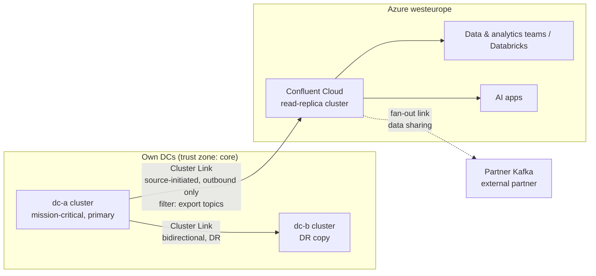
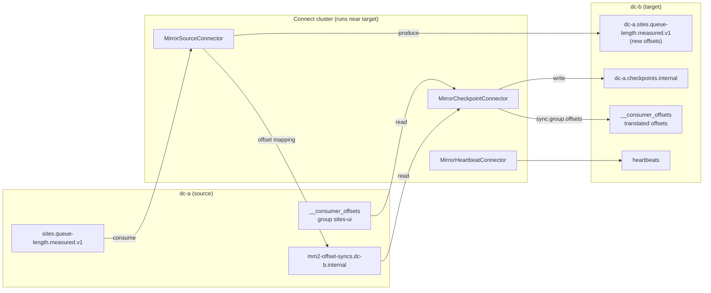
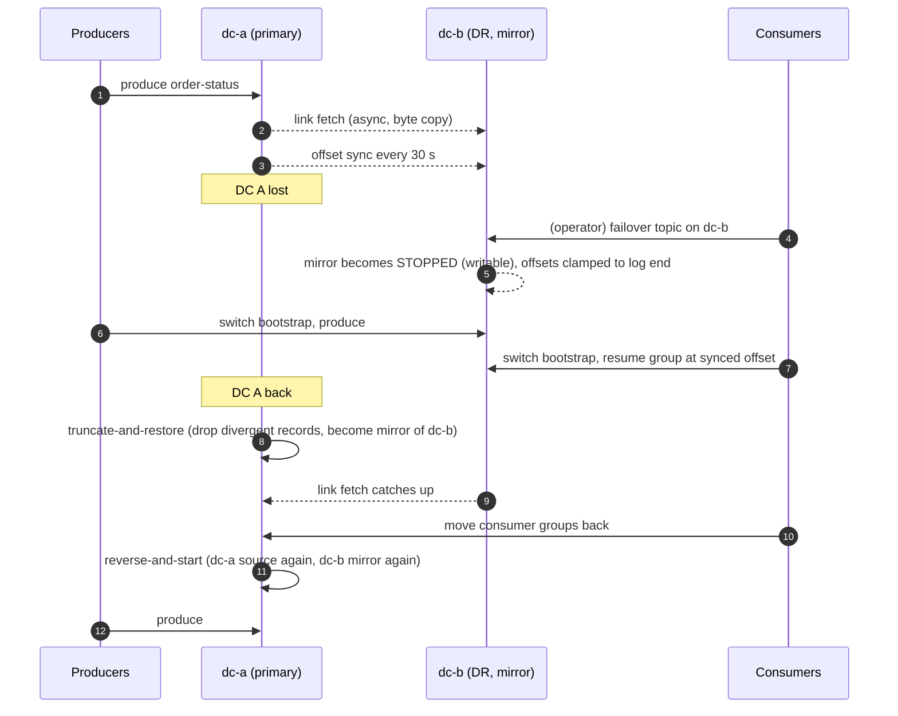
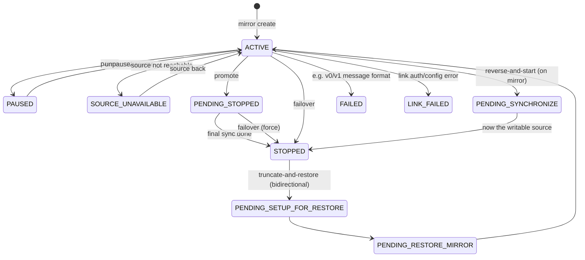

# What this module is for

- Know the three ways to move Kafka data between clusters, and pick one with a reason.
- Know exactly what happens to offsets, consumer groups and topic names on failover and failback.
- Have a clear default design: on-prem stays primary, Confluent Cloud on Azure is the read side.

Source course: *Hybrid and Multicloud Architecture with Apache Kafka* (12 modules, ~46 min),
https://developer.confluent.io/courses/hybrid-cloud/intro/. The course is short and partly
marketing; the depth here comes from the current docs. **[V]** = depends on version or region.

---

# 1. Why hybrid, and the five shapes

Course: https://developer.confluent.io/courses/hybrid-cloud/hybrid-multicloud-architectures/

The problem the course starts from is a common one: many point-to-point
integrations (batch, ETL, APIs, custom code), each with its own network path, security and
monitoring. A streaming backbone replaces N×M connections with "publish once, subscribe many".
The course names four reasons to go hybrid: **global data access, cloud migration, data sharing,
disaster recovery**. Data sharing includes the **read-replica** idea: a second cluster shields the
Tier-1 workload from load by lower-priority consumers. That is the core of the design in this course.

| Shape | Flow | Typical use | Tool notes |
|---|---|---|---|
| Active/passive | A → B | DR | Cluster Linking one-way, or bidirectional link for easy failback |
| Active/active | A ↔ B | Both sides write; HA across regions | Different topic names or prefixes per side; consumer groups unique per side |
| Aggregation (many→one) | A, B, C → Hub | Several DCs/domains into one analytics cluster | One link per source into the hub |
| Fan-out (one→many) | A → B, C | Data sharing, regional copies | One link per destination |
| Forwarding / chain | A → B → C | Hop through a DMZ or region | A mirror topic can be the source of another link |

# 2. Cluster Linking

Course: https://developer.confluent.io/courses/hybrid-cloud/cluster-linking/ ·
docs: https://docs.confluent.io/platform/current/multi-dc-deployments/cluster-linking/index.html

**What it is.** A replication feature inside the broker (Confluent Server and Confluent Cloud).
No Connect cluster, no extra VMs. Two objects:

1. **Cluster link** — a named, persistent connection between two clusters, with its own config
   (offset sync, ACL sync, auto-create filters, prefix).
2. **Mirror topic** — a read-only topic on the destination, owned by the link. The destination
   broker fetches from the source like a follower replica fetches from a leader.

**Why it matters.** The copy is **byte-for-byte**: same partitions, **same offsets**, same
timestamps, no decompress/recompress. So:

- a consumer group can move from source to destination and continue at the *same* offset number;
- there is no offset translation table to lag behind;
- the topic name stays the same (unless you set `cluster.link.prefix`), so client config barely changes.

What it syncs, and how:

| Item | How | Default |
|---|---|---|
| Records | continuous fetch | — |
| Topic configs | most configs synced from source; some never (e.g. schema validation, tiered storage, replica placement) | `topic.config.sync.ms=5000` |
| Partition count | new source partitions appear on the mirror | automatic |
| Consumer offsets | `consumer.offset.sync.enable=true` + `consumer.offset.group.filters` (JSON) | off; when on, every `consumer.offset.sync.ms=30000` |
| ACLs | `acl.sync.enable=true` + `acl.filters` | off |
| New topics | `auto.create.mirror.topics.enable=true` + `auto.create.mirror.topics.filters` | off |
| Start point of new mirrors | `mirror.start.offset.spec` = `earliest` / `latest` / ISO timestamp | `earliest` |

**Who opens the connection** (this is the part people most often get wrong):

| Mode | Configs | Who dials whom | When |
|---|---|---|---|
| Destination-initiated (default) | `link.mode=DESTINATION` on destination | destination brokers → source brokers | destination can reach every source broker |
| **Source-initiated** | destination half: `link.mode=DESTINATION`, `connection.mode=INBOUND`; source half: `link.mode=SOURCE`, `connection.mode=OUTBOUND` | **source brokers → destination**; destination then uses that connection in reverse | source is behind a firewall/NAT (on-prem DC → Confluent Cloud) |
| Bidirectional | `link.mode=BIDIRECTIONAL` on both sides, same link name | either side (can also be source-initiated) | DR with easy failback; active/active |

Source-initiated requires Confluent Server (Enterprise) on the source, CP **7.1.0+**. All
link-level configs go on the **destination** half. `link.mode` cannot be changed after creation.

**Limits worth knowing.** Mirror topics are read-only. Kafka transactions / exactly-once are not
supported on mirror topics. A link with mirror topics on it cannot be deleted. `cluster.link.prefix`
cannot be changed later and disables the reverse commands. Confluent Cloud links cannot be paused
(only individual mirror topics).

# 3. MirrorMaker 2

Course: https://developer.confluent.io/courses/hybrid-cloud/mirrormaker2/ ·
docs: https://kafka.apache.org/documentation/#georeplication

**What it is.** Open-source replication built on Kafka Connect. It *consumes* from the source and
*produces* to the target, so the target writes new log entries with **new offsets**.

| Piece | Job |
|---|---|
| `MirrorSourceConnector` | copies records and topic configs; writes offset mappings to `mm2-offset-syncs.<target>.internal` |
| `MirrorCheckpointConnector` | reads committed group offsets on the source, translates them, writes `<source>.checkpoints.internal` on the target; with `sync.group.offsets.enabled=true` it writes translated offsets into the target's `__consumer_offsets` (only for groups not active there) |
| `MirrorHeartbeatConnector` | writes `heartbeats` so you can see the flow is alive and trace topology |

The course says "4 internal connectors and 3 internal topics"; the docs list the three connectors
above plus the internal topics. Topic naming: `DefaultReplicationPolicy` renames
`orders.x` to `dc-a.orders.x` (prevents loops in active/active).
`IdentityReplicationPolicy` keeps names but then you must prevent cycles yourself.

**Offset translation is the weak spot.** MM2 records a sync point only every so often; for a
committed offset between two sync points it translates *down* to the earlier safe point. Since
Kafka 3.5 (KAFKA-14666) translation became more conservative, so after failover consumers usually
**re-read** some records (duplicates), and in edge cases translation lags behind by a lot. [V]
Your consumers must be idempotent either way.

**Operating cost.** You run and size a Connect cluster per target, tune producer/consumer
settings, and changes in dedicated mode need restarts. The course also says MM2 exposes no
replication-lag metric out of the box; you derive it. That is still mostly true (replication
latency metrics exist, lag in records you build yourself). [V]

# 4. Confluent Replicator

Course: https://developer.confluent.io/courses/hybrid-cloud/confluent-replicator/ ·
docs: https://docs.confluent.io/platform/current/multi-dc-deployments/replicator/index.html

Replicator is Confluent's older, commercial Connect connector. Like MM2 it consumes and
re-produces (new offsets, at-least-once). Differences that still matter:

- topic **renaming** and per-message handling are possible (Connect SMTs), which Cluster Linking
  cannot do — the course's reason to pick it for "migration with a new naming convention";
- loops are prevented with **provenance headers**;
- consumer offset translation works only for **Java** consumers, via the
  `ConsumerTimestampsInterceptor` (timestamp-based); no ACL sync;
- it has replication lag and throughput metrics, and Confluent support.

It is still in the CP 8.4 licence list, so it is not removed. Treat it as legacy: keep it where it
already runs, or where you truly need transforms in flight. [V]

# 5. Choosing

| | Cluster Linking | MirrorMaker 2 | Replicator |
|---|---|---|---|
| Runs where | inside brokers | Connect cluster you run | Connect cluster you run |
| Offsets | **preserved** (byte copy) | new offsets, translated via checkpoints | new offsets, Java-only timestamp translation |
| Topic names | same (optional fixed prefix) | prefixed by default | renamable |
| Transforms in flight | no | SMTs possible | SMTs possible |
| Consumer offset sync | yes, any client | yes (checkpoint + group sync) | Java clients only |
| ACL sync | yes | yes (simple) | no |
| Firewall-friendly | **source-initiated** mode | Connect near target pulls (inbound to source) or near source pushes | same as MM2 |
| Licence | Confluent Server Enterprise / CC | Apache 2.0 | Confluent Enterprise |
| Either side plain Apache Kafka? | source may be Kafka 3.0+/IBP 3.0+; destination must be Confluent Server or CC | yes | yes |
| Failback tooling | `truncate-and-restore` + `reverse-and-start` (bidirectional links) | manual | manual |

Short rule: **Cluster Linking by default**; MM2 when one side cannot run Confluent Server (e.g.
Strimzi / Red Hat Streams on OpenShift, or Event Hubs as target); Replicator only where it already
runs or you need renaming/transforms.

# 6. Use cases in the course

Course: https://developer.confluent.io/courses/hybrid-cloud/use-cases/

| Use case | What the course says | What to add |
|---|---|---|
| Global data access | one cluster per region, linked; no Connect per location | Latency to consumers decides, not replication |
| Migration | exact replicas, same offsets, so consumers resume correctly; *cannot rename topics* | Promote per topic, move consumers then producers |
| Data sharing | replicate only selected topics into a cluster the other party may see (US agencies example) | That is the CC read-replica / partner-sharing model |
| HA/DR | multi-DC, failover to the other site | Async: RPO > 0; see §7 |

# 7. HA and DR with Cluster Linking

Course: https://developer.confluent.io/courses/hybrid-cloud/disaster-recovery/ ·
docs: https://docs.confluent.io/platform/current/multi-dc-deployments/cluster-linking/mirror-topics-cp.html

**HA vs DR.** Inside one site or region, HA comes from replication across racks/zones (and on-prem
from a Multi-Region Cluster stretched over close DCs). DR across sites uses an **asynchronous**
link. Async means **RPO > 0**: the producer gets its ack from the source before the link copies
the record. Watch **mirror lag** — that is your live RPO.

**RTO** comes from three things: how fast you decide (avoid automatic triggers that fire on false
positives), how fast clients switch bootstrap/credentials (service discovery + restart), and
whether consumer offsets are already on the DR side (offset sync).

**Failover vs promote** (both run on the destination, per topic):

| | `promote` | `failover` |
|---|---|---|
| Use | planned migration/switchover | disaster |
| Source must be reachable | yes | no |
| Checks | no mirroring lag, no config lag, no offset lag | none |
| Final offset/config sync | yes | **no** |
| Result | topic becomes writable (`STOPPED`), identical to source | topic becomes writable now; last records may be missing |

**Offset clamping.** On failover/promote, synced group offsets larger than the mirror's log end
offset are lowered to the log end offset, so a group never skips records that did not arrive.
Combined with the sync interval, consumers can re-read up to ~30 s of data. Design for duplicates.

**Failback** (only on **bidirectional** links, KRaft, CP 7.7+ for the reverse commands, no prefix):

1. `truncate-and-restore` on the **old primary's** topic: it becomes a mirror of the DR topic; any
   records written to the old primary after the failover point (divergent) are **truncated — data
   loss** unless clients can reprocess.
2. Update offset-sync filters (active/passive: `LOCAL_MIRROR` only).
3. Move consumer groups back, then `reverse-and-start` on the (new) mirror: it becomes the
   writable source again, and the other side becomes a mirror. During the reverse, the old source is
   `PENDING_MIRROR` and the mirror `PENDING_SYNCHRONIZE`, both read-only.

(The *other* side of a reverse goes `STOPPED` → `PENDING_MIRROR` → `ACTIVE`.)

---

# Changed since the course

| Course says / shows | Current state (2026-11-07) | Source |
|---|---|---|
| CL exercise: destination must be a **Dedicated** cluster | Destination may be **Dedicated or Enterprise** (and Freight on AWS with private networking). Basic/Standard: source only, and only for destination-initiated links | CC Cluster Linking overview; private-networking page |
| Cluster types implied: Basic/Standard/Dedicated | **Basic, Standard, Enterprise, Dedicated, Freight**. Enterprise is always private networking | CC cluster types |
| MM2 exercise on **CP 7.4 / Kafka 3.4 with ZooKeeper** | CP 8.x = Kafka 4.x, **KRaft only**, ZooKeeper removed in 8.0. The compose file in the course would not start on 8.x | CP 8.4 docs |
| Mirror topics are only read-only copies; failback not covered | **Bidirectional links**, `reverse-and-start` / `reverse-and-pause`, `truncate-and-restore` exist (CP 7.7+ for reverse on hybrid links; truncate only on bidirectional links in KRaft) | CP mirror topics doc |
| Promote/failover described briefly | Offset **clamping** on failover/promote; `failover` does no final offset sync; `--validate-only` dry run | CP commands doc |
| Offset sync: groups filter | Filters now have `topicTypes` (`LOCAL_MIRROR`, `REMOTE_MIRROR`) for bidirectional links; share-group offset sync section exists (Kafka 4.x share groups) [V] | CP mirror topics doc |
| Source-initiated "removes the need for PrivateLink" | Private networking is still needed for a *private* CC destination (Enterprise always private). Source-initiated removes the *inbound* rule on the DC side only | CC private networking doc |
| CLI flag `--source-cluster-id` | `--source-cluster` (CLI v3+); CLI v4 uses `--config <file or k=v list>` (docs still show `--config-file`) | CLI v4.82 reference |
| No RBAC detail | **`ClusterLinkConnection`** RBAC role for source-initiated links from CP: 7.8.9, 7.9.8, 8.0.6, 8.1.4, 8.2.2, 8.3.0+ [V] | CC CL overview |
| CP min version not given | CP as source of source-initiated link to CC: **7.1.0+**. CP as destination: Confluent Server **7.8.x+** per current CP page. IBP ≥ 3.0 both sides | CL docs (CP, CC) |
| MirrorMaker (1) not mentioned | MirrorMaker 1 was removed in Kafka 4.0; only MM2 remains [V] | Kafka 4.0 notes |
| Truncate-and-restore safe | Do **not** run it with Tiered Storage on CP 7.9.0–7.9.2 or 8.0.0 (silent data inconsistency); fixed in 7.9.3, 8.0.1, 8.1.0+ | CP commands doc |
| DR text: "multi-region cluster, 99.99 % SLA" for HA in a region | In CC that is a multi-zone cluster (Standard/Enterprise need ≥ 2 eCKU for 99.99 %; Dedicated needs multi-zone) | CC cluster types |
| Promo code `HYBRCLOUD101` / `CONFLUENTDEV1` ($25) | Unconfirmed in 2026; standard trial is $400 / 30 days | CC free trial doc |

---

# In practice

Scenario: an organisation runs mission-critical Confluent Platform on-prem in two data centres. It
wants to serve data/AI consumers in the cloud (Azure, Databricks) without touching the operational
clusters. Other parts of the landscape: OpenShift with GitOps, an IoT redesign, an API gateway.

| Question | Default position | Why |
|---|---|---|
| DC-A ↔ DC-B | If inter-DC RTT is a few ms: one **Multi-Region Cluster** (sync replicas + observers, 3rd-site controller). Otherwise two clusters and a **bidirectional** link | Stretch gives RPO 0 and no client switch; a link is async (RPO > 0) but survives a long WAN |
| DC → Azure | **Source-initiated** link, one-way, topic filter = curated export topics only, consumer-group filter = none or explicit groups | No inbound firewall rule in the DC; cloud replay load never hits mission-critical brokers |
| Why not MM2 | MM2 is the fallback if the on-prem brokers are Strimzi/Red Hat Streams (no Confluent Server) | Then you own a Connect cluster, prefixes and offset-translation risk |
| Failback need for the cloud copy? | No — CC is a read replica. One-way is enough | Don't pay complexity you don't use. If CC ever becomes a DR target, the link must be **created bidirectional** from day one (mode cannot change later) |
| Several on-prem clusters (operations, integration bus, IoT) | **Aggregation** into one CC landing cluster, one link each | Matches "one cluster per SLA class" |
| External partners | Fan-out from CC (or a separate sharing cluster) with only contract topics | Data sharing pattern; never a link into the mission-critical cluster |
| OpenShift | CFK `ClusterLink` and `SchemaExporter` CRs in Git, ArgoCD applies them | Same GitOps flow as the rest of the platform |
| IoT | Edge MQTT broker → on-prem Kafka; non-critical telemetry can be cloud-first and never touch the DC | Replication is not the place to fix device protocols |

Things to say carefully:
- RPO for the cloud copy = mirror lag (seconds). For mission-critical DR inside the DCs, an MRC
  gives RPO 0 if RTT allows — that is the difference between "DR" and "analytics copy".
- Offsets in the cloud equal offsets on-prem. A data scientist can say "replay from offset 18 200 on
  partition 2" and it means the same record in both places.

**Common misreadings this module corrects:**

1. "A mirror topic gets stuck in `PENDING_MIRROR` if a consumer group is active on the destination
   at failover" — not what the docs say. `PENDING_MIRROR` is the state of the *old source* during a
   reverse command. The documented trap: if consumer groups are not moved before
   `reverse-and-start`, the topic can stick in **`PENDING_STOPPED`** (escape: `failover`, with some
   re-reads). Separately, offset-sync filters must not include groups that are active on the
   destination, or their offsets get overwritten and promote cannot roll offsets back.
2. "Failover = promote/failover; failback = truncate-and-restore" — incomplete. Failback =
   `truncate-and-restore` on the old primary **then** `reverse-and-start`, and both need a link
   created with `link.mode=BIDIRECTIONAL` (KRaft; CP 7.7+ for reverse on hybrid links; no prefix).
   A one-way source-initiated link cannot be reversed; the mode cannot be changed later.
3. Offsets: `failover` does **no** final offset sync (promote does), and synced offsets are
   clamped to the mirror's log end offset. "Re-read up to the 30 s window" is right; add clamping.
4. "Minimum CP version 7.1+ or 7.8+, depending on which page" — both are right for different
   cases: **7.1.0+** for CP as the source of a source-initiated link to CC; **7.8.x+** for a CP
   *destination*.

Questions an architect asks the team that owns the platform:
- What is the RTT between the two DCs, and is there a third site for the KRaft quorum?
- Which topics are allowed to leave the DC, and who decides (data owner, security)?
- Do the on-prem brokers run Confluent Server, or Apache Kafka / Strimzi?
- Is the cloud copy only for analytics, or may it ever become a DR target?

---

# Q&A

**1. Why Cluster Linking and not MirrorMaker 2 for DC → Confluent Cloud?**
Cluster Linking copies bytes, so offsets, partitions and names stay the same. No offset
translation, no Connect cluster to size, and the DC opens only an outbound connection. MM2 stays the
fallback if the on-prem side cannot run Confluent Server.

**2. Explain source-initiated links. Who connects to whom?**
The source (on-prem) brokers open TCP connections out to the Confluent Cloud destination; the
destination then sends its fetch requests back over that same connection. You create two halves:
the destination half first (`DESTINATION` + `INBOUND`, all link configs), then the source half
(`SOURCE` + `OUTBOUND`, credentials for both sides). The firewall must allow long-lived TCP.

**3. A consumer group fails over to the DR cluster. Where does it resume?**
At the last synced offset, at most `consumer.offset.sync.ms` (30 s default) old, and never above the
mirror's log end offset (clamping). So it re-reads up to ~30 s plus whatever never replicated is
missing. Consumers must be idempotent.

**4. Harder: "Your link is one-way source-initiated. DC-A is back after a failover. How do you fail back?"**
With a one-way link you cannot use `truncate-and-restore` or `reverse-and-start`; those need a
bidirectional link, and link mode cannot be changed. So: create a new link the other way, mirror
the topics back under new names or after deleting the old ones, and move clients — slow and
error-prone. That is why a link that may ever be used for DR is created **bidirectional** from day
one; the analytics link to Azure can stay one-way.

**5. Harder: "After failover, people kept writing to DC-A for two minutes before it was isolated. What happens to those records?"**
They diverge. `truncate-and-restore` on DC-A truncates them so DC-A can mirror DC-B again — they
are lost unless you exported them first (consume the divergent range by offset before restoring, or
replay from the source system). The real fix is fencing: make the old primary read-only fast
(revoke producer ACLs, network cut-off) when you declare the disaster.

**6. Promote or failover?**
Promote for planned moves: it checks lag is zero and does a final offset/config sync, so it needs
the source online. Failover for disasters: it works without the source and does no final sync.

**7. When would you still use Replicator?**
When topics must be renamed or transformed in flight, or where it already runs. Offset translation
only for Java consumers, no ACL sync — I would not start a new design on it.

**8. Harder: "Stretch cluster or two clusters with a link between DC-A and DC-B?"**
Depends on RTT and what RPO the business needs. With a few ms between DCs and a third site for the
KRaft quorum, a Multi-Region Cluster gives RPO 0 and no client switch (observers for async copies).
Over longer distance synchronous replication hurts every produce, so two clusters with an async
bidirectional link, accepting RPO = link lag.

**9. Can the link's catch-up hurt the mission-critical cluster?**
Yes — a new mirror starting at `earliest` reads the whole retention. Put a **quota on the link
principal** on the source, create mirrors with `mirror.start.offset.spec=latest` where history is not
needed, and rely on tiered storage for old segments. The cloud consumers themselves never touch
the DC.

**10. Does the mirror copy topic configs and ACLs?**
Most topic configs, yes (`topic.config.sync.ms`); some never (schema validation, tiered storage,
placement). ACLs only with `acl.sync.enable` and filters — for a cloud read replica you normally
**don't** sync ACLs, because cloud consumers are different principals (Entra ID / CC service accounts).

---

# Sources

- Course (12 modules): https://developer.confluent.io/courses/hybrid-cloud/intro/ — architectures
  `/hybrid-multicloud-architectures/`, Cluster Linking `/cluster-linking/`, MM2 `/mirrormaker2/`,
  Replicator `/confluent-replicator/`, use cases `/use-cases/`, DR `/disaster-recovery/`, exercises
  `/cluster-linking-configuration-exercise/`, `/mirrormaker2-configuration-exercise/`,
  `/global-architecture-configuration/`
- CP Cluster Linking overview: https://docs.confluent.io/platform/current/multi-dc-deployments/cluster-linking/index.html
- CP mirror topics (states, reverse, truncate, clamping): https://docs.confluent.io/platform/current/multi-dc-deployments/cluster-linking/mirror-topics-cp.html
- CP commands: https://docs.confluent.io/platform/current/multi-dc-deployments/cluster-linking/commands.html
- CP link configs: https://docs.confluent.io/platform/current/multi-dc-deployments/cluster-linking/configs.html
- CC Cluster Linking overview (cluster types): https://docs.confluent.io/cloud/current/multi-cloud/cluster-linking/index.html
- CC private networking for links: https://docs.confluent.io/cloud/current/multi-cloud/cluster-linking/private-networking.html
- CC hybrid CP↔CC tutorial: https://docs.confluent.io/cloud/current/multi-cloud/cluster-linking/hybrid-cc.html
- CC cluster types: https://docs.confluent.io/cloud/current/clusters/cluster-types.html
- REST API v3 (mirrors:reverse-and-start-mirror, mirrors:truncate-and-restore): https://docs.confluent.io/platform/current/kafka-rest/api.html
- Apache Kafka geo-replication (MM2): https://kafka.apache.org/documentation/#georeplication
- Replicator: https://docs.confluent.io/platform/current/multi-dc-deployments/replicator/index.html
- CP licences: https://docs.confluent.io/platform/current/installation/license.html
