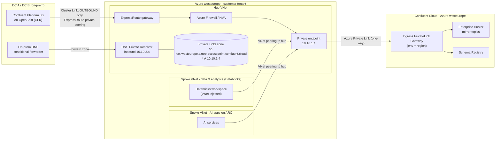
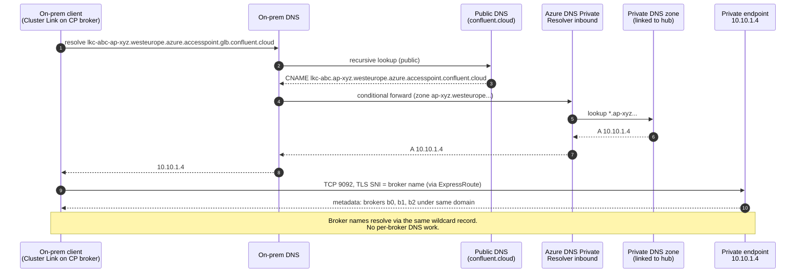
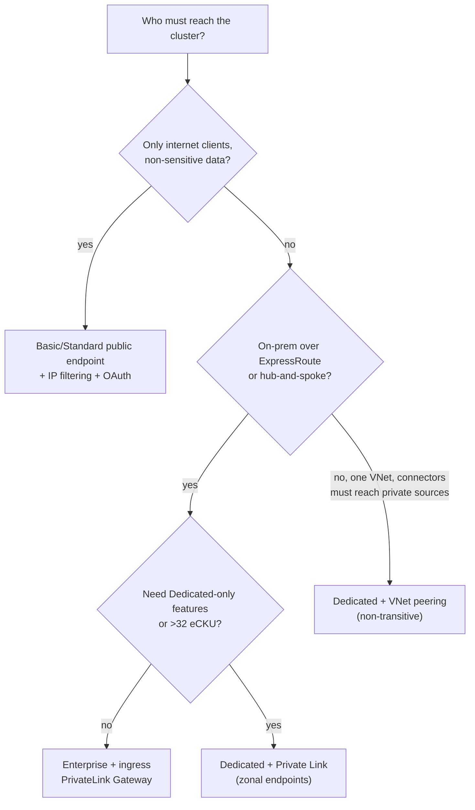

**[V]** = depends on version, region or pricing; check before you say it as fact.

## 1. What this module is for

- Answer "how do Azure teams and the on-prem DC reach Confluent Cloud privately?" with Azure words, not AWS words.
- Know the two Azure Private Link models (Dedicated per-network, Enterprise ingress gateway) and the DNS path end to end, from an on-prem client to a private endpoint.
- Defend "do not expose on-prem brokers to Azure" with the Kafka-protocol reason, not just "security".

Course: https://developer.confluent.io/courses/confluent-cloud-networking/intro/ (10 modules, 1 h 38, recorded around 2022, AWS-first).

---

## 2. Core concepts

### 2.1 Why Kafka networking is not HTTP networking

Source: course intro, https://developer.confluent.io/courses/confluent-cloud-networking/intro/

| Point | What it means for design |
|---|---|
| Kafka is a binary protocol on TCP, not HTTP | An HTTP proxy, WAF or L7 API gateway cannot sit in the path. 3scale/APIM are for the REST layer only. |
| Bootstrap is only the first hop | Client connects to any bootstrap address, gets **metadata** with every broker's `advertised.listeners` address, then opens a direct TCP connection to **each broker that leads a partition it uses**. |
| No plain L4 load balancer in front | A load balancer can serve bootstrap. It cannot serve broker traffic, because the client must reach a *specific* broker. |
| TLS names must match | Each advertised host name must be in the broker certificate (SAN or wildcard). |

How Confluent Cloud solves it: brokers sit behind a Confluent proxy layer. Every broker gets a host name under one cluster domain (for example `b0-…`, `b1-…`), and wildcard DNS sends all of them to the same few IPs. The proxy routes by TLS SNI. That is why one private endpoint per zone (or one per gateway) is enough on the Azure side, and why your DNS needs a **wildcard** record, never per-broker records. Broker names are not static; do not hard-code them.

### 2.2 The options on Azure, by cluster type

Source: course summary https://developer.confluent.io/courses/confluent-cloud-networking/summary/ plus current docs (sources §7).

| Cluster type | Public endpoint | VNet peering | Private Link inbound | Notes for Azure |
|---|---|---|---|---|
| Basic | yes | no | no | 99.5% SLA; no RBAC on Kafka resources, no OAuth, no audit logs |
| Standard | yes | no | no | public only |
| **Enterprise** | **no** (Azure public page lists only Basic/Standard/Dedicated) **[V]** | no | **yes — ingress PrivateLink Gateway + Access Point** (replaced PrivateLink Attachment on 2026-05-04) | elastic eCKU; on Azure with Private Link max **32 eCKU** **[V]**; minutes to provision |
| **Dedicated** | yes | yes | **yes — per-network Private Link Service, zonal aliases** | CKU; up to 100 CKU on Azure by request **[V]**; network type is chosen at creation and cannot change |
| Freight | — | — | — | AWS only today **[V]** |

Rule of thumb: **Enterprise for most private use cases on Azure, Dedicated when you need peering, very large scale, broker-side schema validation, or features only Dedicated has** (check the feature list per type when it matters).

### 2.3 Public endpoints

Source: https://developer.confluent.io/courses/confluent-cloud-networking/public-endpoints/

- TLS everywhere, authentication by API key (SASL/PLAIN inside TLS) or OAuth (SASL/OAUTHBEARER, not on Basic).
- Behind a Confluent proxy layer with DoS protection. **No static ingress IPs** — Confluent says the IPs behind the DNS names should not be relied on. So you cannot allow-list Confluent Cloud by IP in your outbound firewall; allow-list by FQDN (Azure Firewall application/network rules with FQDN) instead.
- Static **egress** IPs exist for managed connectors and Cluster Linking going *out* of Confluent Cloud to your public endpoints.
- **IP filtering** (new since the course): IP groups (IPv4 CIDRs) + IP filters, scoped to organisation or environment, by operation group (`MANAGEMENT`, `SCHEMA`, `FLINK`, `KAFKA_DATA`, `KAFKA_MANAGEMENT`, `KAFKA_DISCOVERY`, `KSQL`). Max 25 groups and 25 filters per org. It applies to **public** traffic only. Whether `KAFKA_DATA` filtering works on every public cluster type is not stated clearly in the docs **[V]** — the lab tests it.

### 2.4 VNet peering (Dedicated only)

Source: https://developer.confluent.io/courses/confluent-cloud-networking/vpc-peering/ and Azure peering doc.

- Confluent Cloud network (a Confluent-managed VNet) is peered with your VNet. Traffic is private and **bidirectional** — managed connectors can reach sources in your VNet.
- You grant the Confluent service principal a custom role ("Confluent Cloud Peering Creator") on your VNet and tag the VNet with `ConfluentEnvIDs`.
- **Not transitive.** Azure Gateway Transit and UDRs are not supported. So:
  - a spoke VNet peered to your hub cannot reach Confluent through the hub;
  - **on-prem over ExpressRoute into the hub cannot reach a peered Confluent network.**
- DNS: Confluent hosts the records publicly; clients must use public DNS resolution. A **DNS forwarder** in Confluent Cloud lets managed connectors resolve *your* private names.
- CIDR planning: you give Confluent an address range that must not overlap anything you route **[V]** for size.

For an estate with an on-prem DC and ExpressRoute, this non-transitivity is the main reason peering is a poor fit.

### 2.5 Azure Private Link — what is the same for both models

Source: https://developer.confluent.io/courses/confluent-cloud-networking/private-link/

- You create an **Azure private endpoint** (a NIC with a private IP in your subnet) that connects to a **Private Link Service** owned by Confluent.
- Traffic is **one-way**: your side opens connections to Confluent. Confluent cannot open a connection into your VNet over this path. (For Confluent → your services there is a separate **egress** Private Link feature, see 2.8.)
- The private endpoint IP is **reachable from anything that can route to that subnet**: peered spokes, ExpressRoute, site-to-site VPN. This is the property that makes Private Link work in hub-and-spoke with on-prem, where peering does not.
- The cluster has **no public endpoint** once it is private. Console features that read data (topic browser, Flink workspace) need your browser to reach the private endpoint too.
- You must create a **private DNS zone** with a wildcard record pointing to the private endpoint IP(s), and link it to the VNet(s) where clients or your DNS resolver live.

### 2.6 Dedicated: per-network Private Link Service

Source: https://docs.confluent.io/cloud/current/networking/private-links/azure-privatelink.html

| Step | What you do |
|---|---|
| 1 | Create a Confluent **network** in `westeurope` with connection type `PRIVATELINK`, DNS resolution **private** (cannot change later). Provisioning is slow (often an hour or more) **[V]**. |
| 2 | Register your **Azure subscription** on that network (`Private Link Access`) so Confluent auto-approves endpoints from it. |
| 3 | Read the **Private Link Service alias per zone** from the network. |
| 4 | Create **1 private endpoint** (single-zone cluster) or **3** (multi-zone, one per zonal alias). |
| 5 | Private DNS zone = the network's DNS domain without the cluster id and without `glb` (doc example: `lkc-123abc-4kgzg.centralus.azure.confluent.cloud` → zone `4kgzg.centralus.azure.confluent.cloud`). Records: `*` → all endpoint IPs; `*.az1`, `*.az2`, `*.az3` → the matching zonal endpoint IP. TTL 60 s. |
| 6 | Create the Dedicated cluster in that network. |

Zonal records exist so that a client talking to a broker in zone 2 goes through the zone-2 endpoint and does not cross zones.

### 2.7 Enterprise: ingress PrivateLink Gateway + Access Point (new model)

Source: https://docs.confluent.io/cloud/current/networking/azure-platt.html

**Changed since the course and since most blog posts:** on **2026-05-04** Confluent replaced the **PrivateLink Attachment (PLATT)** with the **ingress PrivateLink Gateway**. Existing PLATTs keep working; new PLATTs will stop being provisionable in a later release. Terraform: `confluent_gateway` (`azure_ingress_private_link_gateway`) + `confluent_access_point` (`azure_ingress_private_link_endpoint`) instead of `confluent_private_link_attachment` + `…_connection`.

| | Dedicated Private Link | Enterprise ingress gateway |
|---|---|---|
| Unit | one Confluent network (per cluster or a few clusters) | one **gateway per environment per region** |
| What it reaches | the Dedicated clusters in that network | **all Enterprise clusters, Schema Registry and Flink** in that environment and region |
| Endpoints | 1 or 3 zonal private endpoints | **1 private endpoint per access point**, any zone, up to **10 endpoints per gateway** |
| Approval | subscription registered on the network | each private endpoint registered as an **access point** |
| DNS zone | network domain, `*` + `*.az1..3` | access point's `dns_domain`, **one `*` record** |
| Cross-region / cross-env | possible with care **[V]** | **not supported** (same region, same environment only) |
| Time to build | hours | minutes |
| Public name resolution | — | **required**: global name `…accesspoint.glb.confluent.cloud` is public and returns a CNAME to `$lkc.$accessPointId.$region.azure.accesspoint.confluent.cloud`, which your private zone answers |

Gateway states: `CREATED` → `READY` (after the endpoint connection is accepted) → `EXPIRED` (create a new one).

### 2.8 Egress: Confluent Cloud reaching your Azure services

Fully managed connectors and Cluster Linking (destination-initiated) need to reach *your* side. Options: public egress IPs + your firewall allow-list, VNet peering (Dedicated), or **egress Private Link endpoints** (`confluent_gateway` with `azure_egress_private_link_gateway` + `confluent_access_point` with `azure_egress_private_link_endpoint`, for example to an ADLS or SQL private link service). The course says managed connectors cannot reach private sources over Private Link — that is no longer true.

### 2.9 ExpressRoute and on-prem

Not in the course. Azure side from Microsoft Learn (sources).

- **Private peering** on the ExpressRoute circuit carries RFC 1918 traffic between the DC and VNets. Private endpoints are reachable over private peering like any VNet IP. Microsoft peering is not needed for Private Link.
- Topology: ExpressRoute gateway in a **hub VNet**; private endpoint for Confluent in the hub (or in a shared "connectivity" spoke); spokes peered to the hub. On-prem routes reach the private endpoint subnet through the gateway.
- Resilience: two circuits in two peering locations (many metros have two), or a circuit plus a site-to-site VPN as backup. A Cluster Linking flow can tolerate a short outage (it resumes from its offsets), but plan the link lag alarm.
- The firewall question: on-prem → Azure traffic often passes an Azure Firewall/NVA in the hub. With private endpoints, enable network policies on the subnet if you want UDRs/NSGs to apply to PE traffic **[V]**, and keep long-lived TCP (Cluster Linking keeps connections open; idle timeouts on firewalls break it).

### 2.10 DNS — the part that usually breaks

Not in the course for Azure. Microsoft Learn: Azure DNS Private Resolver; Confluent DNS pages.

- **Azure DNS Private Resolver** in the hub: an **inbound endpoint** (an IP that on-prem DNS servers can forward to) and an **outbound endpoint + forwarding ruleset** (Azure workloads resolving on-prem names).
- The Confluent **private DNS zone** is linked to the hub VNet where the resolver lives (and to spokes, or spokes use the resolver as their DNS server).
- **On-prem DNS servers**: add a **conditional forwarder** for the Confluent private zone name (Enterprise: the access point `dns_domain`; Dedicated: the network domain) → the resolver inbound endpoint IP. Alternative: forward the whole `confluent.cloud` to the inbound endpoint; Azure DNS answers public names publicly and private-zone names privately.
- For Enterprise, the client resolves the **public** `glb` name first, so on-prem DNS must also be able to resolve public names (or forward `confluent.cloud` as above).
- Test from the real client host with `nslookup`/`dig` on the bootstrap name and on one broker name; both must return the private endpoint IP.

### 2.11 Why exposing on-prem brokers directly is hard

This is the main reason the design in this course keeps the on-prem brokers private.

| Problem | Why |
|---|---|
| Per-broker addressing | Every client in Azure must reach **every broker** at its advertised address. With N brokers: N DNS names, N NAT rules or N load-balancer front ends, all in the cloud trust zone. |
| A listener per network zone | Internal clients and Azure clients see different addresses, so each broker needs another listener (`advertised.listeners` with a name per zone) and the certificate SANs for it. |
| Change coupling | Adding, replacing or renumbering a broker becomes a firewall and DNS change in two organisations. On OpenShift, broker pods get per-pod routes; still one route per broker. |
| Load on mission-critical brokers | Every cloud consumer, every replay and every backfill reads from the on-prem brokers. |
| Trust zone | It publishes the cluster topology to a less trusted zone, and opens **inbound** ports into the DC. For organisations that run critical or regulated operations under NIS2, that is a segmentation argument you have to win. |

What to do instead: **source-initiated Cluster Linking**: the on-prem brokers open **outbound** connections to Confluent Cloud over ExpressRoute → private endpoint. One controlled flow, quota-capped, no inbound rule. Cloud consumers read the mirror in the cloud.

---

## 3. Diagrams

### 3.1 Target topology (Enterprise cluster, hub-and-spoke)

### 3.2 DNS resolution path from an on-prem client (sequence)

### 3.3 Choosing (decision flow)

---

## 4. Changed since the course

The course modules date from about 2022 (one page says "As of today (Q2 2022)").

| Course says / implies | Current state (2026-11) | Source |
|---|---|---|
| Cluster types: Basic, Standard, Dedicated | Basic, Standard, **Enterprise**, Dedicated, **Freight** (AWS only) | cluster types doc |
| Private Link only for Dedicated | Dedicated (per-network PLS) **and Enterprise** (ingress gateway). On Azure, Enterprise is private only **[V]** | Azure Private Link overview, Azure public doc |
| (Not in course) PrivateLink Attachment for serverless | **Replaced by ingress PrivateLink Gateway + Access Point, 2026-05-04**; PLATT still works, new ones to be blocked | azure-platt doc |
| Private Link only on AWS and Azure | GCP Private Service Connect also, plus AWS **Private Network Interface (PNI)** for Enterprise/Freight | networking docs |
| Schema Registry only reachable over the internet | Serverless Schema Registry reachable through the ingress gateway | azure-platt doc |
| Managed connectors cannot reach private sources over Private Link | **Egress Private Link endpoints** (Azure supported); also DNS forwarding with peering | Azure overview, connector networking |
| Authentication = API key (SASL/PLAIN) | Also **OAuth/OIDC** (Standard and up) and **mTLS** (Dedicated on Azure **[V]**) | OAuth overview, mTLS doc |
| No word on IP allow-listing | **IP filtering** with IP groups and operation groups (incl. `KAFKA_DATA` **[V]**) | IP filtering doc |
| Azure DNS records: course text says CNAME, video says A | Current Azure docs: **A records** in an Azure Private DNS zone (`*`, plus `*.azN` for Dedicated) | Dedicated PL doc |
| Allow-list up to 10 subscriptions per PL network | Still a per-network list for Dedicated **[V]**; Enterprise gateway: up to 10 private endpoints per gateway | docs |
| Transit Gateway module | AWS only; on Azure the equivalent role is played by **your hub VNet + Private Link** | — |

---

## 5. In practice

Context: an organisation runs mission-critical Confluent Platform on-prem in two data centres (on
OpenShift), and wants to serve data/AI consumers in Azure (Databricks, AI apps on ARO) without
touching the operational clusters. Identity is Entra ID; REST APIs go through an API gateway.

- **Target**: on-prem CP → source-initiated Cluster Link → **ExpressRoute private peering** → private endpoint in the hub → **Enterprise** cluster in `westeurope` via the **ingress PrivateLink Gateway**. Data & analytics and AI spokes reach the same private endpoint through hub peering. No public endpoints on the cluster.
- **Why Enterprise first**: provisions in minutes, elastic, one gateway covers Kafka + Schema Registry + Flink for the environment. Move to Dedicated only if a Dedicated-only feature is required (for example broker-side schema validation in CC, see [module 03](../03-stream-governance/notes.md)) or scale passes the Azure Private Link eCKU cap **[V]**.
- **Environments**: one gateway per environment and region. If you split `prod` and `non-prod` environments (you should), that is two gateways and two DNS zones. Plan the 10-endpoint-per-gateway limit if each spoke wants its own endpoint; usually one endpoint in the hub is enough.
- **DNS**: Azure DNS Private Resolver in the hub; on-prem DNS conditional forwarder for the access-point zones. Most organisations already use this pattern for Azure PaaS private endpoints (Storage, Key Vault, Databricks), so reuse the existing DNS design rather than invent one.
- **Firewall**: the link is a long-lived outbound TCP flow on 9092 (and 443 for REST/SR). Ask the network team for an FQDN-based rule and idle timeouts longer than Kafka's keepalive behaviour.
- **What does not go to Azure**: on-prem brokers are never addressable from Azure. That keeps the NIS2 segmentation story simple: one outbound flow, one direction.
- **Databricks**: VNet-injected workspaces in a spoke resolve the private zone through the hub resolver. Serverless Databricks compute needs its own private connectivity path (network connectivity configuration with private endpoint rules) **[V]**: check before promising serverless SQL/Lakeflow reading Kafka directly. Tableflow → Delta in your own storage avoids that question for most analysts.

Questions an architect asks the team that owns the network and platform:
- Is there already a hub with an ExpressRoute gateway, a firewall and a DNS Private Resolver?
- How do on-prem DNS servers resolve Azure private endpoint names today?
- What idle timeout do the firewalls on the DC → Azure path apply to long-lived TCP?
- Are `prod` and `non-prod` separate Confluent environments, and who may create private endpoints?

---

## 6. Q&A

**Q1. Why not just open a listener on the on-prem cluster for Azure consumers?**
Kafka clients connect to every partition leader directly, so each broker needs an address reachable from Azure, a listener for that zone and a certificate name. Every new broker becomes a firewall and DNS change, and every cloud replay hits mission-critical brokers. A source-initiated Cluster Link is one outbound flow, and cloud load stays in the cloud.

**Q2. Peering or Private Link from Azure?**
Private Link. Azure VNet peering to Confluent is Dedicated-only and **not transitive** — no gateway transit, no UDRs — so on-prem over ExpressRoute and spokes behind a hub cannot use it. A private endpoint is just an IP in the hub, so anything routed to the hub reaches it. Peering only wins when managed connectors must reach private sources and you cannot use egress Private Link.

**Q3. Enterprise or Dedicated for the private landing cluster?**
Enterprise by default: elastic, minutes to provision, and one ingress gateway serves Kafka, Schema Registry and Flink for the environment. Dedicated when you need its specific features (for example broker-side schema validation in CC) or more than the Azure Private Link eCKU cap **[V]**. Dedicated networks take hours and fix the DNS mode at creation, so decide early.

**Q4. What is a PrivateLink Attachment and is it still the answer for Enterprise?**
It was the serverless Private Link model (PLATT + connection). Since 2026-05-04 Confluent replaced it with the **ingress PrivateLink Gateway** and **Access Points**; existing PLATTs keep working but new ones will be blocked. The gateway gives each private endpoint a unique DNS domain. In Terraform this is `confluent_gateway` + `confluent_access_point`.

**Q5. Walk me through DNS from an on-prem client to the cluster.**
The client resolves the public `…accesspoint.glb.confluent.cloud` bootstrap name; public DNS returns a CNAME into the access-point domain. On-prem DNS has a conditional forwarder for that domain to the Azure DNS Private Resolver inbound endpoint; the resolver answers from the private DNS zone linked to the hub: wildcard A → private endpoint IP. Broker names use the same wildcard, so adding brokers needs no DNS change.

**Q6. (Hard) The link works for an hour, then stalls with timeouts. Where do you look?**
First the path: firewall or NVA idle timeouts on the long-lived TCP connection, and asymmetric routing through the hub firewall. Then DNS: a broker name that resolves publicly (missing wildcard, zone not linked to the resolver's VNet) — the bootstrap works but one partition leader is unreachable. Then quotas on the link principal and link lag metrics. `kafka-broker-api-versions` and `openssl s_client -servername <broker>` from the CP host isolate DNS vs TLS vs route.

**Q7. (Hard) Who pays for what when 2 TB a day go from the DC to Azure and are read three times?**
ExpressRoute ingress into Azure is free; Confluent charges cluster ingress per GB written and Cluster Linking per GB and per link-hour; the private endpoint has Azure data-processing charges per GB both ways **[V]**. Reads by three Azure consumers are paid once per consumer as Confluent egress plus private-endpoint processing — on-prem pays nothing for them. Reduce with an allow-list of curated topics, zstd at the producer, and fan-out in the cloud (Tableflow, Flink) instead of each team re-reading raw topics.

**Q8. Can Confluent Cloud call into our VNet over Private Link?**
No, inbound Private Link is one-way. For managed connectors to reach private Azure services, use **egress Private Link endpoints** (Confluent creates the endpoint to your Private Link service) or peering on Dedicated. Source-initiated Cluster Linking means Confluent never needs to reach the DC.

**Q9. Public endpoint with IP filtering — good enough for non-sensitive streams?**
For PII-free, non-critical data (queue-length sensors, test environments) it can be. IP filtering restricts management, schema, Flink and, per the operation groups, Kafka data **[V]** to known CIDRs, and OAuth with short-lived tokens removes long-lived secrets. But Confluent's ingress IPs are not static, so your own egress firewall must allow by FQDN, and the data still crosses the internet.

**Q10. How do you avoid a single private endpoint becoming a bottleneck or SPOF?**
A private endpoint is a zone-redundant Azure construct, not a VM, and has high throughput **[V]**. For the gateway model, add a second access point (another private endpoint) in another spoke if teams need isolation; for Dedicated multi-zone you already have three zonal endpoints. The bigger SPOF is ExpressRoute: two circuits or circuit + VPN.

---

## 7. Sources

- Course: https://developer.confluent.io/courses/confluent-cloud-networking/intro/ · /public-endpoints/ · /vpc-peering/ · /private-link/ · /summary/
- Azure Private Link overview: https://docs.confluent.io/cloud/current/networking/azure-privatelink-overview.html
- Enterprise ingress gateway (formerly PLATT): https://docs.confluent.io/cloud/current/networking/azure-platt.html
- Dedicated Azure Private Link: https://docs.confluent.io/cloud/current/networking/private-links/azure-privatelink.html
- Azure VNet peering: https://docs.confluent.io/cloud/current/networking/peering/azure-peering.html
- Azure public networking: https://docs.confluent.io/cloud/current/networking/azure-public.html
- Cluster types: https://docs.confluent.io/cloud/current/clusters/cluster-types.html
- IP filtering: https://docs.confluent.io/cloud/current/security/access-control/ip-filtering/overview.html
- Cluster Linking + private networking: https://docs.confluent.io/cloud/current/multi-cloud/cluster-linking/private-networking.html
- Terraform: `confluent_gateway`, `confluent_access_point`, example `enterprise-ingress-azure` in https://github.com/confluentinc/terraform-provider-confluent (provider 2.94.0)
- Microsoft Learn: Azure DNS Private Resolver https://learn.microsoft.com/azure/dns/dns-private-resolver-overview · Private endpoint DNS integration https://learn.microsoft.com/azure/private-link/private-endpoint-dns-integration · ExpressRoute peering https://learn.microsoft.com/azure/expressroute/expressroute-circuit-peerings · Private Link pricing https://azure.microsoft.com/pricing/details/private-link/
