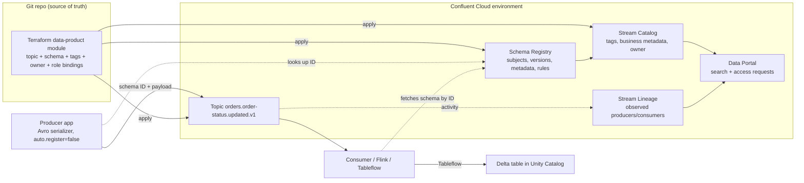
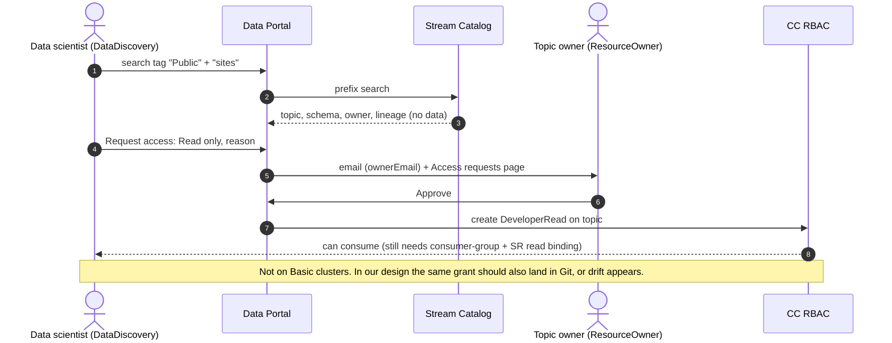
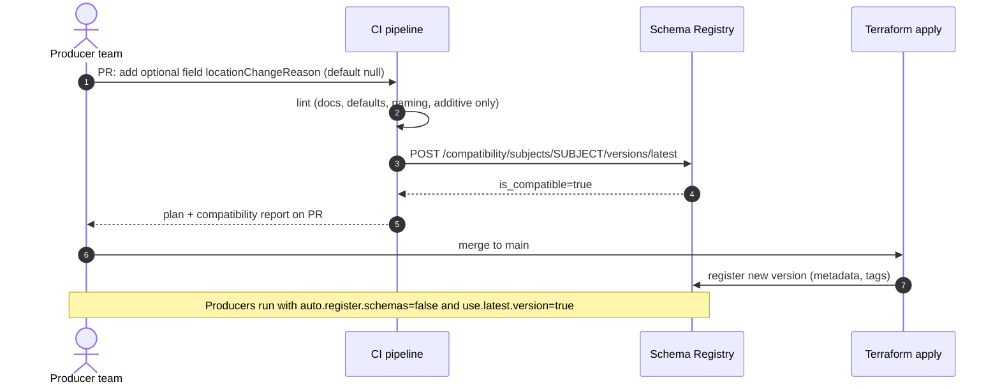

**[V]** = version-, package- or region-dependent. Check before you say it as fact.
Course: https://developer.confluent.io/courses/governing-data-streams/overview/ (17 modules).

# 1. What this module is for

- Governance is what makes a shared Kafka platform usable by teams who do not know each other.
- Confluent splits it into three pillars: **quality** (schemas, contracts), **catalog** (find and
  understand), **lineage** (see who writes and reads what). Data Portal sits on top.
- In the design used across this course it means: "no schema, no topic", one write master per
  subject, and a catalog that cloud data teams actually use.

# 2. Core concepts

## 2.1 Why governance gets hard at scale

Source: https://developer.confluent.io/courses/governing-data-streams/streaming-at-scale/ ·
https://developer.confluent.io/courses/governing-data-streams/stream-governance/

The first project on Kafka has one producer team and one consumer team. They agree the format in
a chat. After twenty teams, nobody knows who owns a topic, which field is personal data, or who
breaks when a field changes. The course frames governance on four principles:

| Principle | What it means for streams | Confluent feature |
|---|---|---|
| Availability | Data is there when needed; consumers resume after failure | Replication, retention, Cluster Linking |
| Usability | Teams can find a stream and know what it means and who owns it | Stream Catalog, Data Portal |
| Integrity | Data has the agreed shape and stays compatible over time | Schema Registry, data contracts |
| Security | Only the right principals read or change it | RBAC, ACLs, CSFLE |

The difference to batch governance: a stream has no "load window" where you can check it. Bad
data reaches every consumer within milliseconds. So checks must happen **before** the write, not
after.

## 2.2 Stream quality = schemas + data contracts

Source: https://developer.confluent.io/courses/governing-data-streams/stream-quality/ ·
https://developer.confluent.io/courses/governing-data-streams/schema-registry/

- The course calls the schema the **contract** between producer and consumer teams. Avro and
  Protobuf carry a schema by design; JSON needs JSON Schema on top.
- **Schema Registry** stores versions per **subject** (default `TopicNameStrategy`:
  `<topic>-value`, `<topic>-key`). The serializer registers or looks up the schema, then writes a
  magic byte + **4-byte schema ID** + payload. The deserializer fetches the schema by ID and caches
  it.
- **Compatibility** is checked on registration, per subject or globally:

| Mode | New schema can read old data? | Old schema can read new data? | Upgrade order |
|---|---|---|---|
| BACKWARD (default) | yes (last version) | not guaranteed | consumers first |
| BACKWARD_TRANSITIVE | yes (all versions) | not guaranteed | consumers first |
| FORWARD(_TRANSITIVE) | not guaranteed | yes | producers first |
| FULL(_TRANSITIVE) | yes | yes | any order |
| NONE | no check | no check | coordinated release |

- **Data contracts** (added to Confluent after the course was recorded) extend a schema with three
  more parts. The course only touches this in the production course
  (https://developer.confluent.io/courses/data-streaming-systems/productionizing-applications/).

| Part | What it is | Example |
|---|---|---|
| Schema | Structure | Avro record `OrderStatusUpdated` |
| Metadata | Free key/value properties on the version | `owner=orders`, `classification=C1`, `major_version=1` |
| Tags | Labels on the schema or on fields (inline `confluent:tags` or in metadata) | field `email` tagged `PII` |
| Rules | Executable policy, run in the **client serializer/deserializer** | CEL condition, JSONata migration, ENCRYPT (CSFLE) |

Rule kinds: `CONDITION` (validate, e.g. CEL `message.orderId.matches('^SO-[0-9]{7}$')`)
and `TRANSFORM` (change, e.g. encrypt a tagged field, or migrate between major versions with
JSONata). Modes: `WRITE`, `READ`, `WRITEREAD`, `UPGRADE`, `DOWNGRADE`, `UPDOWN`. On failure:
`ERROR`, `NONE`, or `DLQ` (send to a dead-letter topic). **Rules need Stream Governance Advanced in
Confluent Cloud [V]**; on Confluent Platform they are an Enterprise feature [V].

- **Broker-side schema ID validation** (Confluent Server only): a topic config
  (`confluent.value.schema.validation=true`) makes the broker check that each record carries a
  **valid, registered schema ID for that subject**. It does **not** check the payload against the
  schema. In Confluent Cloud: **Dedicated clusters only** [V, docs 2026-11].

Important architecture point: rules run in the client. A producer that does not use the Confluent
serializer skips them. So the platform must (a) give teams a producer template with the serializer
configured, and (b) use broker-side ID validation as the hard stop where it exists.

## 2.3 Stream Catalog — tags, business metadata, search

Source: https://developer.confluent.io/courses/governing-data-streams/discovering-streams/ ·
https://developer.confluent.io/courses/governing-data-streams/stream-catalog/

- Stream Catalog is a metadata store per **Confluent Cloud environment**. It auto-registers
  entities: environment, Kafka cluster, topics, schemas, schema records and **fields**,
  connectors, Flink objects. Its REST API has an Apache Atlas shape (`/catalog/v1/types/tagdefs`,
  `/catalog/v1/entity/tags`, `/catalog/v1/search/basic`).
- **Topic attributes**: `owner`, `ownerEmail`, `description`. Data Portal's request workflow needs
  these filled in.
- **Tags**: a tag definition (`TagDef`) is created once, then bound to entities. A tag on a schema
  **field** (`sr_field`) is how you mark PII at field level. Max 1,000 tag definitions per
  environment [V].
- **Business metadata**: a typed set of attributes (e.g. `DataProduct{domain, owner, sla,
  classification}`) bound to a topic or schema. Needs **Advanced** [V].
- **Search**: REST is **prefix search only**; the console has fuzzy/substring search. GraphQL API
  is Advanced only [V]. Docs warn not to poll catalog search for topic lists; use the Kafka and SR
  APIs for that.

Qualified names you will need (from the catalog REST docs):

| Entity | `entityType` | Qualified name |
|---|---|---|
| Topic | `kafka_topic` | `<lsrc-id>:<lkc-id>:<topic>` |
| Schema | `sr_schema` | `<lsrc-id>:<context>:<schema-id>` (default context is `.`) |
| Field | `sr_field` | `<lsrc-id>:<context>:<schema-id>:<record.full.name>:<field>` |

## 2.4 Stream Lineage

Source: https://developer.confluent.io/courses/governing-data-streams/visualizing-streams/ ·
https://developer.confluent.io/courses/governing-data-streams/stream-lineage/

- Lineage is **observed, not declared**. Confluent builds the graph from real produce and consume
  activity: topics, client apps (by client ID / principal), connectors, Flink statements, Kafka
  Streams apps, CLI clients.
- Default view = **last 10 minutes** of activity. A batch job that runs nightly is invisible in that
  window. Point-in-time lineage up to **7 days back** needs Advanced [V].
- Not documented: lineage across a **cluster link** (on-prem source → CC mirror). Do not claim it.
  With **Unified Stream Manager** (below), lineage of a registered CP cluster is visible in the CC
  console [V].
- Consequence: lineage tells you *who actually consumes*; the catalog tells you *who should*. You
  need both for deprecation and for incident impact ("which apps read the topic that just broke?").

## 2.5 Stream security for governance

Source: https://developer.confluent.io/courses/governing-data-streams/stream-security/

| Role | Use |
|---|---|
| `DataDiscovery` | Search the catalog, see metadata, no data access. Give it widely. |
| `DataSteward` | Manage tags, business metadata, schemas across the environment. Platform/governance team. |
| `DeveloperRead` / `DeveloperWrite` | Read/write a topic, consumer group, subject. Read cannot change tags. |
| `ResourceOwner` | Owner of a topic/subject prefix; can approve Data Portal requests and grant access. |

Least privilege: the course uses `OrganizationAdmin` for convenience and says not to do that in
production.

## 2.6 Data Portal and access requests

Source: course module 16 + docs https://docs.confluent.io/cloud/current/stream-governance/data-portal.html

- Self-service UI on top of catalog + lineage: search topics by name or tag, see description,
  owner, schema, lineage, **without data access**.
- **Request access**: "Read only" → `DeveloperRead`; "Read and Write" → `DeveloperRead` +
  `DeveloperWrite`. The owner gets an email (if `ownerEmail` is set); approvers are the
  `ResourceOwner` or admins. Requests expire after 30 days.
- **Not available for Basic clusters**, and not for Confluent Platform topics (USM topics are
  discoverable only) [V].
- Side effect that matters: the approved requests are a **list of consumers** per data product.
  You need that list to retire a `.v1` topic.

## 2.7 Data as a product

Source: https://developer.confluent.io/courses/governing-data-streams/data-as-a-product/

The course maps data-product qualities to governance features: consistent (schema = contract),
accessible (catalog), integrated (lineage), reliable (RBAC). Our version, closer to what a platform
team actually enforces:

| A published stream is a data product when it has | Enforced by |
|---|---|
| A name that follows `<domain>.<dataproduct>.<event>.<version>` | Terraform module validation |
| A registered schema and a compatibility mode | "No schema, no topic" module + broker validation |
| Owner, owner email, description | Catalog entity attributes, set by Terraform |
| Classification tag (C1–C4) and PII field tags | Tags in Terraform + inline `confluent:tags` |
| SLA, retention, support channel | Business metadata (Advanced) or schema metadata properties |
| Known consumers | Data Portal approvals + role bindings in Git |

## 2.8 Packages and current state (not in the course)

Source: https://docs.confluent.io/cloud/current/stream-governance/packages.html (read 2026-11-07)

| Feature | Essentials | Advanced |
|---|---|---|
| Enabled | Automatically on every environment | Upgrade per environment, billed hourly (console shows "from $1/hour") [V] |
| Schema Registry SLA | 99.5% | 99.99% |
| Schemas included | 100 (above: per schema/hour) | 20,000 |
| Schema exporters (Schema Linking) | 10 | 100 |
| Data contract **rules** | no | yes |
| Catalog **tags** | yes | yes |
| Catalog **business metadata** | no | yes |
| Catalog REST / GraphQL | REST | REST + GraphQL |
| Data Portal | yes | yes |
| Lineage | last 10 min | + point-in-time, 7 days |

- **Upgrade is one-way.** You cannot downgrade an environment from Advanced to Essentials. For the
  lab, use a throw-away environment for Advanced features.
- **Unified Stream Manager (USM)** [V]: registers a self-managed CP cluster (CP 7.9.6+ or 8.1+)
  with a CC organisation through an agent. Its topics and connectors then show in the CC console,
  with lineage; quickstart lists **Advanced** governance as a requirement. Business metadata is not
  supported on `usm_` entities, and Data Portal access requests do not work for CP topics.

## 2.9 How it links to Unity Catalog, Purview and Tableflow

| Link | What exists [V, checked 2026-11-07] |
|---|---|
| Stream Catalog → Unity Catalog | **No native metadata sync found.** The real link is **Tableflow**: it materialises a topic as a Delta or Iceberg table and publishes it into Unity Catalog. Delta tables are BYOS (your own ADLS). |
| Stream Catalog → Microsoft Purview | **No native Purview source for Confluent found.** Options: Purview scans Unity Catalog (one-way) and so sees Tableflow tables; or push from the Stream Catalog REST API into Purview's Atlas API (custom job). |
| Tableflow → schemas | Tableflow **refuses schemaless topics**, and **both key and value need a schema**. It follows SR compatibility; adds, removes and widening are automatic; an incompatible change needs manual action. |
| Tableflow → private networking | On privately networked clusters only **custom storage (BYOS)** works, not Confluent-managed storage. |
| Tableflow → Confluent Platform | Not available. On-prem topics reach Tableflow only after they are mirrored to CC. |

Design consequence: the schema is not only for Kafka consumers. It is the **table definition** for
the Databricks user. A bad schema change breaks a Delta table that analysts query. That is a strong
argument for CI compatibility checks and BACKWARD_TRANSITIVE on published subjects.

# 3. Diagrams

## 3.1 Governance planes around one data product

## 3.2 Data Portal access request

## 3.3 Schema change through CI

# 4. Changed since the course

| Course says / assumes | Current state (2026-11) |
|---|---|
| Three pillars: quality, catalog, lineage | Still true, but **Data Portal** and **data contracts** (metadata, tags, rules) are now the main story. Rules = Advanced only [V]. |
| "Upgrade to Advanced" is a simple toggle | It is **irreversible** per environment. Essentials is auto-attached to every environment. |
| Catalog search via REST and GraphQL | REST is prefix-only; GraphQL is Advanced only [V]. |
| Lineage window "last 10 minutes" + point-in-time | Same: 10 min on Essentials, 7 days point-in-time on Advanced [V]. |
| Schema validation "can be linked" | Broker-side **schema ID** validation exists; in CC only on **Dedicated** clusters [V]. It checks the ID, not the payload. |
| Course is Confluent Cloud only | **USM** brings CP clusters (7.9.6+/8.1+) into the CC console, catalog and lineage [V]. |
| No downstream table story | **Tableflow** (Delta GA, Iceberg) publishes topics as tables into Unity Catalog / Glue / Polaris / Snowflake Open Catalog. Requires key and value schemas. |
| srcm v2 API / CLI v3 / Terraform provider v1 | Deprecated; use Environments API and provider **v2.x** (pin `~> 2.94` as of 2026-11-06). |
| Encryption only mentioned as "security" | **CSFLE** is a data-contract ENCRYPT rule on tagged fields, KEK in a cloud KMS (Azure Key Vault) [V]. |

# 5. In practice

Context: an organisation runs mission-critical Confluent Platform on-prem in two data centres,
with clusters split by SLA, on OpenShift with CFK and ArgoCD. It mirrors curated streams to
Confluent Cloud on Azure for data/AI teams (Databricks with Unity Catalog) and does not want those
consumers to touch the operational clusters.

| Question | Position |
|---|---|
| Where does the catalog live? | In the **CC environment** that holds the mirror topics. CP has no Stream Catalog of its own. USM can add on-prem topics to the CC view, but needs Advanced and CP 8.1+ (or 7.9.6+) [V]. |
| What is the source of truth for owner, classification, SLA? | **Git.** The Terraform module (CC) and CFK CRs (on-prem) carry them. The catalog is a projection of Git, written by the pipeline. Manual edits in the console create drift. |
| How does PII get marked? | Inline `confluent:tags: ["PII"]` on fields in the `.avsc`, plus a topic-level classification tag. The CI gate reads the tags: a topic with PII fields can enter the cluster-link filter only if an ENCRYPT rule covers those tags. |
| Schemas across on-prem and CC? | One write master per subject. On-prem SR is master for on-prem producers; **Schema Linking** exports to a CC context (e.g. `:.onprem:`), IDs preserved. Consumers in Azure read from the CC registry only. |
| Broker-side validation? | On-prem Confluent Server: yes, on all published topics. In CC: only if the cluster is Dedicated [V]. Mirror topics are byte copies, so on-prem validation covers the cloud copy. |
| Data Portal access requests? | Work for CC topics on Standard/Enterprise/Dedicated, not Basic [V]. Use them for discovery and requests; then **write the approved grant back to Git** (or let the pipeline import it), so RBAC stays declarative. |
| Unity Catalog / Purview? | Tableflow publishes curated topics as Delta tables (BYOS ADLS in your own region, because private networking excludes Confluent-managed storage) into Unity Catalog. Purview sees them through its UC scan. No direct Stream Catalog → Purview sync; if you need topic-level entries in Purview, a small sync job via both Atlas-style APIs. |
| Who governs? | Platform team owns the module, the CI gates and the tag taxonomy (DataSteward). Domain teams own their data products (ResourceOwner on their prefix). A governance guild owns the classification scheme. "Freedom within guardrails". |

SR compatibility rules alone already let producing domains ship changes without a change board.
The design here extends the same idea with tags, catalog and CI gates.

Questions an architect asks the team that owns the platform:
- Is every published topic backed by a registered schema, and is `auto.register.schemas` off in prod?
- Where is ownership and classification recorded today, and who may change it?
- Which compatibility mode do published subjects use, and who approves a breaking change?
- How do you find all consumers of a topic before you retire it?

# 6. Q&A

1. **"What does Schema Registry actually guarantee?"**
   It guarantees that a registered schema is compatible with earlier versions under the subject's
   mode, and gives each schema a stable ID. It does not guarantee that producers use it. That needs
   `auto.register.schemas=false` in prod, a serializer template, and broker-side ID validation
   where the platform supports it.

2. **"Broker-side validation — so the broker checks the payload?"** *(harder)*
   No. It checks only that the record has a magic byte and a schema ID that exists for the subject.
   A producer can still write a payload that does not match that schema if it builds bytes by hand.
   Content checks are data-contract rules in the client, or a validating Flink/Connect step for
   legacy producers. And in CC it is Dedicated-only [V].

3. **"Which compatibility mode for topics read by Databricks?"**
   BACKWARD_TRANSITIVE, so a consumer on the newest schema can read the whole retained history
   (and a replay). Add a CI lint for "additive only" with defaults, which in practice behaves like
   FULL. Breaking changes go to a new major version: compatibility groups with `major_version`
   metadata, or a `.v2` topic with a parallel run.

4. **"Tags or business metadata — what is the difference and why care?"**
   Tags are labels (PII, C3, Public) that can sit on topics, schemas and single fields; available
   on Essentials. Business metadata is a typed attribute set (owner, SLA, domain) on topics or
   schemas; Advanced only [V]. Tags drive policy (encryption, link filter); business metadata
   drives discovery and support.

5. **"How do you know who consumes a topic before you deprecate v1?"**
   Three sources: role bindings in Git (who is allowed), Data Portal approvals (who asked), Stream
   Lineage (who actually read in the window; 10 min on Essentials, 7 days on Advanced). Lineage
   alone misses nightly jobs, so I would not trust it alone.

6. **"Does lineage follow data across the cluster link from on-prem to Confluent Cloud?"**
   *(harder)* The lineage docs do not describe cross-link lineage, so I would not promise
   it. With Unified Stream Manager the on-prem cluster's own lineage shows in the CC console [V].
   For end-to-end impact I would rely on the link's topic filter in Git plus CloudEvents headers
   (`source`, `id`) that survive the byte copy.

7. **"How does this connect to Unity Catalog?"**
   Not by catalog sync. Tableflow writes the topic as a Delta table into the customer's ADLS and
   registers it in Unity Catalog. That only works for topics with key and value schemas. So "no
   schema, no topic" is also "no schema, no table".

8. **"Data Portal is self-service. Doesn't that bypass your GitOps?"** *(harder)*
   Yes, if you let it. An approval creates a role binding outside Terraform, and the next plan shows
   drift. Either the pipeline imports approved grants into Git, or Data Portal is used for
   discovery and the request opens a PR. I would choose by volume: few requests → PR; many → import
   job. Also: it does not work on Basic clusters, nor for CP topics.

9. **"What does Advanced cost you beyond money?"**
   It cannot be downgraded per environment. It is needed for rules (CEL, migration, encryption),
   business metadata, GraphQL and 7-day lineage, plus the 99.99% SR SLA. For a platform with PII
   and Databricks consumers, I would expect Advanced on prod environments.

10. **"Schema Registry is down. What breaks?"**
    Running clients keep working because serializers cache schema IDs and deserializers cache
    schemas by ID. New schemas, new clients, and consumers meeting an unseen ID wait. On-prem: SR
    in primary/secondary mode, its `_schemas` topic replicated like any critical topic.

# 7. Sources

- Course modules: https://developer.confluent.io/courses/governing-data-streams/overview/ (and the
  module slugs cited per section)
- Packages: https://docs.confluent.io/cloud/current/stream-governance/packages.html
- Data Portal: https://docs.confluent.io/cloud/current/stream-governance/data-portal.html
- Stream Catalog REST: https://docs.confluent.io/cloud/current/stream-governance/stream-catalog-rest-apis.html
- Stream Lineage: https://docs.confluent.io/cloud/current/stream-governance/stream-lineage.html
- Broker-side validation (CC): https://docs.confluent.io/cloud/current/sr/broker-side-schema-validation.html
- Broker-side validation (CP): https://docs.confluent.io/platform/current/schema-registry/schema-validation.html
- Tableflow: https://docs.confluent.io/cloud/current/topics/tableflow/overview.html
- USM: https://docs.confluent.io/cloud/current/usm/overview.html ·
  https://docs.confluent.io/cloud/current/usm/register/overview.html
- Terraform resources: `confluent_schema`, `confluent_tag`, `confluent_tag_binding`,
  `confluent_business_metadata`, `confluent_catalog_entity_attributes` —
  https://github.com/confluentinc/terraform-provider-confluent/tree/master/docs/resources
- Purview / Unity Catalog scan (one-way): https://learn.microsoft.com/en-us/training/modules/explore-azure-databricks/05-data-governance-using-unity-catalog-and-microsoft-purview
