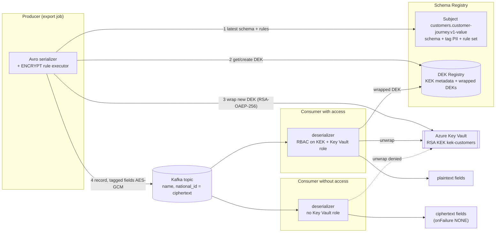
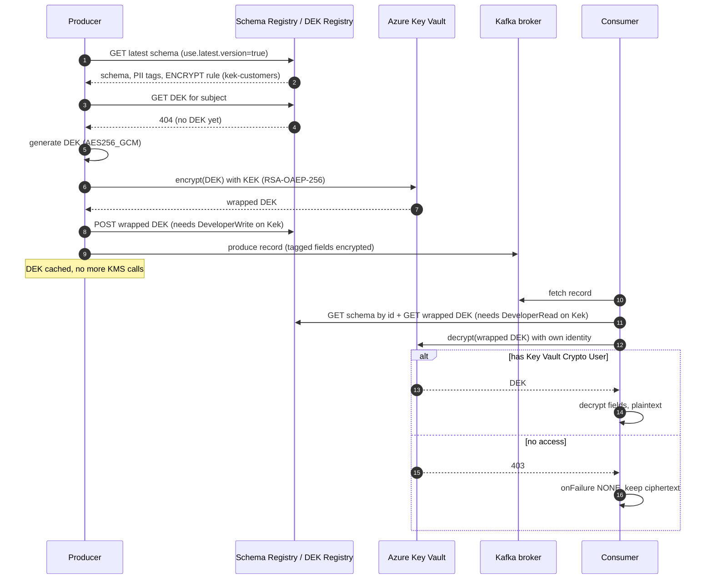
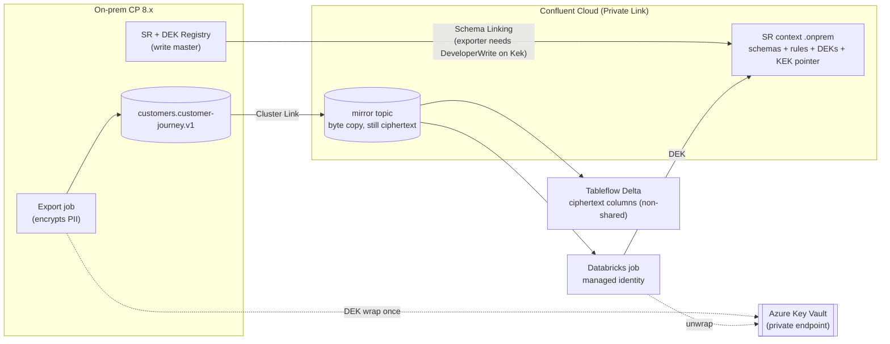

**[V]** = depends on version, licence, region or package; check before you say it as fact.

## 1. What this module is for

- Protect PII fields (customer name, national ID number) so that brokers, Confluent operators, mirror copies in the cloud and consumers without need-to-know see only ciphertext.
- Know the moving parts well enough to answer "where is the key, who can unwrap it, what breaks when it rotates, and what does Databricks see?"
- Know when CSFLE is the wrong tool (minimisation, per-person erasure) so the design does not over-promise.

Course: https://developer.confluent.io/courses/csfle/csfle-overview/ (3 modules, 25 min: overview, envelope encryption, demo).

---

## 2. Core concepts

### 2.1 What layer CSFLE protects

Source: https://developer.confluent.io/courses/csfle/csfle-overview/

| Layer | Protects against | Who still sees plaintext |
|---|---|---|
| TLS in transit | network sniffing | brokers, operators, all consumers |
| Encryption at rest (CC default, BYOK) | stolen disks, cloud storage access | brokers, operators, all consumers |
| **CSFLE** | broker admins, Confluent operators, mirror/replica copies, backups, consumers without key access | **only clients that can unwrap the DEK** |

CSFLE encrypts **selected fields** in the record, in the client serializer, before the record leaves the producer. The rest of the record stays readable, so routing, partitioning by a non-PII key, and most analytics still work.

### 2.2 Envelope encryption

Source: https://developer.confluent.io/courses/csfle/envelope-encryption/

```text
KEK  (Key Encryption Key)  lives in the KMS, never leaves it.
      Azure Key Vault: an RSA key; the client calls Key Vault "encrypt"/"decrypt"
      with RSA-OAEP-256 to wrap/unwrap the DEK.
DEK  (Data Encryption Key) symmetric key that encrypts the field values.
      Default AES256_GCM; AES256_SIV = deterministic; AES128_GCM also allowed.
      Stored only in wrapped (encrypted) form in the DEK Registry.
```

- The **DEK Registry** is part of Schema Registry. It stores KEK metadata (name, KMS type, key id, `shared` flag) and wrapped DEKs, **scoped per subject** (and version on rotation).
- The client unwraps the DEK once with the KMS and **caches** it. The KMS is not on the per-record path.
- The course says envelope encryption combines symmetric crypto with "public-key cryptography". With Azure Key Vault that is literally true (RSA KEK), with AWS/GCP KMS the KEK is usually symmetric. The principle is "a key in the KMS protects the data key", not "public-key crypto".

### 2.3 Tag-driven rules (data contract)

Source: CC/CP CSFLE docs (sources §7).

1. Tag the field in the schema: `"confluent:tags": ["PII"]` (inline), or attach a tag via Stream Catalog. In Confluent Cloud the tag must first exist as a **tag definition** in Stream Catalog.
2. Add an **encryption rule** to the subject's rule set:

```json
{
  "ruleSet": {
    "domainRules": [{
      "name": "encrypt-pii",
      "kind": "TRANSFORM",
      "type": "ENCRYPT",
      "mode": "WRITEREAD",
      "tags": ["PII"],
      "params": {
        "encrypt.kek.name": "kek-customers",
        "encrypt.kms.type": "azure-kms",
        "encrypt.kms.key.id": "https://kv-x.vault.azure.net/keys/kek-customers/<version>",
        "encrypt.dek.expiry.days": "90"
      },
      "onFailure": "ERROR,NONE"
    }]
  }
}
```

3. Producers run with `auto.register.schemas=false` and `use.latest.version=true` so they pick up the registered schema **with** its rules. This is the normal rule for governed topics: producers never register schemas themselves.
4. The serializer finds tagged fields, gets or creates the DEK for the subject, encrypts each tagged field value, writes the record. The deserializer does the reverse.

Rule parameters you should know: `encrypt.kek.name` (required), `encrypt.kms.type` (`azure-kms`, `aws-kms`, `gcp-kms`, `hcvault`, `local-kms` for testing), `encrypt.kms.key.id`, `encrypt.dek.algorithm`, `encrypt.dek.expiry.days`, `preserve.source.fields`.

`onFailure: "ERROR,NONE"`: first value for write (encryption failure → producer error; never send plaintext by accident), second for read (decryption failure → pass the ciphertext through instead of failing the consumer).

### 2.4 Client configuration for Azure Key Vault

Source: CSFLE configuration parameters (CC and CP).

| Setting | Value |
|---|---|
| Dependency (Java) | `io.confluent:kafka-schema-registry-client-encryption-azure` next to the Avro/JSON/Protobuf serializer |
| Credentials | `rule.executors._default_.param.tenant.id`, `…client.id`, `…client.secret`; or env `AZURE_TENANT_ID`, `AZURE_CLIENT_ID`, `AZURE_CLIENT_SECRET`; or nothing → **Azure default credential chain** (managed identity, workload identity on AKS/ARO) |
| Key Vault permissions | encrypt + decrypt on the key (built-in role **Key Vault Crypto User** covers it), Key Vault with Azure RBAC |
| Key id | the Key Vault **key identifier URI**. Prefer the **versioned** URI, or set `encrypt.azure.key.version.save=true` (see rotation) |
| Client versions | Java 7.4.5 / 7.5.4 / 7.6.1+ (7.7+ for CP 7.7 clusters), Go 2.5.0+, .NET 2.5.0+, Python 2.8.0+, JS SR client 0.2.1+ **[V]** |

In production, use **managed identity / workload identity** for the Key Vault call, not a client secret in a properties file.

### 2.5 Shared vs non-shared KEK — the trust decision

Source: CC CSFLE overview https://docs.confluent.io/cloud/current/security/encrypt/csfle/overview.html

| | **Non-shared KEK** (default) | **Shared KEK** |
|---|---|---|
| Who calls the KMS | each client, with its own Azure identity | the DEK Registry (Confluent) can call your KMS |
| Can Confluent decrypt? | no — sees only KEK id and wrapped DEKs | technically yes (temporarily, for processing) |
| Consumer needs | Confluent RBAC on the KEK **and** Azure RBAC on the key | Confluent RBAC on the KEK only |
| CC Flink | only limited operations on deterministically encrypted fields | can process decrypted data |
| Managed connectors | cannot decrypt | can decrypt with RBAC on the KEK |
| Tableflow | tagged fields stay **ciphertext columns** | tagged fields become **plaintext columns** |
| HashiCorp Vault Transit | supported | not supported |
| On CP | the only option ("sharing KEK access is not supported") | — |

You can move from shared to non-shared later. Choosing shared moves Confluent inside the trust boundary for those fields; for customer PII that is a decision for the CISO and DPO, not for the platform team alone.

### 2.6 What a consumer without key access sees

Two independent checks, both must pass to read plaintext (non-shared KEK):

| Check | Controlled by | If it fails |
|---|---|---|
| Read the wrapped DEK from the DEK Registry | Confluent RBAC: `DeveloperRead` on `Kek:<name>` (and on the subject) | cannot get the DEK |
| Unwrap the DEK | Azure RBAC on the Key Vault key | cannot unwrap |

With `onFailure: "...,NONE"` the consumer receives the record with the tagged fields **still encrypted** (for a string field: a base64 ciphertext string). With `...,ERROR` the consumer throws on that record. A consumer that has no encryption rule executor on the classpath also gets ciphertext. A consumer using a plain byte/string deserializer sees the Avro bytes with ciphertext inside. The Confluent Console shows ciphertext.

**Do not use a DLQ for decryption failures** with the current CSFLE version (CP docs warning) — a DLQ copy may land where it should not.

### 2.7 Key rotation and deletion

Source: Manage keys for CSFLE (CC/CP).

| Action | How | Note |
|---|---|---|
| **DEK rotation** | `encrypt.dek.expiry.days` in the rule params | New DEK for new records after expiry; old DEKs stay for old records. DEK Registry keeps up to **10,000 DEKs** — do not set 1 day on 500 subjects. |
| **KEK rotation** | rotate the key in Key Vault (new version), then **rewrap** DEKs (`rewrap-deks` command or DEK API with `rewrap=true`) | **Azure pitfall:** a versionless key URI resolves to the *latest* version; after rotation old wrapped DEKs may no longer unwrap. Use a versioned URI or `encrypt.azure.key.version.save=true`, rewrap, then rotate. The Java client logs a warning for versionless URIs. |
| **Revoke a consumer** | remove its Azure role on the key, or its RBAC on the KEK | takes effect when its cached DEK/token expires or it restarts |
| **Delete keys** | delete/re-encrypt DEKs first, then the KEK in the KMS | deleting a DEK makes **every record under it** unreadable |

**Crypto-shredding is per subject (and DEK period), not per person.** CSFLE does not give you GDPR erasure for one customer. For that you need a different design: pseudonymous ids with a separate lookup store you can delete from, or short retention.

### 2.8 Performance and size

Source: course overview + CP/CC docs.

- CPU: AES-GCM per field is cheap; the cost grows with the number of encrypted fields per record. KMS round trips happen at DEK creation/unwrap, then the DEK is cached.
- Startup latency: first record per subject waits for the DEK Registry + Key Vault call. Key Vault throttling is per vault **[V]**; many short-lived clients (serverless functions, per-batch Spark tasks) can hit it.
- Size: ciphertext adds a nonce + auth tag per field, and string fields are stored base64 (about +33%).
- **Compression gets worse**: encrypted bytes look random. Expect lower zstd/lz4 ratios on topics with many encrypted fields — that is a cost point for ExpressRoute and Confluent per-GB charges.

### 2.9 Requirements

| Platform | Requirement |
|---|---|
| Confluent Cloud | **Stream Governance Advanced** package on the environment (any cluster type, CSFLE is client-side) **[V]** |
| Confluent Platform | current docs: **Confluent Enterprise 8.0+ with the CSFLE Add-On**; the Enterprise licence key is also used as the add-on licence. Schema Registry needs `resource.extension.class=io.confluent.kafka.schemaregistry.rulehandler.RuleSetResourceExtension,io.confluent.dekregistry.DekRegistryResourceExtension`, `confluent.license=…`, `confluent.license.addon.csfle=…`; `dek.registry.rbac.enable=true` to enforce RBAC on KEKs **[V]** |
| CP RBAC | role bindings on `Kek:<name>`; DEK operations are authorised through the KEK binding plus subject scope |

### 2.10 Hybrid: on-prem producer, cloud consumer

Source: Schema Linking docs (CC).

- Mirror topics are **byte copies**: encrypted fields stay encrypted in Confluent Cloud. Good.
- **Schema Linking copies the rule sets, the DEKs and pointers to the KEKs** to the destination registry. The KEK itself is never copied. The exporter principal needs `DeveloperWrite` (or `ResourceOwner`) on each referenced **KEK** in the destination, not only on subjects; without it the exporter goes `PAUSED` with "denied operation Register on Kek".
- So a cloud consumer reads the mirror topic, gets the DEK from the **cloud** registry, and unwraps it with **Azure Key Vault** using its own managed identity. No call back into the DC.
- The producer side (on-prem) needs outbound HTTPS to Key Vault (ideally a Key Vault private endpoint over ExpressRoute) only when a DEK is created or first unwrapped.

### 2.11 Downstream: Flink, Tableflow, Databricks, connectors

| Consumer | Non-shared KEK | Shared KEK |
|---|---|---|
| CC Flink | cannot decrypt; can group/join on **deterministically** encrypted fields (AES256_SIV) | can process decrypted data |
| Tableflow → Delta/Iceberg | tagged fields land as **ciphertext columns** | tagged fields land as **plaintext columns** — the table is now the protected asset, govern it in Unity Catalog |
| Databricks Structured Streaming with `from_avro` | Spark's `from_avro` does **not** run Confluent rules → ciphertext. To decrypt you need the Confluent Java deserializer (a UDF or `foreachBatch`) with a Databricks identity that has Key Vault Crypto User **[V]** | same — Databricks is not Confluent; only Tableflow/Flink benefit from sharing |
| Managed connectors (CC) | cannot decrypt | can decrypt with RBAC on the KEK; the supported connector list was extended in Dec 2025 **[V]** |
| ksqlDB, CP Flink | cannot operate on encrypted fields | n/a on CP |

The practical pattern for analytics: encrypt the join key **deterministically** (same plaintext → same ciphertext), so analysts can count and join customers without ever decrypting. Decrypt only in a small, audited job.

### 2.12 When not to use CSFLE

- If the cloud consumer does not need the field, **remove it** (curated topic via Flink/Streams on-prem). Minimisation beats encryption: do not replicate raw PII.
- If you need per-person erasure (see 2.7).
- If every consumer needs plaintext anyway and they all live inside one trust zone — then at-rest + RBAC may be enough, and CSFLE is cost without benefit.

---

## 3. Diagrams

### 3.1 Encrypt and decrypt flow



### 3.2 First write and first read (sequence)



### 3.3 Hybrid with Schema Linking



---

## 4. Changed since the course

| Course says / implies | Current state (2026-11) | Source |
|---|---|---|
| Envelope encryption = symmetric + public-key crypto | Principle is KMS-held KEK wraps a symmetric DEK. Azure KEK is RSA (RSA-OAEP-256); AWS/GCP KEKs are typically symmetric | Confluent `AzureKmsClient` source; CC docs |
| CSFLE launched (2024) in early access for Java, Go, .NET; Python/JS planned | GA; **Python 2.8+** and **JS** SR client supported **[V]** | CP client-side doc |
| Key sharing presented as a trade-off | Formalised as **shared vs non-shared KEK**, with defined effects on Flink, Tableflow and managed connectors | CC overview |
| Fully managed connectors: always shared KEK | Still true; supported connector set extended Dec 2025 **[V]** | CC release notes |
| CP requirement (earlier docs: CP 7.4.x+ Enterprise) | **Confluent Enterprise 8.0+ with CSFLE Add-On licence** per current docs **[V]** | CP client-side doc |
| No word on Azure key versions | **Versionless Key Vault URIs** can break after rotation → `encrypt.azure.key.version.save` + rewrap | CC manage-keys; client source |
| No word on RBAC for keys | RBAC on **KEK** resources (CC and CP `dek.registry.rbac.enable`); Schema Linking exporters need KEK roles | CC/CP docs |
| No word on Tableflow | Tableflow keeps ciphertext (non-shared) or decrypts (shared) | CC overview |
| Demo uses CP 7.x console tools with `--broker-list` | Kafka 4.x / CP 8.x tools use `--bootstrap-server`; newer tools deprecate `--property` for `--reader-property`/`--formatter-property` **[V]** | Kafka docs |

---

## 5. In practice

This section assumes an organisation that runs mission-critical Confluent Platform on-prem in two data centres and wants to serve cloud (Azure) data and AI consumers without touching the operational clusters.

- **First minimise, then encrypt.** An on-prem export job (Flink or Streams on OpenShift) builds `customers.customer-journey.v1` from operational topics: drop fields nobody in the cloud needs, pseudonymise the customer id, and encrypt the few PII fields that must travel (name, national ID number). Raw operational topics never enter the Cluster Link filter.
- **Encrypt in the platform-owned export job, not in mission-critical producers.** Then order or tracking producers never depend on Key Vault availability; only the export job does, and only when a DEK is created or unwrapped.
- **KEK placement:** non-shared KEK in **Azure Key Vault** (Managed HSM for prod **[V]** on price), one KEK per data domain and classification (`kek-customers-confidential`), owned by Security, not by the platform team. Reach Key Vault from the DC through its private endpoint over ExpressRoute. If data-sovereignty rules out a US cloud KMS, the alternative is an on-prem HSM or HashiCorp Vault Transit (non-shared only) — but then every Azure consumer needs a network path into the DC for key unwraps, which undoes part of the "nothing reaches into the DC" design. State this trade-off; do not hide it.
- **Schema Linking must carry the keys:** grant the exporter `DeveloperWrite` on the KEK in Confluent Cloud, or mirror topics arrive with no usable DEKs.
- **Data platform teams / Databricks:** the first analytics layer (Tableflow Delta in Unity Catalog) shows **ciphertext columns** for PII with a non-shared KEK — exactly what most analysts should see. Use **AES256_SIV deterministic** encryption on the pseudonymous customer key so joins and distinct counts work. The rare job that needs plaintext runs as a dedicated Databricks service principal with Key Vault Crypto User and the Confluent deserializer, and is audited.
- **Shared KEK only by explicit decision:** if the data teams want CC Flink to transform decrypted PII or Tableflow to land plaintext, that is a CISO/DPO decision because Confluent can then decrypt.
- **Governance hook:** policy-as-code in the topic PR: a subject with a field tagged `PII` must have an ENCRYPT rule, or the topic cannot enter the link filter.

Questions an architect asks the team that owns the platform:

- Which fields in the topics planned for the cloud are PII, and who decided that?
- Who owns the KEK, and who approves a new Key Vault role assignment?
- Is a US cloud KMS acceptable for this data, or is an on-prem key store required?
- Which consumers really need plaintext, and how is that job audited?

---

## 6. Check yourself

**Q1. How does CSFLE work, in one minute?**
Fields tagged PII in the schema get an ENCRYPT rule in Schema Registry. The producer's serializer creates a data key per subject, wraps it with a KEK in Azure Key Vault, stores the wrapped key in the DEK Registry, and encrypts the tagged fields with AES-GCM. A consumer gets the wrapped key from the registry, asks Key Vault to unwrap it with its own identity, and decrypts. Brokers and Confluent only ever see ciphertext.

**Q2. What does a consumer without key access see?**
The record arrives; non-PII fields are readable; tagged fields stay as ciphertext if the rule's read failure mode is `NONE`, or the consumer errors if it is `ERROR`. There are two checks: Confluent RBAC on the KEK to read the wrapped DEK, and Azure RBAC on the Key Vault key to unwrap it. With a non-shared KEK both must pass.

**Q3. Shared or non-shared KEK for customer data?**
Non-shared by default: Confluent sees only the KEK id and wrapped DEKs. The price is that CC Flink and managed connectors cannot decrypt, and Tableflow lands ciphertext columns. Shared is a deliberate decision to put Confluent in the trust boundary for those fields, made by Security and the DPO.

**Q4. On-prem producers encrypt; how does a Databricks job in Azure decrypt a mirror topic?**
Cluster Linking copies bytes, so the fields stay encrypted. Schema Linking copies the rule set and the wrapped DEKs plus a pointer to the KEK into the cloud registry — the exporter needs DeveloperWrite on the KEK there. The job uses the Confluent deserializer (Spark `from_avro` does not run rules) and unwraps via Key Vault with its managed identity. No call back to the DC.

**Q5. (Hard) Security rotates the Key Vault key. What breaks?**
If the rules use a **versionless** key URI, DEKs wrapped with the old version may fail to unwrap after rotation, and consumers start seeing ciphertext or errors. Use versioned key URIs or `encrypt.azure.key.version.save=true`, rewrap the DEKs after rotating, keep old key versions enabled until rewrap is confirmed. DEK rotation is separate: `encrypt.dek.expiry.days`, with the 10,000-DEK limit in mind.

**Q6. (Hard) GDPR: a customer asks to be erased. Can you crypto-shred them?**
Not with CSFLE alone — DEKs are per subject and period, not per person, so deleting a DEK destroys everyone's data in that window. Per-person erasure needs pseudonymous ids with a deletable mapping table, or short retention on topics holding direct identifiers. CSFLE limits who can read; it is not an erasure mechanism.

**Q7. What does CSFLE cost in performance?**
Per-field AES is cheap; KMS calls are rare because DEKs are cached. The visible costs are bigger records (nonce, tag, base64 for strings), worse compression because ciphertext looks random, and startup latency plus possible Key Vault throttling with many short-lived clients. Encrypt only the fields that need it.

**Q8. Can analysts still join and count customers?**
Yes, if the join key is encrypted with **AES256_SIV** (deterministic): same plaintext, same ciphertext, so joins, group-bys and distinct counts work on ciphertext. CC Flink can do this even with a non-shared KEK. The trade-off is that equal values are visible as equal — acceptable for a pseudonymous id, not for low-cardinality fields like nationality.

**Q9. Why not just encrypt at rest with BYOK?**
BYOK protects disks and the storage layer; brokers, operators and every authorised consumer still read plaintext, and every mirror copy is plaintext too. CSFLE moves the boundary to the client: only identities with the key see the field, wherever the bytes go. They complement each other.

**Q10. Does CSFLE work on our own Confluent Platform?**
Yes, but per current docs it needs Confluent Enterprise 8.0+ with the CSFLE add-on licence, and the DEK Registry extension enabled in Schema Registry **[V]**. Only non-shared KEKs exist on CP. Flink and ksqlDB on CP cannot work on encrypted fields, so do the minimisation and encryption in one export step and keep processing upstream of it.

---

## 7. Sources

- Course: https://developer.confluent.io/courses/csfle/csfle-overview/ · /envelope-encryption/ · /csfle-demo/
- CC CSFLE overview: https://docs.confluent.io/cloud/current/security/encrypt/csfle/overview.html
- CC config parameters: https://docs.confluent.io/cloud/current/security/encrypt/csfle/config-parameters.html
- CC manage keys: https://docs.confluent.io/cloud/current/security/encrypt/csfle/manage-keys.html
- CP CSFLE overview and client-side: https://docs.confluent.io/platform/current/security/protect-data/csfle/overview.html · https://docs.confluent.io/platform/current/security/protect-data/csfle/client-side.html
- CP config parameters: https://docs.confluent.io/platform/current/security/protect-data/csfle/config-parameters.html
- Schema Linking (CSFLE section): https://docs.confluent.io/cloud/current/sr/schema-linking.html
- Azure example: https://github.com/confluentinc/csfle-examples/tree/master/azure
- Terraform example: https://github.com/confluentinc/terraform-provider-confluent/tree/master/examples/configurations/field-level-encryption-schema
- Azure KMS client source (RSA-OAEP-256, versionless warning): https://github.com/confluentinc/schema-registry/tree/master/client-encryption-azure
- Microsoft Learn: Key Vault RBAC roles https://learn.microsoft.com/azure/key-vault/general/rbac-guide · Key Vault throttling https://learn.microsoft.com/azure/key-vault/general/overview-throttling
