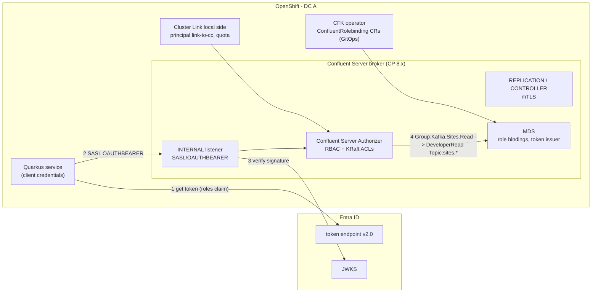

**[V]** = depends on version or licence; check before you say it as fact. Not in the Confluent Cloud course; sources are the CP docs listed at the end.

## 1. What this part is for

- Speak about the **on-prem** clusters with the same precision as the cloud side: how brokers authenticate clients and each other, how RBAC works without ZooKeeper, and where quotas protect mission-critical traffic.
- Line up identity so that the same Entra app roles work on-prem and in Confluent Cloud.

---

## 2. Core concepts

### 2.1 Listeners per traffic class

One listener per kind of traffic, each with its own authentication. Example for a broker on OpenShift:

| Listener | Port | Security | Who |
|---|---|---|---|
| `INTERNAL` | 9092 | SASL_SSL + OAUTHBEARER (Entra) | applications in the DC (the ESB's Camel routes, Quarkus services) |
| `REPLICATION` | 9093 | SSL with **mTLS** | inter-broker traffic |
| `CONTROLLER` | 9094 | SSL with mTLS | KRaft controller quorum (controllers only) |
| `LINK` (optional) | 9095 | SASL_SSL + OAUTHBEARER or mTLS | the source-initiated Cluster Link's local side, separately quota'd and monitored |
| `ADMIN` | 9096 | mTLS | platform automation, CFK operator |

Benefits: a firewall rule per class, separate metrics, and you can change client auth without touching replication.

### 2.2 mTLS

- `ssl.client.auth=required` on the listener; the principal comes from the certificate subject. Map it with `ssl.principal.mapping.rules`, for example `RULE:^CN=([a-zA-Z0-9.-]+),OU=kafka.*$/$1/L,DEFAULT`.
- Use a **private CA** (cert-manager on OpenShift, or the corporate PKI). Public CAs are removing the `clientAuth` EKU in 2026.
- Strong for machine-to-machine inside the platform (brokers, controllers, CFK, Connect). Weak for 200 application teams: certificate issuing, rotation and revocation (CRL/OCSP) become your problem, and the principal is a CN, not an Entra identity.
- Kafka 4.x/CP 8.x: TLS 1.3 is the default protocol where both sides support it **[V]**.

### 2.3 SASL/OAUTHBEARER with Entra ID

Source: https://docs.confluent.io/platform/current/security/authentication/oauth-oidc/configure-entra-id.html and configure-cs.

Broker (Confluent Server) listener config:

```properties
listener.name.internal.sasl.enabled.mechanisms=OAUTHBEARER
listener.name.internal.sasl.oauthbearer.jwks.endpoint.url=https://login.microsoftonline.com/<tenant>/discovery/v2.0/keys
listener.name.internal.sasl.oauthbearer.expected.audience=<api-app-client-id>
listener.name.internal.sasl.oauthbearer.sub.claim.name=sub
listener.name.internal.principal.builder.class=io.confluent.kafka.security.authenticator.OAuthKafkaPrincipalBuilder
# with RBAC:
listener.name.internal.oauthbearer.sasl.server.callback.handler.class=io.confluent.kafka.server.plugins.auth.token.CompositeBearerValidatorCallbackHandler
# without RBAC:
# listener.name.internal.oauthbearer.sasl.server.callback.handler.class=org.apache.kafka.common.security.oauthbearer.OAuthBearerValidatorCallbackHandler
confluent.oauth.groups.claim.name=groups     # or roles — see 2.5
```

- In KRaft mode the principal builder and the groups setting are also needed on **controller** nodes.
- Entra app registration: `requestedAccessTokenVersion: 2`, issuer `https://login.microsoftonline.com/<tenant>/v2.0`, token endpoint `…/oauth2/v2.0/token`, scope `<Application ID URI>/.default`. One app registration per client, not shared.
- Clients (Java, Kafka 4.x):

```properties
security.protocol=SASL_SSL
sasl.mechanism=OAUTHBEARER
sasl.login.callback.handler.class=org.apache.kafka.common.security.oauthbearer.OAuthBearerLoginCallbackHandler
sasl.oauthbearer.token.endpoint.url=https://login.microsoftonline.com/<tenant>/oauth2/v2.0/token
sasl.jaas.config=org.apache.kafka.common.security.oauthbearer.OAuthBearerLoginModule required \
  clientId="<client-app-id>" clientSecret="<secret>" scope="api://kafka-prod/.default";
# JVM: -Dorg.apache.kafka.sasl.oauthbearer.allowed.urls=https://login.microsoftonline.com/<tenant>/oauth2/v2.0/token,https://login.microsoftonline.com/<tenant>/discovery/v2.0/keys
```

- The **allowed URLs system property** applies to brokers too (they fetch the JWKS). Since Kafka 4.0 the default is an empty list (CVE-2025-27817 fix). Forgetting it is the classic failure after the CP 8 upgrade.
- **Dependency on Entra**: brokers cache the JWKS; clients need Entra to get new tokens (lifetime about an hour). An Entra outage longer than token lifetime stops new connections. For mission-critical producers (for example order and tracking events) decide consciously: OAuth with a long enough token lifetime and good alerting, or mTLS for those few services so operations do not stop when the cloud IdP has a bad hour. Raise this point early in the design.

### 2.4 Confluent Server RBAC with MDS

Source: CP RBAC overview, configure MDS for OAuth.

- **Metadata Service (MDS)** runs inside Confluent Server brokers. It is the system of record for role bindings, issues tokens to CP components, and serves the RBAC REST API that the `confluent` CLI and Control Center use.
- The **Confluent Server Authorizer** checks both RBAC role bindings and ACLs: `authorizer.class.name=io.confluent.kafka.security.authorizer.ConfluentServerAuthorizer`, `confluent.authorizer.access.rule.providers=CONFLUENT,KRAFT_ACL` in KRaft mode (was `ZK_ACL` before) **[V]**.
- User store: `confluent.metadata.server.user.store=OAUTH` (IdP only) or `LDAP_WITH_OAUTH` (both, for migration). OAuth settings: `confluent.metadata.server.oauthbearer.jwks.endpoint.url`, `…expected.issuer` (must match `iss` exactly — v1/v2 mismatch again), `…expected.audience`, `…sub.claim.name`, `…groups.claim.name`.
- Same role names as in CC: `SystemAdmin`, `UserAdmin`, `ClusterAdmin`, `Operator`, `SecurityAdmin`, `ResourceOwner`, `DeveloperRead/Write/Manage`, `AuditAdmin` … with prefix resource patterns (`--resource Topic:orders. --prefix`).
- Schema Registry, Connect, ksqlDB, REST Proxy and Control Center integrate with MDS for RBAC; components with REST endpoints do **not** accept mTLS-derived principals for RBAC (they need basic auth or tokens).
- Requires the commercial **confluent-server** component (Enterprise licence). Strimzi / Apache Kafka have ACLs only.
- On OpenShift: CFK has CRs for RBAC (`ConfluentRolebinding`) so bindings live in Git and ArgoCD applies them.

### 2.5 Aligning on-prem RBAC with Entra and with CC

- `confluent.oauth.groups.claim.name` tells the broker which claim holds group membership. RBAC can bind to `Group:<value>`.
- For workloads (client credentials), **use the `roles` claim** as the "groups" claim: set `confluent.oauth.groups.claim.name=roles`, bind `Group:Kafka.Sites.Read` → `DeveloperRead` on `Topic:sites.` (prefix). Same reasons as in CC: app roles must be assigned directly to the SP, groups overage, groups are GUIDs **[V]** (test that the broker accepts a non-`groups` claim name as group source).
- Result: **one Entra app role = one access pattern, on-prem and in the cloud.** In CC the role is a pool filter; on-prem it is a `Group:` principal. Same governance flow (data-product owner approves the role assignment).

### 2.6 Quotas on-prem — including the Cluster Link

Kafka quotas on CP are richer than in CC:

| Quota | Entity | Use |
|---|---|---|
| `producer_byte_rate`, `consumer_byte_rate` | user and/or client-id | throughput ceilings |
| `request_percentage` | user and/or client-id | CPU time on network/IO threads — protects against chatty clients |
| `controller_mutation_rate` | user | limits topic/partition creation storms |
| Cluster Link: link config `cluster.link.quota…` / quota on the link principal **[V]** | link | a cloud catch-up after an outage cannot saturate brokers |

```bash
kafka-configs --bootstrap-server broker:9096 --command-config admin.properties --alter \
  --add-config 'consumer_byte_rate=52428800,request_percentage=25' \
  --entity-type users --entity-name 'link-to-cc'
```

Source-initiated link: the reads happen on the on-prem brokers under the **local principal of the link**. Quota that principal. Also set replica fetch limits if mirror reads compete with ISR replication.

### 2.7 Audit logs on CP

- Confluent Server writes structured audit events (CloudEvents) to `confluent-audit-log-events`, configurable with `confluent audit-log config` via MDS (routes per resource and event type, destinations can be another cluster).
- Default captures authorization **denials** and management operations; allowed produce/consume are opt-in per route because of volume **[V]**.
- Ship to Splunk with the Splunk sink connector or the Splunk OpenTelemetry/ HEC path.

### 2.8 Encryption at rest on-prem

- Kafka has no built-in at-rest encryption. Use encrypted storage (OpenShift Data Foundation / storage-class encryption, LUKS) and for tiered storage the object store's encryption.
- For fields that leave the DC: CSFLE (module 04).

---

## 3. Diagram — on-prem identity and authorization path



---

## 4. Changed (for people who learned CP security on 6.x/7.x)

| Then | CP 8.x (Kafka 4.x) |
|---|---|
| ZooKeeper ACLs (`ZK_ACL`), ZK SASL/TLS config | **KRaft only**; ACLs in the metadata log (`KRAFT_ACL`); controller listener security is now part of the design **[V]** |
| Java OAuth clients could call any token URL | **allowed URLs** system property required (default empty) |
| MDS user store mostly LDAP | **OAuth-only** (`OAUTH`) or `LDAP_WITH_OAUTH` |
| Kafka 4.0 removed old client protocol versions | audit client versions before upgrading (very old clients cannot connect) |
| Confluent MQTT Proxy, ZooKeeper-based tools | removed or deprecated |

---

## 5. Check yourself (CP side)

**Q1. mTLS or OAuth on-prem?**
Both, by traffic class. mTLS for brokers, controllers, the operator and possibly the few most critical producers, because it has no runtime dependency on a cloud IdP. OAuth with Entra for application teams, because identity, access requests and offboarding then follow Entra, and the same app roles work in Confluent Cloud.

**Q2. (Hard) Entra is down for two hours. What happens to Kafka on-prem?**
Existing connections keep working until re-authentication; brokers have the JWKS cached. Clients cannot get new tokens, so new connections and re-auth after token expiry (about an hour) fail. That is why the most critical producers either use mTLS or have token lifetime, re-auth settings and alerting designed for it — a deliberate decision, not a default.

**Q3. How does RBAC work without ZooKeeper?**
MDS in Confluent Server keeps role bindings; the Confluent Server Authorizer evaluates RBAC and ACLs, with ACLs stored in the KRaft metadata log. CFK manages role bindings as Kubernetes resources, so they sit in Git and ArgoCD applies them. It needs Confluent Server (Enterprise licence) — Strimzi only has ACLs.

**Q4. How do you keep on-prem and cloud permissions consistent?**
One Entra app role per access pattern. In Confluent Cloud the role is in an identity pool filter; on-prem the broker reads the `roles` claim as groups and RBAC binds `Group:<role>`. Terraform (CC) and CFK CRs (on-prem) are generated from the same data-product definition.

**Q5. How do you protect brokers from the Cluster Link catching up after an outage?**
Quota the link's local principal (byte rate and request percentage), give it its own listener so it is visible in metrics, and alert on link lag rather than throttle time. Cloud consumers never read on-prem directly, so the link is the only cloud-driven load.

---

## 6. Sources

- Configure Entra ID for OAuth on CP: https://docs.confluent.io/platform/current/security/authentication/oauth-oidc/configure-entra-id.html
- Configure Confluent Server brokers for OAuth: https://docs.confluent.io/platform/current/security/authentication/oauth-oidc/configure-cs.html
- Configure MDS for OAuth: https://docs.confluent.io/platform/current/security/authentication/oauth-oidc/configure-mds.html
- RBAC overview: https://docs.confluent.io/platform/current/security/authorization/rbac/overview.html
- Kafka quotas: https://kafka.apache.org/documentation/#design_quotas
- Kafka 4.x system properties (allowed URLs): https://kafka.apache.org/42/configuration/system-properties/
- CP audit logs: https://docs.confluent.io/platform/current/security/compliance/audit-logs/audit-logs-concepts.html
- CFK RBAC: https://docs.confluent.io/operator/current/co-rbac.html
