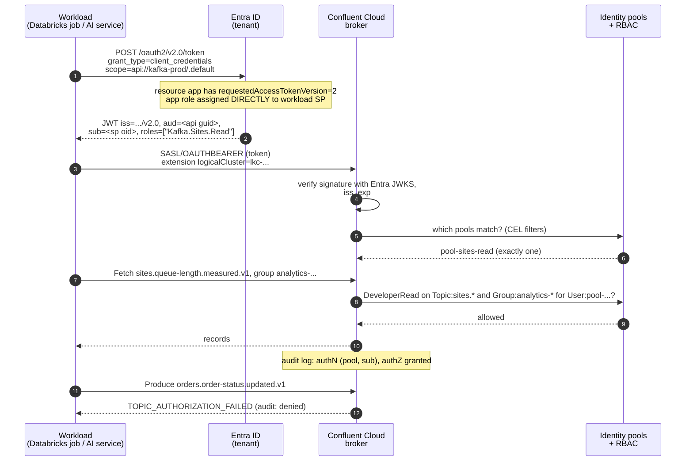
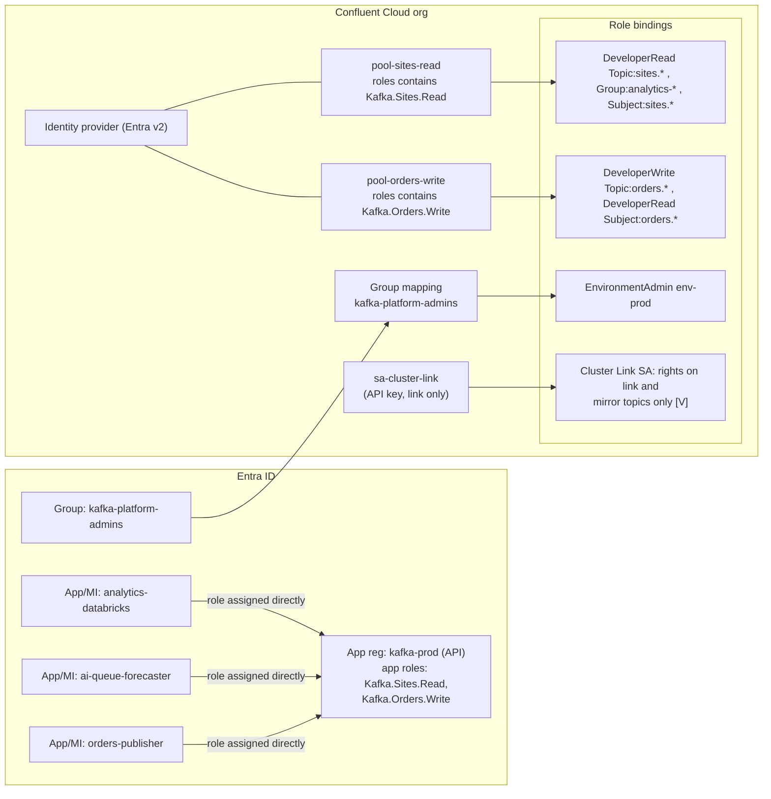

**[V]** = depends on version, cluster type, region or package; check before you say it as fact.

## 1. What this module is for

- Design identity and access for many teams (data & analytics, AI apps, operational domains, partners) on Confluent Cloud with Entra ID as the identity provider, not API keys everywhere.
- Know which security feature exists on which cluster type — several do not exist on Basic, and quotas only exist on Enterprise/Dedicated/Freight.
- Have precise answers for the Entra pitfalls: v2 tokens, client-credentials + app roles, group overage.

Course: https://developer.confluent.io/courses/cloud-security/intro/ (11 short lessons, 42 min). CP-side: see `notes-cp-security.md`.

---

## 2. Core concepts

### 2.1 Who can be a principal in Confluent Cloud

Source: https://developer.confluent.io/courses/cloud-security/authentication/

| Principal | For | Authenticates with | RBAC principal string |
|---|---|---|---|
| User account | people (Console, CLI) | Confluent login or **SSO** (SAML/OIDC, e.g. Entra) | `User:u-xxxx` |
| Group mapping | SSO users by IdP group | SSO group claim | `User:group-xxxx` |
| Service account | applications | **API key** (SASL/PLAIN) | `User:sa-xxxx` |
| **Identity pool** | applications | **OAuth/OIDC JWT** (SASL/OAUTHBEARER) | `User:pool-xxxx` |
| Certificate identity pool | applications | **mTLS** client certificate | `User:pool-xxxx` |

### 2.2 API keys

Source: course authentication lesson + API key docs.

- **Resource-specific keys**: one key = one Kafka cluster, or one Schema Registry, Flink region, ksqlDB, Tableflow. **Cloud API keys**: org-level management API (Terraform, CLI automation).
- Owned by a user or a service account; the owner's role bindings/ACLs decide what the key may do.
- Long-lived shared secrets. Rotation = create the second key, roll clients, delete the first. Easy to leak into repos and CI logs.
- Fine for: Terraform's Cloud API key (held in a vault), the Cluster Link credential, quick labs, Basic clusters (no OAuth there).

### 2.3 OAuth/OIDC with identity pools

Source: https://docs.confluent.io/cloud/current/security/authenticate/workload-identities/identity-providers/oauth/overview.html

```text
Identity provider  = issuer URI + JWKS URI (Entra tenant)
Identity pool      = identity_claim (who it is in audit logs, default claims.sub)
                   + CEL filter on token claims (who may use this pool, max 300 chars)
Role bindings      = to User:pool-xxxx
```

| Fact | Detail |
|---|---|
| Cluster types | **Standard, Enterprise, Dedicated, Freight. Not Basic.** |
| Token | JWT access tokens only, validated against the JWKS |
| Client minimums | Apache Kafka client 3.2.1+, CP 7.2.1+, librdkafka 1.9.2+ |
| SASL extensions | `logicalCluster` (cluster id), `identityPoolId` (optional now) |
| **Auto pool mapping** | omit `identityPoolId` → token is matched against all pools; the client gets the **union** of matching pools' permissions |
| Quotas + pools | **client quotas only work when exactly one pool matches** — design filters to be mutually exclusive |
| Identity pool ACLs | manageable only by CLI/REST, not the Console |
| Schema Registry | also accepts OAuth: `bearer.auth.credentials.source=OAUTHBEARER` (own client id/secret) or `SASL_OAUTHBEARER_INHERIT` (reuse the Kafka login) + `bearer.auth.logical.cluster=lsrc-…`, `bearer.auth.identity.pool.id` |
| Kafka 4.x Java clients | must allow the token endpoint by JVM system property: `-Dorg.apache.kafka.sasl.oauthbearer.allowed.urls=https://login.microsoftonline.com/<tenant>/oauth2/v2.0/token` (default is an empty list since 4.0; CVE-2025-27817). The first thing that breaks after a client upgrade. |
| Azure workloads | Entra **user-assigned managed identity** is a supported token source — no client secret at all |

### 2.4 Entra ID specifics (the usual follow-up questions)

Sources: CC identity providers doc, CP Entra doc (Microsoft behaviour is the same for both).

**Setup shape:** one app registration represents "Kafka" (the resource/API, e.g. `api://kafka-prod`), with **app roles** like `Kafka.Sites.Read`. Each workload is its own app registration (or managed identity) that requests a token for `api://kafka-prod/.default` with the **client-credentials** grant.

| Pitfall | What happens | Fix |
|---|---|---|
| **v1 tokens** | Default for app registrations: `iss` = `https://sts.windows.net/<tid>/`. Confluent's provider expects `https://login.microsoftonline.com/<tid>/v2.0` → validation fails | Set `requestedAccessTokenVersion: 2` in the **resource** app's manifest (Terraform `api { requested_access_token_version = 2 }`) |
| **Audience** | v2 tokens carry the resource app's **client id (GUID)** as `aud`, not the `api://` URI | Filter on `claims.aud == "<guid>"` |
| **Client credentials + groups** | App roles assigned to a **group** are **not evaluated** when Entra builds the `roles` claim for an application token. A workload SP that is a member of a group that holds the role gets **no role** | Assign app roles **directly to each workload's service principal** (Terraform `azuread_app_role_assignment`) |
| **Group overage** | If a principal is in more groups than fit in a JWT (about 200), Entra drops the `groups` claim and puts an overage marker (`_claim_names`/`hasgroups`) that needs a Graph call. Confluent does not call Graph → **sees no groups** → pool filter does not match | Do not filter on `groups` for workloads. Use the **`roles`** claim (one role per access pattern) or "groups assigned to the application" (`groupMembershipClaims: ApplicationGroup`) |
| **Group ids** | `groups` contains **object ids**, not names | If you must use groups, filter on GUIDs and document them |
| **`sub` for apps** | For client credentials `sub` = the workload SP's object id | Good `identity_claim` (stable, appears in audit logs); `azp`/`appid` = client id is an alternative |
| **Secrets** | Client secrets expire (max 2 years); expiry = outage | Managed identity or federated credentials (workload identity on AKS/ARO) |

Recommended pool filter for a workload pool:

```text
claims.aud == "5f1c…-api-app-client-id" && "Kafka.Sites.Read" in claims.roles
```

One pool per access pattern (read sites, write orders …), one app role per pool. That keeps filters short (300-char limit), mutually exclusive (quotas), and auditable.

For **people**: SSO with Entra, then **group mappings** (Entra group → RBAC). The overage problem exists here too (SAML: 150 groups) — use groups assigned to the Confluent enterprise app.

### 2.5 RBAC

Source: https://developer.confluent.io/courses/cloud-security/rbac-and-acls/ + predefined roles doc.

| Role | Scope | Use |
|---|---|---|
| OrganizationAdmin / EnvironmentAdmin / CloudClusterAdmin | org / env / cluster | platform team only; break-glass |
| AccountAdmin, BillingAdmin, NetworkAdmin | org | separation of duties |
| Operator, MetricsViewer | org/env/cluster | ops and monitoring tools (Datadog reads metrics with MetricsViewer) |
| DataSteward, DataDiscovery | env / org-env | governance team, catalogue browsing |
| FlinkAdmin / FlinkDeveloper | env / compute pool | stream processing teams |
| **ResourceOwner** | topic, group, subject, … (prefix allowed for many types) | a **domain team owns its prefix** (`orders.`) |
| **DeveloperRead / DeveloperWrite / DeveloperManage** | topic, consumer group, subject, transactional id, KEK — **prefix allowed** | application access |
| Assigner | a service account | lets a pool/CI act as an SA |

- Prefix binding in CLI: `--resource Topic:orders. --prefix`; in Terraform: `crn_pattern = "<cluster rbac_crn>/kafka=<lkc>/topic=orders.*"`.
- A consumer needs **DeveloperRead on the topic and on its consumer group** (and on the subject in Schema Registry). Forgetting the group is the most common onboarding ticket.
- **Basic clusters: no RBAC on Kafka resources** (topics, groups). Use ACLs there, or use Standard+.

### 2.6 ACLs

- Classic Kafka ACLs on topics, groups, transactional ids, cluster; ALLOW/DENY; literal or prefixed.
- Use when: Basic clusters; identity-pool or SA rules not expressible as a role (e.g. `IdempotentWrite`, specific `DescribeConfigs`); migrating ACLs 1:1 from on-prem.
- RBAC and ACLs are both evaluated; keep one model per resource to stay auditable. An ACL DENY wins over an allow **[V]**.

### 2.7 Audit logs

Source: https://developer.confluent.io/courses/cloud-security/auditing-and-monitoring/ + audit log docs.

- On by default for **Standard, Enterprise, Dedicated, Freight**. **Basic clusters do not include audit logs.**
- Events go to topic `confluent-audit-log-events` on a separate, Confluent-owned **audit log cluster** for the organisation. Find it with `confluent audit-log describe`. Max **two API keys** on that cluster. Retention **7 days** — replicate (Cluster Linking or a connector) to Splunk/Sentinel for longer.
- Event types: **authentication** (incl. which identity pool and identity claim), **authorization** (allowed/denied with principal, operation, resource), **management** (topic create/delete, ACL and config changes), **organisation** (API keys, role bindings, service accounts). CloudEvents JSON.
- Not every allowed produce/fetch is logged individually — check what is captured by default before promising per-record access logs **[V]**.

### 2.8 Encryption at rest and BYOK

Source: https://developer.confluent.io/courses/cloud-security/encryption/ + BYOK docs.

- All data at rest is encrypted by default with provider-managed keys; TLS 1.2+ in transit.
- **BYOK (self-managed keys)** on Azure: **Dedicated** and **Enterprise** **[V]**; not Freight. Chosen **at cluster creation**, cannot be added later.
- Azure Key Vault requirements: **RSA or RSA-HSM** key, **purge protection on**, Azure RBAC on the vault; Confluent gives a CLI snippet that grants its app **Key Vault Crypto Service Encryption User** + **Key Vault Reader**. Dedicated with vault firewall: allow trusted Microsoft services. **Enterprise: vault must allow public access from all networks** — a point your security team will notice.
- Revoking or deleting the key makes the cluster unusable. Never delete old key versions. After cluster deletion the key is released after a 5-day cool-down.
- BYOK protects storage; operators and authorised clients still see plaintext. For field-level protection see module 04 (CSFLE).

### 2.9 Client quotas

Source: client quotas doc.

| Fact | Detail |
|---|---|
| Cluster types | **Enterprise, Freight, Dedicated** only |
| What | **ingress and egress bytes/second** per principal. No request-rate quota in CC. |
| Principals | service accounts and identity pools (not API keys) |
| Default | one default quota per cluster for principals without a specific one |
| Semantics | each listed principal gets the full value (not shared); enforced at cluster level; a ceiling, not a guarantee; shows up as **throttle latency** on the client |
| Pools | works only when exactly **one** pool matches the client |

### 2.10 Network controls (link to module 02)

Private networking (Private Link) and **IP filtering** (IP groups + operation groups, public traffic only). mTLS on CC: Dedicated clusters on Azure; Enterprise/Freight on AWS **[V]**; uses a private CA uploaded as a certificate authority plus certificate identity pools. Public CAs are removing the `clientAuth` EKU in 2026 — plan a private CA for any mTLS, on-prem too.

---

## 3. Diagrams

### 3.1 OAuth client-credentials flow with Entra ID (sequence)



### 3.2 Principals and bindings for multi-team access



---

## 4. Changed since the course

| Course says / implies | Current state (2026-11) | Source |
|---|---|---|
| Apps authenticate with API keys or OAuth | Also **mTLS** with certificate identity pools (Dedicated on Azure **[V]**); **auto pool mapping** (no pool id needed); Entra **managed identity** as token source | OAuth overview, mTLS doc |
| No cluster-type caveats | OAuth: Standard+ (not Basic). Kafka RBAC: Standard+ (not Basic). Audit logs: Standard+ (not Basic). Quotas: Enterprise/Dedicated/Freight only | OAuth, RBAC, audit, quota docs |
| BYOK = Dedicated | BYOK on **Dedicated and Enterprise** on Azure **[V]**; Enterprise needs a publicly reachable vault | BYOK docs |
| Audit log: three event types | Still auth, authz, org/management; separate audit cluster; 7 days; 2 keys max | audit docs |
| (Not covered) network security | **IP filtering** with operation groups; Private Link via ingress gateway | IP filtering, networking |
| (Not covered) client quotas | Quotas per SA or identity pool, ingress/egress only, Enterprise/Dedicated/Freight | quota doc |
| RBAC roles list | New roles: **NetworkAdmin**, **FlinkAdmin/FlinkDeveloper/FlinkFunctionDeveloper**, **DataSteward/DataDiscovery**, USM roles for registered CP clusters, ParentAdmin | predefined roles doc |
| Kafka client config | Kafka **4.x** Java clients need the **allowed URLs** system property for OAuth endpoints | Kafka 4.0 notes, CVE-2025-27817 |
| Schema Registry auth = API key | SR also accepts OAuth (own token or inherited from Kafka login) | Java client OAuth doc |
| (Not covered) KEK resources | RBAC on **KEKs** for CSFLE | module 04 |

---

## 5. In practice

This section assumes an organisation that runs mission-critical Confluent Platform on-prem in two data centres and serves cloud (Azure) data and AI consumers from a Confluent Cloud landing cluster.

- **Entra ID is the identity source** for both people and workloads. People: SSO + group mappings for the platform team and a small set of read-only roles. Workloads: OAuth identity pools mapped to **app roles**, assigned **directly** to each workload's service principal or managed identity. API keys only for Terraform (Cloud API key in a vault), the Cluster Link credential, and anything on a Basic cluster.
- **One app role per access pattern, one pool per role.** Name roles after data products: `Kafka.Sites.Read`, `Kafka.Orders.Write`. The data-product owner approves the role assignment in Entra (that is the access request), the platform's Terraform owns the pool and the role bindings. A self-service data portal can raise these requests.
- **RBAC by domain prefix**, matching a naming rule like `<domain>.<dataproduct>.<event>.<version>`: domain teams get `ResourceOwner` on their prefix in non-prod, `DeveloperWrite` in prod (topics are created only by the platform pipeline); consumers get `DeveloperRead` on topic prefix + their group prefix (`analytics-`, `ai-`) + subject prefix.
- **Quotas** on the Enterprise landing cluster: a default quota for every principal, larger named quotas for known replay-heavy consumers (analytics backfills). On-prem, the important quota is on the **Cluster Link principal** (see `notes-cp-security.md`). Remember: CC quotas are bytes only; request-rate protection is on-prem only.
- **Audit**: replicate `confluent-audit-log-events` to the SIEM (Splunk, Sentinel) — 7 days is not enough for NIS2 incident investigation. Alert on denied authorizations against PII topics and on role-binding changes.
- **BYOK**: if Security demands it, decide at cluster creation; on Enterprise the vault needs public network access, on Dedicated it can stay behind the firewall with trusted services. That may be what pushes the prod landing cluster to Dedicated.
- **External partners**: no direct Kafka identities in the main org. Expose through the API gateway (for example 3scale) over HTTP/SSE, or a separate cluster/environment with its own identity provider if a partner must use Kafka. Keeps Entra B2B guests out of data-plane RBAC.

Questions an architect asks the team that owns the platform:

- Who approves an app-role assignment, and how long does an access request take today?
- Are app roles assigned directly to service principals, or to groups?
- Where do audit events go, and for how long are they kept?
- Is BYOK a hard requirement, and has that decided the cluster type?

---

## 6. Check yourself

**Q1. API keys or OAuth for application access?**
OAuth with Entra for workloads: short-lived tokens, no secret to rotate when using managed identity, and access follows the app's Entra identity. API keys remain for Terraform's Cloud key, the Cluster Link credential and Basic clusters, which do not support OAuth. Each key is held in a vault and rotated with two-key overlap.

**Q2. How do you map Entra identities to Confluent permissions?**
An identity provider for the tenant (v2 issuer), then identity pools whose CEL filter checks `aud` and an app role in the `roles` claim, one pool per access pattern. RBAC binds to `User:pool-…`, scoped by topic, group and subject prefix. The access request is the app-role assignment in Entra, approved by the data-product owner.

**Q3. (Hard) A team put their service principals in an Entra group and assigned the app role to the group. Tokens have no roles. Why?**
With the client-credentials grant, Entra does not evaluate group-based app role assignments when it builds the `roles` claim; only roles assigned directly to the service principal appear. So the pool filter does not match and authentication fails. Fix: assign the role directly to each SP (Terraform `azuread_app_role_assignment`), or use managed identities with direct assignment.

**Q4. (Hard) Why not filter pools on the `groups` claim?**
Group overage: past about 200 groups, Entra replaces the claim with a pointer to Graph, and Confluent does not call Graph, so the principal appears to have no groups. Groups also arrive as object ids, not names. App roles in the `roles` claim are bounded, named and assigned per app — designed for this.

**Q5. A consumer can read the topic but fails at startup. Most likely?**
Missing `DeveloperRead` on its **consumer group** (or on the Schema Registry subject). Topic permission alone is not enough to commit offsets. Second most likely on Kafka 4.x Java clients: the OAuth token endpoint not listed in `org.apache.kafka.sasl.oauthbearer.allowed.urls`.

**Q6. How do you stop one team's backfill from hurting the others in Confluent Cloud?**
Client quotas on Enterprise/Dedicated: a default per-principal ingress/egress ceiling plus named quotas for known heavy consumers. It needs one pool per client — with auto pool mapping, a token matching two pools gets no quota. On-prem, the stronger control is not letting those consumers connect at all: they read the cloud mirror.

**Q7. What is in the audit log, and is it enough for NIS2?**
Authentication (including identity pool and claim), authorization decisions, management and organisation changes, on Standard+ clusters, in a Confluent-owned audit cluster with 7-day retention. For NIS2 you replicate it to the SIEM, keep it longer, and alert on denied access to classified topics and on role-binding changes. Basic clusters have no audit log — another reason not to run anything real on Basic.

**Q8. BYOK — yes or no?**
If policy requires customer-controlled keys: Dedicated or Enterprise with an RSA key in Key Vault with purge protection, chosen at cluster creation. Know the cost: losing or revoking the key bricks the cluster, and Enterprise needs a publicly reachable vault. BYOK does not hide data from operators or authorised clients — CSFLE does that for specific fields.

**Q9. RBAC or ACLs?**
RBAC with prefixes for people and workloads on Standard+ clusters; it is easier to review per data product. ACLs where RBAC is missing (Basic) or for specific operations, and for a 1:1 migration from on-prem ACLs. Not both on the same resource without a reason, or nobody can answer "who can read this topic?".

**Q10. How do you remove a leaver's or a retired app's access quickly?**
People: disable in Entra — SSO and group mappings follow. Workloads: remove the app-role assignment; new tokens no longer match the pool, existing tokens expire within their lifetime (about an hour) and the broker re-validates on re-authentication. API keys: delete the key — immediate. That difference is one more argument for OAuth plus short token lifetimes.

---

## 7. Sources

- Course: https://developer.confluent.io/courses/cloud-security/intro/ · /authentication/ · /rbac-and-acls/ · /encryption/ · /auditing-and-monitoring/
- OAuth overview: https://docs.confluent.io/cloud/current/security/authenticate/workload-identities/identity-providers/oauth/overview.html
- Identity pools: https://docs.confluent.io/cloud/current/security/authenticate/workload-identities/identity-providers/oauth/identity-pools.html
- Identity providers (Entra v2, `requestedAccessTokenVersion`): https://docs.confluent.io/cloud/current/security/authenticate/workload-identities/identity-providers/oauth/identity-providers.html
- Java client OAuth config: https://docs.confluent.io/cloud/current/security/authenticate/workload-identities/identity-providers/oauth/clients/java-clients.html
- mTLS on CC: https://docs.confluent.io/cloud/current/security/authenticate/workload-identities/identity-providers/mtls/configure.html
- Predefined RBAC roles: https://docs.confluent.io/cloud/current/security/access-control/rbac/predefined-rbac-roles.html
- Audit logs: https://docs.confluent.io/cloud/current/monitoring/audit-logging/cloud-audit-log-concepts.html · configure: https://docs.confluent.io/cloud/current/monitoring/audit-logging/configure.html
- BYOK: https://docs.confluent.io/cloud/current/security/encrypt/byok/overview.html · Azure: https://docs.confluent.io/cloud/current/security/encrypt/byok/byok-azure.html
- Client quotas: https://docs.confluent.io/cloud/current/clusters/client-quotas.html
- Kafka 4.x allowed URLs: https://kafka.apache.org/42/configuration/system-properties/ · CVE-2025-27817
- Microsoft Learn: app roles https://learn.microsoft.com/entra/identity-platform/howto-add-app-roles-in-apps · group claims and overage https://learn.microsoft.com/security/zero-trust/develop/configure-tokens-group-claims-app-roles · access token versions https://learn.microsoft.com/entra/identity-platform/access-tokens
- Terraform: `confluent_identity_provider`, `confluent_identity_pool`, `confluent_role_binding`, `confluent_kafka_client_quota` (provider 2.94.0); example `authentication-using-oauth/azure-entra-id`
