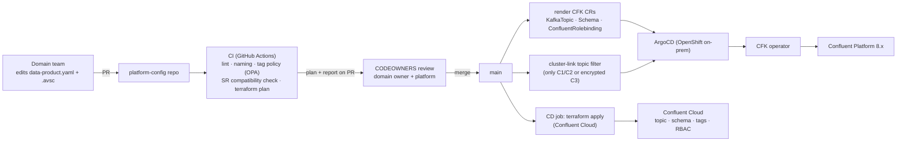
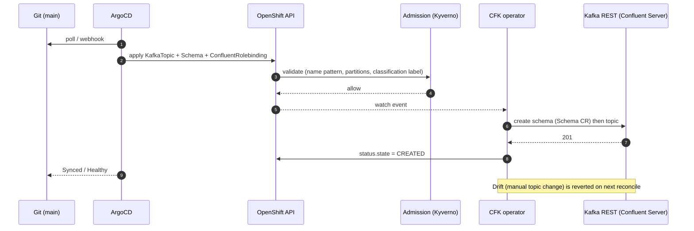
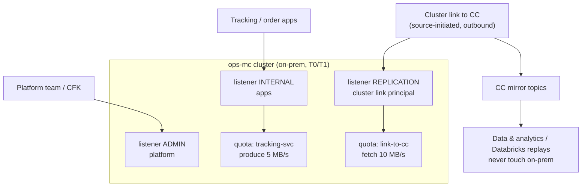

**[V]** = version-, cluster-type- or region-dependent. Check before you say it as fact.
Course: https://developer.confluent.io/courses/data-streaming-systems/overview/ (10 modules).

# 1. What this module is for

- The course covers the step from "it works" to "it runs a business": data, platform, apps,
  continuity, GitOps, operations.
- We add what a **platform team** in a hybrid estate needs: operating model, self-service, quotas,
  isolation, metrics that page someone, chargeback, sizing.
- This is the "how would you run it" half of platform design: operating model, run partners that
  operate platform services, and the controls that keep a shared cluster healthy.

# 2. Core concepts (course, in our words)

## 2.1 Three pillars and five qualities

Source: https://developer.confluent.io/courses/data-streaming-systems/overview/

The course splits a streaming system into **data**, **platform**, **applications**. They depend on
each other: a schema decision (data) changes retention and partitioning (platform) and client
code (apps). Production readiness is judged on five qualities: security, reliability,
performance, operational excellence, cost. The warning that matters most for us: a platform that
is shared without a multi-tenancy plan becomes an **"accidental shared service"** — one cluster,
many teams, no quotas, no owner per topic, and the platform team gets paged for other teams'
mistakes.

## 2.2 Start with the data

Source: https://developer.confluent.io/courses/data-streaming-systems/data-requirements/

Before cluster design, list the data: who produces, who consumes, volume and peak, latency need,
retention, ordering key, classification, and what happens if it is late or lost. This inventory
decides cluster split, replication, retention and cost. For many operational estates the main
finding is the same: **volume is small** (hundreds of msg/s for operations); **criticality,
trust zones and governance** drive the design, not throughput.

## 2.3 Design the platform — scaling pitfalls

Source: https://developer.confluent.io/courses/data-streaming-systems/design-the-streaming-platform/

| Pitfall | Why it hurts | Fix |
|---|---|---|
| Storage and compute coupled | Long retention forces more brokers than CPU needs | Tiered storage (CP) / Infinite Storage (CC) |
| Partition imbalance | Hot brokers after growth or skewed keys; reassignment is manual and moves data | Self-Balancing Clusters (CP) / automatic in CC; key design review |
| Slow provisioning on-prem | Weeks to add brokers before peak | Capacity plan with headroom; OpenShift + CFK to scale out |
| Unplanned multi-tenancy | Noisy neighbours, no chargeback, no owner | Quotas, prefixes + RBAC, cluster split by SLA |
| Too many partitions "for later" | More open files, longer recovery, more controller metadata, consumer overhead | Size from throughput; you can add partitions later (but key→partition mapping changes) |

## 2.4 Plan for business continuity

Source: https://developer.confluent.io/courses/data-streaming-systems/plan-for-business-continuity/

- **Inside a region/site:** multi-zone cluster, RF=3, `min.insync.replicas=2`, `acks=all`.
  Writes survive one zone loss; RPO = 0 for acknowledged writes.
- **Across regions/sites:** async replication → RPO > 0. The course recommends
  **active/passive**, and **fail forward** (stay on DR) over failing back unless there is a reason.
- **Tools:** Cluster Linking (byte-for-byte, offsets kept, consumer offsets synced) + Schema
  Linking (DR registry in IMPORT mode; switch to READWRITE on failover).
- **Measure RTO**, do not assume it: DNS/bootstrap switch, client restarts, offset sync window,
  re-pointing of connectors.

## 2.5 Automate the road to production (GitOps)

Source: https://developer.confluent.io/courses/data-streaming-systems/automate-the-road-to-production/ ·
exercises: https://developer.confluent.io/courses/data-streaming-systems/build-an-event-streaming-platform-with-gitops-exercise/ ·
https://developer.confluent.io/courses/data-streaming-systems/create-an-application-delivery-pipeline-with-gitops-exercise/

- GitOps = desired state in Git, declarative, versioned; an agent **pulls** and reconciles.
- **Two pipelines, two owners:**

| Pipeline | Owner | Manages | Tools |
|---|---|---|---|
| Platform | Platform team | Clusters, networking, SR, Connect workers, RBAC baselines, upgrades | Terraform (CC), CFK CRs + ArgoCD (on-prem) |
| Application / data | Domain teams | Topics, schemas, connectors, role bindings for their apps, app deployments | Golden module / CRs from a template, PR to a config repo |

- Promotion: folder per environment on `main` (`staging/`, `prod/`), promotion = PR that copies
  config; environment-specific bits in a folder that promotion skips. Rollback = revert commit.
- Rules: separate Dev/Staging/Prod/DR; no `latest` tags; no manual `kubectl`/console changes;
  infrastructure applied by service accounts, not people.

## 2.6 Operating the platform

Source: https://developer.confluent.io/courses/data-streaming-systems/operating-the-platform/

Monitor throughput, latency, errors, resources (JMX on CP; Metrics API on CC). Alert on
thresholds, detect anomalies (e.g. someone changes a topic's RF), do post-mortems that improve
dashboards. Keep **clients up to date** — old clients cause broker problems. Most client defaults
favour latency over throughput; review them per workload.

## 2.7 Productionizing applications

Source: https://developer.confluent.io/courses/data-streaming-systems/productionizing-applications/

- Default retries/timeouts are too tight for real failures (broker restarts, IP changes). Use
  `delivery.timeout.ms` as the one budget, idempotent producers, `exactly_once_v2` in Streams.
- Non-Java clients (librdkafka) have different defaults (auto-commit, partitioner hashing). Check
  them; a different partitioner breaks key ordering across mixed-language producers.
- Test failure, not only the happy path: broker restart, rebalance, network partition, multi-node.
- Data quality rules and migration rules in the schema (see module 03).
- Broker-side schema validation only checks the schema ID (module 03).
- App metrics: consumer lag + commit rate; producer request rate, error rate, latency.
- Kafka Streams: `num.standby.replicas ≥ 1`, explicit names for processors and state stores.

# 3. Added for a platform team

## 3.1 Operating model

| Role | Owns | Does not own |
|---|---|---|
| **Platform team** (central technology platforms) | Clusters, CFK/Terraform base, golden modules, CI gates, quotas, observability, upgrades, DR tests, tag taxonomy | Topic contents, schemas of domains, consumer code |
| **Domain team** (orders, tracking, customers…) | Its data products: topic config within module limits, schema, contract metadata, access approvals | Cluster config, quotas above its tier |
| **Consumer team** (data & analytics teams, AI apps) | Its consumers, consumer groups, lag SLOs, Databricks jobs | Producer schemas |
| **Governance guild** | Classification scheme, naming standard, "what may leave the DC" policy | Day-to-day approvals |
| **Run partner** (outsourced operations, if any) | 24/7 operations against runbooks; executes upgrades | Design decisions, policy |

Platform-as-product means: a **service catalogue** (what you can order: topic, schema, connector,
link entry, quota tier), an **SLO per cluster tier**, an onboarding page, and a **paved road**
that is shorter than any workaround.

## 3.2 Self-service provisioning — one request, two runtimes

| | Confluent Cloud | Confluent Platform on OpenShift |
|---|---|---|
| Declares | `confluent_kafka_topic`, `confluent_schema`, `confluent_subject_config`, `confluent_role_binding`, `confluent_tag_binding`, `confluent_kafka_client_quota` | CFK CRs: `KafkaTopic`, `Schema`, `ConfluentRolebinding`, `ClusterLink`, `SchemaExporter`, `KafkaRestClass` |
| Applied by | GitHub Actions running `terraform apply` (push) | ArgoCD syncing manifests; CFK operator reconciles via Kafka REST (pull) |
| State | Terraform state (Azure Blob backend) | The cluster itself + Git; no external state file |
| Policy gate | OPA/Conftest on `terraform show -json` plan | Same Rego policies via Conftest in CI + Kyverno/Gatekeeper admission in OpenShift |
| Drift | `terraform plan` on a schedule | ArgoCD shows OutOfSync; self-heal on |
| Gaps [V] | Client quotas only Enterprise/Freight/Dedicated; broker validation only Dedicated | No CFK CR for client quotas found → a platform Job (`kafka-configs`) driven from the same Git values |

The developer writes **one YAML/HCL "data product" spec**; the platform renders it to Terraform
(cloud) or CRs (on-prem). The domain team never touches either directly. That keeps the
"no schema, no topic" rule identical in both places.

## 3.3 Multi-tenancy — an isolation ladder

| Level | Isolation | Cost | Use for |
|---|---|---|---|
| 1. Topic prefix + RBAC/ACLs | Access only | Lowest | Most teams on a shared non-critical cluster |
| 2. + Client quotas per principal | Throughput (noisy neighbour) | Low | Shared clusters with batch/replay consumers |
| 3. + Separate listeners / networks | Network path (internal vs link vs admin) | Medium | On-prem mission-critical cluster |
| 4. Separate cluster per SLA tier | Failure domain, upgrades, config | High | Mission-critical vs analytics (a common split) |
| 5. Separate environment / org | Billing, governance package, admin | Highest | Prod vs non-prod; partner-facing |

Kafka facts that shape the choice:
- **Apache Kafka quotas are per broker** (`producer_byte_rate`, `consumer_byte_rate`,
  `request_percentage`, `controller_mutation_rate`), on `user`, `client-id` or both. A client
  that spreads over more brokers gets more total throughput.
- **CC quotas are per cluster, per principal** (service account or identity pool), ingress and
  egress bytes only; one quota per principal; a default quota per cluster. **Enterprise,
  Freight, Dedicated only** [V]. Quotas cap, they do not reserve.
- Throttling shows up as **latency** (`produce-throttle-time-avg`, `fetch-throttle-time-avg`),
  not errors. Teach consumers to read that metric.
- Shared cluster ≠ shared failure domain only if quotas, partition limits and topic-creation
  policies are in place. A team that creates 5,000 partitions hurts everyone.

## 3.4 Observability — what pages someone

| Signal | Source (CP / CC) | Alert when | Why |
|---|---|---|---|
| **Under-min-ISR partitions** | `kafka.server:type=ReplicaManager,name=UnderMinIsrPartitionCount` / CC: not exposed (managed) | > 0 for 1 min | `acks=all` producers get `NotEnoughReplicas` → writes stop |
| Under-replicated partitions | `...name=UnderReplicatedPartitions` | > 0 for 5 min | Durability margin lost |
| Offline partitions | `kafka.controller:type=KafkaController,name=OfflinePartitionsCount` | > 0 | Data unavailable |
| Active controller | `ActiveControllerCount` summed = 1; KRaft quorum lag | ≠ 1 | Metadata changes stop |
| **Consumer lag** | `kafka-consumer-groups`, exporter, Control Center / CC `io.confluent.kafka.server/consumer_lag_offsets` | lag time > SLO per data product (not raw offsets) | The business SLA lives here |
| **Cluster link lag** | CP link metrics / CC `cluster_link_mirror_topic_offset_lag` (preview) [V] | > N s behind for M min | RPO of the cloud copy and DR |
| Produce/fetch latency p99 | `RequestMetrics` / CC `producer_latency_avg_milliseconds` | > baseline × 3 | Early sign of disk, network, ISR churn |
| Throttle time | client metrics / CC `client_limit_milliseconds` [V] | sustained > 0 for a T0 client | A quota is too tight or a tenant misbehaves |
| ISR shrink/expand rate | `IsrShrinksPerSec`, `IsrExpandsPerSec` | flapping | Network or GC issues, stretched-cluster RTT |
| Disk / request handler idle | OS + `RequestHandlerAvgIdlePercent` | disk > 70%, idle < 30% | Capacity |
| Schema Registry errors | SR JMX / client deserialisation errors, DLQ volume | rising | Contract breaks |

Lag in **time**, not offsets: 10,000 messages behind is fine for a firehose and fatal for order
status. Express consumer SLOs per data product as "seconds behind head".

Many shops already run **Datadog** or **Splunk** for monitoring. Datadog has Confluent Platform
(JMX) and Confluent Cloud (Metrics API) integrations. The CC Metrics API also has a Prometheus
`/export` endpoint. Control Center (legacy) was removed in CP 8.0; the newer Control Center is
Prometheus-based [V].

## 3.5 Chargeback

| Where | How | Note |
|---|---|---|
| Confluent Cloud | **Cost allocation export** (console) splits each billable metric across the **principals** that used it; unattributable costs land in an `unallocated` row. Billing API gives daily cost per resource. | Export has no public API [V]. Identity pools roll up to the pool. So: one service account per app, not shared keys. |
| Confluent Cloud, DIY | Billing API (per resource, daily) × Metrics API ratios (bytes in/out per principal) | Community tools exist (e.g. `ccloud-chargeback-helper`); base fees, partitions, storage are split by rule |
| On-prem | Showback by **quota tier** (reserved) or measured bytes in/out + storage per topic prefix | Hardware is sunk cost; charge for reserved capacity so teams do not over-ask |

Stream Catalog tags are governance metadata, not billing dimensions. Chargeback keys on the
**principal**, so the onboarding rule "one service account per application" is also a finance
rule.

## 3.6 Capacity planning

Worked example (a small operations cluster; assumed inputs [A]):

| Input | Value |
|---|---|
| Peak ingress | 2 MB/s (≈ 1,000 msg/s × 2 KB) |
| Replication | RF 3 in DC-A + observers 2 in DC-B (MRC) → 5 copies |
| Retention local | 7 days (MRC does not support tiered storage — module 07) |
| Consumers | average fan-out 6 (apps + link) |

| Quantity | Formula | Result |
|---|---|---|
| Storage | 2 MB/s × 86,400 × 7 × 5 copies × 1.4 headroom | ≈ 8.5 TB across the cluster |
| Replication network | ingress × (copies − 1) | 8 MB/s inside the cluster, of which 4 MB/s cross-DC |
| Consumer egress | ingress × fan-out | 12 MB/s |
| Partitions | max(throughput need, consumer parallelism need) per topic | dozens per topic at most; keep total in low thousands |

Conclusion: this is a small cluster by bytes. Size it for **failure** (lose a DC, still serve at
peak, with a replay running) and for **isolation**, not for load. Re-check with real numbers
after day one.

For CC: Basic/Standard/Enterprise/Freight scale in **eCKU** automatically; Dedicated in CKU
manually. Plan the **cluster type** (networking, SLA, features) first, size second.

# 4. Diagrams

## 4.1 GitOps flow — one data-product spec, two runtimes

## 4.2 ArgoCD + CFK reconcile for a new topic

## 4.3 Multi-tenant cluster with quotas

# 5. Changed since the course

| Course says / assumes | Current state (2026-11) |
|---|---|
| GitOps exercise pins Terraform provider **v1.47.0** | Provider **v2.x** (`~> 2.94`, 2026-11-06). v1 is listed for removal since March 2025. |
| Scale CC by changing **CKUs** | Basic, Standard, Enterprise, Freight scale elastically in **eCKU**; only Dedicated uses manual CKUs [V]. |
| Quotas are an operator concern | CC has principal-level client quotas, but only on **Enterprise, Freight, Dedicated** [V]. |
| Failback after planned failover "coming Q3 2023" | Available: reverse / truncate-and-restore on bidirectional links [V]. |
| Control Center as default ops UI | **Control Center (legacy) removed in CP 8.0**; new Control Center + Prometheus [V]. Many shops use Datadog/Grafana. |
| Self-managed infinite storage not in Apache Kafka | Confluent Tiered Storage (compacted topics since CP 7.6); Apache **KIP-405 GA in 3.9** (no compacted topics, needs an RSM plugin) [V]. |
| ZooKeeper-era operations | CP 8.x / Kafka 4.x are **KRaft only**. Monitor quorum, not ZooKeeper. Kafka 4.0 also dropped old client protocol versions — audit clients before upgrade [V]. |
| Consumer rebalances are a deployment risk | **KIP-848** (GA 4.0, client opt-in `group.protocol=consumer`) makes rolling deploys incremental; plan client upgrades for it. |
| ksqlDB for stream processing | Flink is the strategic engine in CC; ksqlDB is not where new features go [V]. |
| No hybrid ops view | **Unified Stream Manager** shows CP 7.9.6+/8.1+ clusters in the CC console [V]. |
| No cost allocation story | CC **cost allocation by principal** (console export) [V]. |
| CFK not covered in depth | CFK **3.3** (2026-06): CP 7.5–8.3 on Kubernetes 1.28–1.36 / **OpenShift 4.15–4.22** [V]. Check 8.4 support. |

# 6. In practice

Setting: an organisation runs mission-critical Confluent Platform on-prem in two data centres and
wants to serve cloud (Azure) data and AI consumers without touching the operational clusters.

| Topic | Position |
|---|---|
| Operating model | The central platform team owns the paved road and policy; domains own data products; data & analytics teams consume from CC; a run partner (if any) executes against runbooks and the same Git repo. Ask: who signs a platform decision? |
| Self-service | One data-product spec in Git → Terraform for CC, CFK CRs via **ArgoCD** for on-prem. Same Rego policy in CI and in OpenShift admission. Classification tag decides whether the topic enters the link filter. |
| Cluster split | **Split by SLA**. T0/T1 on-prem `ops-mc`; analytics and replays in CC. Never let a data team connect to `ops-mc`. |
| Quotas | On-prem: quota on the **link principal** and on every app principal; replays are impossible on-prem by design. CC: if you need per-tenant quotas, the cluster must be Enterprise or Dedicated. |
| Observability | Dashboards per tier (Datadog, Grafana or similar): under-min-ISR, offline partitions, link lag, consumer lag **in seconds per data product**, p99 produce latency. Pages go to the run partner for platform signals, to domain on-call for lag on their own consumers. |
| Upgrades | CP version bump = PR on the CFK `Kafka` CR; ArgoCD sync; CFK rolls brokers with PDBs. KRaft migration first if any cluster is still on ZooKeeper (CP 7.8 EoS 2026-12-02, 7.9 EoS 2027-02-19) [V]. |
| Chargeback | CC: one service account per app → cost allocation by principal. On-prem: showback by quota tier. |
| Capacity | Small by bytes; size for DC loss + replay + headroom. Raw IoT and camera data are the exception — keep them out of `ops-mc`. |

Questions an architect asks the team that owns the platform:
- Who signs a platform decision, and who is paged for a platform signal at night?
- Is every cluster already split by SLA tier, or does one cluster serve operations and analytics?
- Does any cluster still run on ZooKeeper, and when is the KRaft migration planned?
- Is there one service account per application, or are API keys shared?

# 7. Check yourself

1. **"How do you stop the platform becoming an accidental shared service?"**
   Make the shared parts explicit: a service catalogue, an owner per topic, quotas per principal,
   a cluster per SLA tier, and a paved road that is faster than tickets. Then measure: % topics
   with owner and schema, number of untracked principals, quota breaches.

2. **"Terraform for Confluent Cloud, CFK for on-prem — isn't that two systems?"**
   Two engines, one interface. Teams write one data-product spec; the platform renders it. Policy
   is shared Rego, checked in CI for both and again at OpenShift admission. The difference stays
   in the platform team.

3. **"Terraform state for hundreds of topics — how do you split it?"** *(harder)*
   State per domain per environment, not one big state: smaller blast radius, faster plans,
   parallel teams. Cluster and network in a platform state that domains read via outputs. API keys
   for apply are per pipeline, scoped to the domain's prefix with RBAC.

4. **"How do you protect operational item tracking from a data scientist's backfill?"**
   They never connect to the on-prem cluster. They read the CC mirror, which is sized for replay.
   On-prem serves one link fetch per topic, capped by a quota on the link principal.

5. **"Quotas in Kafka — what is the catch?"** *(harder)*
   In Apache Kafka / CP they are enforced **per broker**, so the effective cluster limit scales
   with how many brokers a client touches. They throttle by delaying responses, which looks like
   latency, not errors. In CC they are per principal per cluster, bytes only, and only on
   Enterprise, Freight and Dedicated [V].

6. **"Which three alerts would you set first?"**
   Under-min-ISR > 0 (writes are about to fail), consumer lag in seconds per critical data product
   (the business SLA), and cluster link lag (RPO of the cloud copy and DR). Then offline partitions
   and p99 produce latency.

7. **"How do you do chargeback on a shared Confluent Cloud cluster?"**
   One service account per application, then CC cost allocation splits usage costs by principal;
   base and unattributable costs go to an unallocated bucket that the platform distributes by rule.
   Shared API keys make chargeback impossible, so they are not allowed.

8. **"How do you test a platform change before prod?"**
   Same Git path through dev → staging → prod. For upgrades: staging first, client compatibility
   audit (Kafka 4.0 drops old protocol versions), soak with production-like load, then a rolling
   upgrade with PDBs. For DR: a scheduled failover drill that measures RTO, not a document.

9. **"Why not let teams create topics in the console?"**
   Then there is no schema, no owner, no classification, and nothing for the link filter or
   chargeback to key on. Console access stays read-only for teams; create goes through the PR.

# 8. Sources

- Course modules: https://developer.confluent.io/courses/data-streaming-systems/overview/ (and
  slugs per section)
- Cluster types: https://docs.confluent.io/cloud/current/clusters/cluster-types.html
- Client quotas (CC): https://docs.confluent.io/cloud/current/clusters/client-quotas.html
- Metrics API: https://docs.confluent.io/cloud/current/monitoring/metrics-api.html ·
  examples https://docs.confluent.io/cloud/current/monitoring/metrics-api-examples.html
- Cluster Linking metrics: https://docs.confluent.io/cloud/current/multi-cloud/cluster-linking/metrics-cc.html
- Cost allocation: https://docs.confluent.io/cloud/current/billing/cost-allocation.html
- CFK release notes: https://docs.confluent.io/operator/current/release-notes.html
- CP versions and EoS: https://docs.confluent.io/platform/current/installation/versions-interoperability.html
- Kafka quotas: https://kafka.apache.org/documentation/#design_quotas
- Terraform provider: https://registry.terraform.io/providers/confluentinc/confluent/latest
