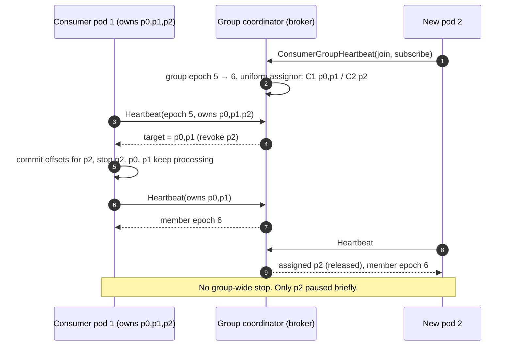
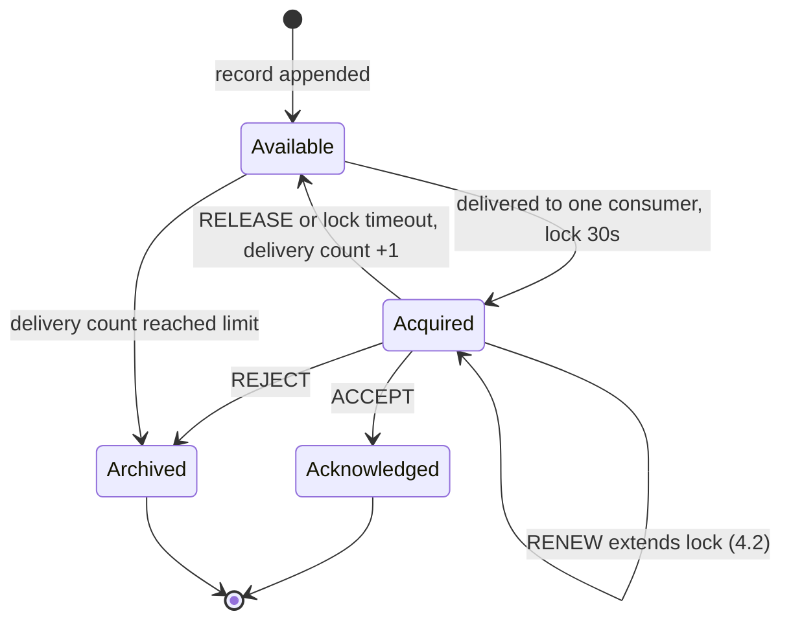
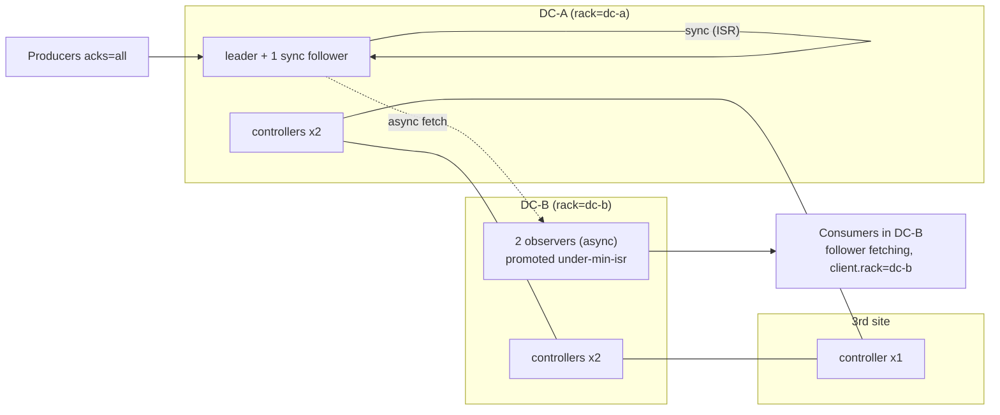
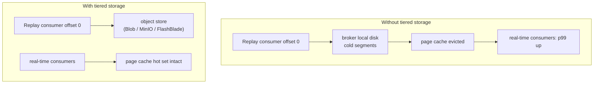

**[V]** = version-dependent. "Changed since the course", "In practice", Q&A for the whole module
are in `notes.md`; this file adds part-2 questions at the end.

# 2.7 Consumer groups — the classic protocol

Source: https://developer.confluent.io/courses/architecture/consumer-group-protocol/ ·
hands-on https://developer.confluent.io/courses/architecture/consumer-group-protocol-hands-on/

- **Group coordinator** = the broker leading the `__consumer_offsets` partition that
  `hash(group.id)` maps to. Committed offsets are records in that compacted topic.
- **Classic rebalance**: members send `JoinGroup`; the coordinator picks a **group leader**
  (a client); the leader computes the assignment with a **client-side assignor** (range,
  round-robin, sticky, cooperative-sticky); everyone gets it via `SyncGroup`.
- **Eager** rebalance: all members revoke all partitions first → stop-the-world.
  **Cooperative** (incremental) rebalance: only partitions that move are revoked, in two rounds.
- **Static membership** (`group.instance.id`): a member restarting within `session.timeout.ms`
  keeps its partitions, no rebalance.
- Liveness: heartbeats (`heartbeat.interval.ms`, `session.timeout.ms` default 45 s) and the poll
  loop (`max.poll.interval.ms`, default 5 min). Slow processing → member kicked → rebalance.

| Internal | Architecture consequence |
|---|---|
| Group-wide barrier on every membership change | Rolling deploys of a 30-pod consumer on OpenShift trigger many rebalances; eager ones pause the whole group. |
| Assignment logic lives in the client | All members must run compatible client versions and the same assignor; upgrades are coordinated. |
| `max.poll.interval.ms` | A slow downstream (DB, HTTP) causes rebalance storms. Bound work per poll (`max.poll.records`) or move to async processing. |
| Offsets in `__consumer_offsets` | Offsets are per cluster. A mirror cluster needs offset sync (Cluster Linking) or translation (MM2). |

# 2.8 KIP-848 — the new consumer group protocol (Kafka 4.0 GA)

Source: https://kafka.apache.org/42/operations/consumer-rebalance-protocol/ (not in the course)

- **Server-side assignment.** The group coordinator computes the target assignment with a
  **broker-side assignor**: `group.consumer.assignors` = `uniform`, `range` (first one is the
  default). A client can ask for one with `group.remote.assignor`.
- **One RPC: `ConsumerGroupHeartbeat`.** Members heartbeat; the response carries their target
  partitions. There is **no group-wide sync barrier**: each member reconciles on its own —
  revoke what it must give up, then get new partitions once the previous owner released them.
- **Epochs**: group epoch (bumps on membership/subscription change) → target assignment epoch →
  member epoch. A member converges to the target independently.
- **Configs move to the broker**: `group.consumer.heartbeat.interval.ms`,
  `group.consumer.session.timeout.ms`. Client configs `heartbeat.interval.ms`,
  `session.timeout.ms`, `partition.assignment.strategy` are **not used** with the new protocol.
- **Enable**: server side on by default in 4.0 (feature `group.version`); **client opt-in with
  `group.protocol=consumer`** in 4.x; default planned for 5.0 [V].
- **Migration**: online — roll consumers with `group.protocol=consumer`; the group converts from
  Classic to Consumer when the first new member joins (only if the classic assignor does not embed
  custom metadata). Offline — stop all, restart with the new protocol. Downgrade works the same way
  in reverse.
- **Limits** [V]: no client-side assignors; rack-aware assignment not fully supported. Kafka
  Streams has its own new protocol (KIP-1071), separate from this. Static membership
  (`group.instance.id`) still works.
- librdkafka-based clients (Python, Go, .NET, JS) support it from recent versions; check yours [V].
- Inspect: `kafka-consumer-groups --describe --group g --state` / `--members`; Kafka 4.0 also has
  `kafka-groups --list` showing group type (Classic / Consumer / Share) [V].

| Internal | Architecture consequence |
|---|---|
| No global barrier | Rolling deploys, autoscaling (HPA/KEDA on lag) and pod evictions no longer pause the whole group. |
| Assignment on the broker | Client upgrades decouple from assignment logic; the platform team controls assignors. |
| Custom client assignors not supported | Apps with custom assignment (e.g. "co-locate partitions for local joins" with custom metadata) cannot migrate online. Inventory them. |
| Broker-side session timeout | One platform-wide liveness policy; teams cannot set 5-minute session timeouts to hide GC problems. |

# 2.9 Share groups — Queues for Kafka (KIP-932)

Source: Kafka 4.2 release https://kafka.apache.org/blog/2026/02/17/apache-kafka-4.2.0-release-announcement/ ·
Confluent https://www.confluent.io/blog/kafka-queue-semantics-share-consumer-ga/ (not in the course)

- A **share group** lets many consumers read the **same partitions** cooperatively. Records are
  handed out one by one (in batches), not partitions per member. So **consumers > partitions**
  works.
- The **share-partition leader** (on the partition leader broker) tracks in-flight records: a
  record is **acquired** by one consumer for a lock duration (default 30 s [V]); the consumer
  **acknowledges** it: `ACCEPT` (done), `RELEASE` (give back), `REJECT` (unprocessable), and since
  4.2 `RENEW` (extend the lock).
- **Delivery count**: each release/time-out increments it; at the limit (default 5 [V]) the record
  is archived (not redelivered). No built-in DLQ topic at the time of writing [V].
- **No ordering guarantee** within a partition. At-least-once.
- Status [V]: early access 4.0, preview 4.1, **production-ready 4.2**. Confluent Cloud GA on
  **Enterprise and Dedicated** (Standard announced for 2H 2026). CP: check your 8.x release notes.
- Tools: `kafka-share-groups`, `kafka-console-share-consumer`; share lag metrics (KIP-1226, 4.2).

| Internal | Architecture consequence |
|---|---|
| Per-record acquisition and ack | Work queues (task per message, slow variable processing) no longer force "partitions = max workers". |
| No ordering | Not for order status or item scans where order per key matters. Use for jobs: image inference per camera snapshot, notification sending, enrichment calls. |
| Delivery count + archive, no DLQ topic yet | Failed records need an explicit "reject → publish to DLQ" in the consumer [V]. |
| Lives in the Kafka log | Messages are replayable and retained like any topic, unlike a classic queue. |
| Versus AMQ Artemis (ESB) | Artemis still has selectors, priorities, per-message TTL/scheduling, request-reply and XA. Share groups cover the plain competing-consumer case. |

# 2.10 Transactions

Source: https://developer.confluent.io/courses/architecture/transactions/ ·
hands-on https://developer.confluent.io/courses/architecture/transactions-hands-on/

- A producer with `transactional.id` calls `initTransactions()`: the **transaction coordinator**
  (leader of a `__transaction_state` partition) returns the producer ID and bumps the **epoch** →
  any older instance with the same `transactional.id` is **fenced** (zombie protection).
- `beginTransaction()` → sends to several partitions (partitions are registered with the
  coordinator) → `sendOffsetsToTransaction()` for consume-transform-produce → `commitTransaction()`.
- Commit = coordinator writes PREPARE, then **transaction markers** (commit/abort control records)
  into every involved partition, then COMPLETE.
- Consumers with `isolation.level=read_committed` read only up to the **last stable offset (LSO)**
  = first offset of the oldest still-open transaction. Aborted records are filtered.
- **KIP-890 (Kafka 4.0, transaction version 2)** [V]: the server bumps the epoch per transaction
  and adds partitions implicitly, which closes the main causes of **hanging transactions**.
- `transaction.timeout.ms` (default 60 s): an open transaction is aborted by the coordinator after
  this.

| Internal | Architecture consequence |
|---|---|
| Exactly-once is **Kafka → Kafka** | A DB or HTTP sink is outside the transaction. Sinks need idempotent writes (upsert by key, dedup by CloudEvents `id`). |
| LSO blocks `read_committed` readers | A hanging transaction stops all `read_committed` consumers on that partition. Alert on LSO lag; `kafka-transactions --find-hanging` / `abort` exist for operators. |
| Markers are records in the log | Offsets have gaps; never compute "count = offset difference". Cluster Linking mirrors are byte copies incl. markers, so `read_committed` works on the mirror [V]. |
| Fencing by `transactional.id` | Use a stable ID per input partition/instance. Random IDs per pod restart lose zombie protection. |

# 2.11 Topic compaction

Source: https://developer.confluent.io/courses/architecture/compaction/

- `cleanup.policy=compact` keeps **at least the latest record per key**; older values for the same
  key are removed by the **log cleaner** threads. `compact,delete` also applies retention.
- Only **closed segments** are cleaned; the active segment never is. `segment.ms` / `segment.bytes`
  decide how soon records become cleanable.
- Trigger: dirty ratio ≥ `min.cleanable.dirty.ratio` (default 0.5); bounds:
  `min.compaction.lag.ms` (records stay uncompacted at least this long) and
  `max.compaction.lag.ms` (cleaned at the latest after this).
- **Tombstone** = key with `null` value: deletes the key; kept for `delete.retention.ms`
  (default 24 h) so consumers can see it, then removed.
- Offsets are kept; compaction leaves gaps.

| Internal | Architecture consequence |
|---|---|
| Latest per key, forever | Good for **current state**: location master data, current order status, device registry, KTable sources. New consumers bootstrap state by reading the topic. |
| Active segment not compacted | Duplicates per key are normal for a while. Consumers must apply "last write wins" by key. |
| Tombstones expire | A consumer offline longer than `delete.retention.ms` misses deletes → keeps stale keys. Set it longer than the longest allowed consumer downtime. |
| GDPR erasure by tombstone | Erases in this topic only. Mirrors, tiered copies (after compaction runs), lake tables and backups need their own erasure. Prefer not to put raw PII in compacted topics; use pseudonymous keys + CSFLE. |
| Tiered + compacted | Confluent Tiered Storage supports compacted topics since CP 7.6 (irreversible switch); **KIP-405 does not** [V]. |

# 2.12 Tiered storage

Source: https://developer.confluent.io/courses/architecture/tiered-storage/ ·
docs https://docs.confluent.io/platform/current/clusters/tiered-storage.html

Two different implementations:

| | Confluent Tiered Storage (CP) | Apache Kafka tiered storage (KIP-405) |
|---|---|---|
| Status | GA in CP for years; Enterprise feature | **GA since Kafka 3.9** [V] |
| Enable | broker `confluent.tier.feature=true`, default for topics `confluent.tier.enable`, backend `confluent.tier.backend` (`S3`, `GCS`, `AzureBlockBlob`) | broker `remote.log.storage.system.enable=true`, topic `remote.storage.enable=true` |
| Local retention | `confluent.tier.local.hotset.ms` / `.bytes` | `local.retention.ms` / `local.retention.bytes` |
| Object stores | S3, GCS, Azure Blob natively; certified S3-compatible on-prem: Pure FlashBlade, NetApp, Dell ECS, MinIO, Ceph, Nutanix, Cloudian, Scality | Whatever the **RemoteStorageManager plugin** supports; Apache ships no production S3/Azure plugin (community plugins, e.g. Aiven's) [V] |
| Compacted topics | Yes, since CP 7.6 | No |
| Metadata | `_confluent-tier-state` topic | `__remote_log_metadata` topic |
| Limits | No JBOD; **not with Multi-Region Clusters** [V] | No compacted topics; plugin maturity |

How it works: once a segment is closed, the leader uploads it to the object store and records
that in the tier metadata topic. Local copies are deleted after the hotset/local retention.
A fetch for an old offset is served from the object store through a separate path, not from local
disk; recent data still comes from page cache.

| Internal | Architecture consequence |
|---|---|
| Old reads come from object store | **Replays stop hitting broker disks and page cache** → real-time consumers keep their latency. Without it, a replay is a disk-I/O event on the brokers that serve production. |
| Less local data per broker | Broker replacement and rebalancing move days, not months, of data → faster recovery, faster scaling. |
| Retention becomes cheap | Months of history possible on-prem. But the object store is now on the path for historical reads (and for upload; if uploads stall, local disks fill). |
| First byte of old data is slower | Fine for replays and backfills; not for low-latency random reads. |
| Not with MRC | You cannot have both on the same cluster [V]. Choose MRC for the critical cluster, and keep long history elsewhere (CC mirror, or a separate tiered cluster). |
| Strimzi / Red Hat Streams | KIP-405 only, with a plugin; no compacted tiered topics. Part of the "CFK vs Strimzi" trade-off. |

# 2.13 Cluster elasticity

Source: https://developer.confluent.io/courses/architecture/cluster-elasticity/

- A new broker gets **no data** until partitions are reassigned
  (`kafka-reassign-partitions`, with replication throttles). Removing a broker = moving its
  replicas away first.
- **Self-Balancing Clusters** (Confluent Server, `confluent.balancer.enable`) move replicas
  automatically on broker add/remove or imbalance. Strimzi uses Cruise Control. CC does it for you.
- With tiered storage, rebalancing moves only the local hotset.

Consequence: on-prem capacity must be added **before** peak, and rebalances compete with
production replication — throttle them and schedule them outside peak hours (check the real
load curve: for many operations the peak is the early morning wave, not the night).

# 2.14 Geo-replication and Multi-Region Clusters

Source: https://developer.confluent.io/courses/architecture/geo-replication/ ·
hands-on https://developer.confluent.io/courses/architecture/geo-replication-hands-on/ ·
MRC docs https://docs.confluent.io/platform/current/multi-dc-deployments/multi-region.html

| Tool | Runs | Offsets | Fits |
|---|---|---|---|
| MirrorMaker 2 | Connect cluster | **Translated** (checkpoints) → replay or skip on failover | Non-Confluent clusters |
| Replicator | Connect cluster | Translated (Java consumers) | Legacy CP; per-message transforms |
| **Cluster Linking** | Inside the destination (or source-initiated from CP) | **Preserved**, byte-for-byte, consumer offsets synced | CP ↔ CC, DR, migration, DC → Azure |
| **Multi-Region Cluster** | One cluster across sites | Same cluster, nothing to translate | Low-RTT sites with a 3rd site for controllers |

**MRC building blocks** (Confluent Server, Enterprise):
- **Replica placement** JSON per topic: `replicas` (sync, in ISR) and `observers` (async, not in
  ISR by default), each with `count` and `rack` constraint. Brokers have `broker.rack` = site.
- **Observers** do not slow `acks=all`, because the leader does not wait for them. They can serve
  reads with **follower fetching** (KIP-392: `replica.selector.class=...RackAwareReplicaSelector`,
  consumer `client.rack`).
- **Automatic observer promotion** needs placement **`"version": 2`** and
  `observerPromotionPolicy` [V]:

| Policy | Promotes observers into the ISR when |
|---|---|
| `under-min-isr` (default in v2) | ISR < `min.insync.replicas` |
| `under-replicated` | ISR < configured replica count |
| `leader-is-observer` (v1 behaviour) | only after a manual unclean election |

  Observers are demoted automatically when sync replicas are back. Metric:
  `ObserversInIsrCount`.
- **Controllers** across ≥ 3 sites (example 2-2-1); a 2-site layout needs a preferred site or
  manual quorum change during a partition.
- **Limits from the docs** [V]: Tiered Storage not supported; MRC is "available for new KRaft
  clusters"; with Self-Balancing every broker needs `broker.rack`.

| Internal | Architecture consequence |
|---|---|
| Observers are outside the ISR | Remote copy without remote latency; RPO > 0 for the observer site. |
| Promotion only helps if observers are caught up | Losing **all** sync replicas at once (whole primary site) with lagging observers = data loss or manual unclean election [V]. Size the sync set to survive the failure you care about. |
| One cluster = one bootstrap list over two sites | Clients fail over without reconfiguration — the main advantage over two linked clusters. |
| No tiered storage with MRC | Long retention on a MRC cluster costs local disk on every replica (sync + observers). |

# Diagrams (part 2)

## KIP-848 rebalance when a pod is added



## Share group record lifecycle



## Transaction commit (consume-transform-produce)

```mermaid
sequenceDiagram
  autonumber
  participant App as Streams app (transactional.id = itemscan-enricher-0)
  participant TC as Transaction coordinator
  participant OUT as Output partition
  participant OFF as __consumer_offsets
  participant C as read_committed consumer
  App->>TC: InitProducerId → PID, epoch+1 (fences old instance)
  App->>OUT: produce enriched records (txn open)
  App->>TC: AddOffsetsToTxn / TxnOffsetCommit
  App->>TC: EndTxn(COMMIT)
  TC->>TC: PREPARE_COMMIT in __transaction_state
  TC->>OUT: COMMIT marker
  TC->>OFF: COMMIT marker
  TC->>TC: COMPLETE_COMMIT
  C->>OUT: fetch → records up to LSO only
  Note over OUT,C: Open or hanging txn holds LSO back → read_committed readers stall
```

## MRC across two DCs with observers and a 3rd-site controller



## Replay with and without tiered storage



# Check yourself (part 2)

1. **"What does KIP-848 change operationally?"**
   Rebalances become incremental and server-driven, so rolling deploys and autoscaling stop
   pausing whole groups. Session and heartbeat timeouts move to the broker. Clients opt in with
   `group.protocol=consumer`; custom client-side assignors block the online migration.

2. **"Can share groups replace AMQ Artemis on the service bus?"** *(harder)*
   For plain competing consumers with at-least-once, yes in principle, from Kafka 4.2 / CC
   Enterprise and Dedicated [V]. Not for selectors, priorities, scheduled delivery, request-reply
   or XA, and there is no ordering. I would use share groups for new work-queue cases on Kafka and
   keep Artemis where those features are used.

3. **"Exactly-once from on-prem to Databricks?"** *(harder)*
   Transactions give exactly-once inside one Kafka cluster. Cluster Linking copies bytes including
   markers, so `read_committed` on the mirror sees the same committed data [V]. Into Delta,
   exactly-once comes from the sink side: Structured Streaming checkpoints with idempotent Delta
   writes, or Tableflow. End to end it is "effectively once" with dedup on the event `id`.

4. **"Compaction and GDPR — does a tombstone erase the person?"**
   Only in that topic, and only after the cleaner runs on closed segments; until then the old
   value is still on disk. Mirrors, tiered copies, lake tables and backups keep their own copies.
   That is why raw PII should not be in compacted topics; key by pseudonymous ID and encrypt PII
   fields with CSFLE so key destruction is the erase.

5. **"Tiered storage — why do you want it, and why can't you have it everywhere?"**
   It moves historical reads off broker disks and page cache, so replays do not hurt real-time
   traffic, and it makes long retention and broker recovery cheap. On Confluent it is not
   supported together with Multi-Region Clusters [V], so the MRC critical cluster keeps short
   retention and history lives in the cloud mirror.

6. **"Observers vs sync replicas in the second DC?"**
   Sync replicas give RPO 0 but put the WAN RTT in every `acks=all` write. Observers keep writes
   local and give a near-real-time remote copy with RPO > 0; automatic promotion keeps
   partitions writable when the ISR degrades. If the whole primary DC is lost and observers lag,
   promotion is unclean — so for T0 data with low RTT I would put sync replicas in both DCs.

# Sources (part 2)

- Course modules: `consumer-group-protocol`, `transactions`, `compaction`, `tiered-storage`,
  `cluster-elasticity`, `geo-replication` under https://developer.confluent.io/courses/architecture/
- KIP-848: https://kafka.apache.org/42/operations/consumer-rebalance-protocol/ ·
  https://www.confluent.io/blog/kip-848-consumer-rebalance-protocol/
- KIP-932 / 4.2: https://kafka.apache.org/blog/2026/02/17/apache-kafka-4.2.0-release-announcement/ ·
  https://www.confluent.io/blog/kafka-queue-semantics-share-consumer-ga/
- Confluent Tiered Storage: https://docs.confluent.io/platform/current/clusters/tiered-storage.html
- MRC: https://docs.confluent.io/platform/current/multi-dc-deployments/multi-region.html
- Cluster Linking (CP): https://docs.confluent.io/platform/current/multi-dc-deployments/cluster-linking/index.html
