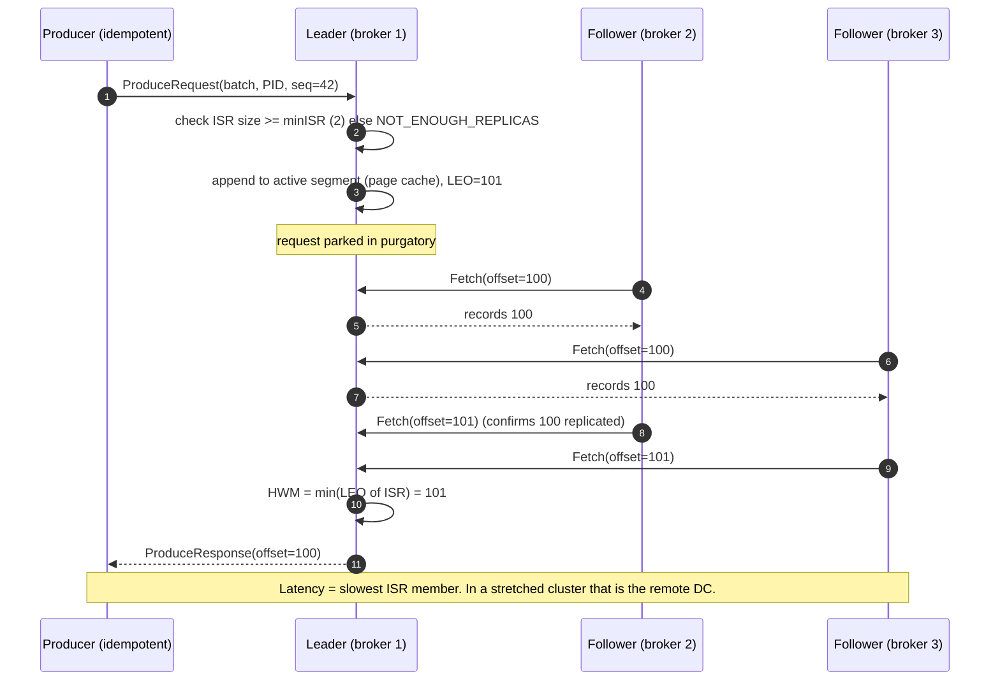
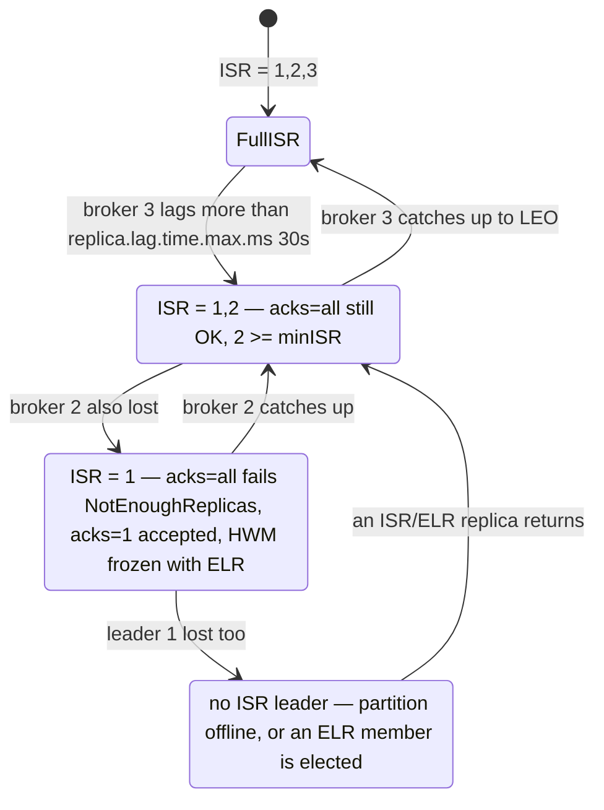
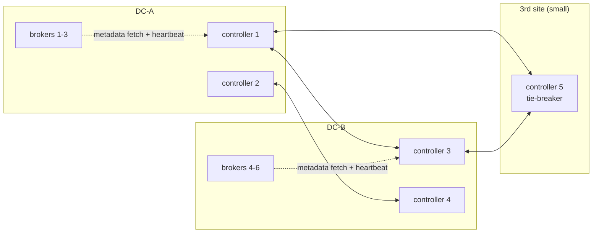

**[V]** = version-dependent. Check before you say it as fact.
Course: https://developer.confluent.io/courses/architecture/get-started/ (15 modules).
Part 2 (consumer groups incl. KIP-848, share groups, transactions, compaction, tiered storage,
elasticity, geo-replication and MRC): `notes-clients-and-storage.md`.

# 1. What this module is for

- Teams that know Confluent well will ask one layer down ("why does that happen?").
- Every internal here is paired with the **architecture decision it forces**: stretched cluster
  RTT, replay isolation, quorum placement, key design, durability settings.
- Baseline: **Kafka 4.x = CP 8.x, KRaft only**. CP 8.0 = Kafka 4.0 (2025-06) … CP 8.4 = Kafka 4.4
  (2026-10-27) [V].

# 2. Core concepts — part 1

## 2.1 The shape of Kafka

Source: https://developer.confluent.io/courses/architecture/get-started/

- A **storage layer** (brokers holding partition logs) and a **compute layer** (producers,
  consumers, Connect, Streams, Flink) that only talks to it through the Producer/Consumer APIs.
- Record = timestamp, key, value, headers. Key and value are **bytes** to the broker. The broker
  never parses payloads (one exception: Confluent broker-side schema *ID* validation, module 03).
- Topic → partitions. A partition is an append-only log; offsets increase and are never reused.
  **Partition = unit of ordering, parallelism and placement.**

| Internal | Architecture consequence |
|---|---|
| Ordering only within a partition | Pick the key from the business invariant: `orderId` for order status, `itemTag` for item scans. Ordering across orders does not exist. |
| Broker treats payload as bytes | Contracts and validation must live in clients/registry; Cluster Linking can copy bytes without understanding them. |
| Partition count is fixed per key mapping | Adding partitions later moves keys to new partitions → ordering breaks across the change. Size once per major version; `.v2` topic if you must change. |

## 2.2 Inside the broker

Source: https://developer.confluent.io/courses/architecture/broker/

Request path for a produce:

1. **Network threads** (`num.network.threads`, default 3) read the request from the socket and put
   it on the **request queue**.
2. **I/O threads** (`num.io.threads`, default 8) validate it and append the batch to the
   partition's **active segment** — written to the OS **page cache**, not fsynced by default.
3. If `acks=all`, the request waits in **purgatory** until the followers in the ISR have fetched
   past that offset. Fetch requests with `fetch.min.bytes`/`fetch.max.wait.ms` also wait there.
4. Response goes to the response queue → network thread → client.

Storage on disk: one directory per partition; **segments** (`log.segment.bytes`, default 1 GiB, or
`segment.ms`) with `.log`, `.index` (offset → position) and `.timeindex` (time → offset).
Retention deletes whole closed segments. Reads of recent data are served from page cache and,
without TLS, with **zero-copy** (`sendfile`) to the socket.

| Internal | Architecture consequence |
|---|---|
| Durability comes from replication, not fsync | `acks=all` + RF 3 + `min.insync.replicas=2` is the durability story. A single-replica topic can lose acknowledged data on power loss. |
| Recent reads come from page cache | Give brokers RAM for page cache. Tail consumers are cheap. |
| **Old reads come from disk** | A replay from offset 0 reads cold segments, competes for disk I/O, and evicts hot pages → **p99 latency for real-time consumers rises**. This is why analytics replays must not run on the mission-critical cluster, and why tiered storage helps (part 2). |
| TLS disables zero-copy | Encryption costs broker CPU on every fetch. Size CPU for TLS; it is not optional in a NIS2 estate. |
| Thread pools are shared | A tenant with huge request rates starves others → `request_percentage` quota. |

## 2.3 Replication — the data plane

Source: https://developer.confluent.io/courses/architecture/data-replication/

- Each partition has one **leader** and N−1 **followers**. Followers **pull** with fetch requests,
  like consumers.
- **LEO** (log end offset) = next offset to write on a replica. **High watermark (HWM)** = highest
  offset replicated to all ISR members; consumers only read below the HWM.
- **ISR** (in-sync replicas) = leader + followers that caught up to the leader's LEO within
  `replica.lag.time.max.ms` (default 30 s). A follower that falls behind longer is removed
  (**ISR shrink**); it re-joins when caught up (**ISR expand**).
- **Leader epoch**: increases on each leader change. A returning replica truncates its log to the
  epoch boundary the new leader reports → no divergent history.
- **Unclean leader election** (`unclean.leader.election.enable`, default false): if no ISR member
  is alive, the partition stays **offline** rather than elect a stale replica and lose data.
- **ELR — Eligible Leader Replicas (KIP-966)** [V]: the controller remembers replicas that were in
  the ISR when it shrank below `min.insync.replicas`, and may elect one of them safely when the ISR
  is empty. With ELR, the HWM advances only while ISR ≥ `min.insync.replicas`. **Enabled by default
  on new clusters from Kafka 4.1**; opt-in on 4.0 (`eligible.leader.replicas.version=1`). With ELR,
  `min.insync.replicas` can no longer be set at broker level, only cluster or topic level.

| Internal | Architecture consequence |
|---|---|
| `acks=all` waits for **every current ISR member**, not for `min.insync.replicas` of them | Produce latency = slowest ISR member's fetch round trip. In a stretched cluster that includes the **inter-DC RTT on every write**. |
| ISR membership is time-based (30 s) | A flaky WAN link makes replicas drop out and re-join (ISR churn). Then `acks=all` writes are fast while shrunk and the margin is gone; under min ISR they fail. |
| Followers pull | Cross-DC replication traffic = ingress × number of remote replicas. Rack/DC-aware placement decides the WAN bill. |
| Unclean election off | Availability vs RPO: losing all ISR members = offline partition until a former ISR member returns (or ELR elects one). Decide per tier; never enable unclean on T0 data. |

## 2.4 The control plane — KRaft

Source: https://developer.confluent.io/courses/architecture/control-plane/

- **Controllers** (3 or 5 voters) run a Raft-style quorum over a single-partition internal topic,
  **`__cluster_metadata`**. The **active controller** is the quorum leader; it writes all metadata
  changes (topics, partitions, ISR, configs, ACLs, broker registrations).
- **Brokers** fetch the metadata log (pull, like followers) and apply it. They register and
  **heartbeat** to the controller; a broker that misses heartbeats for `broker.session.timeout.ms`
  (default 9 s) is **fenced** and its leaderships move.
- **Snapshots** bound the metadata log; a restarting broker loads the snapshot, then the tail.
- **Dedicated vs combined mode**: combined (broker + controller in one process) is for small or
  test clusters. CFK requires separate controllers [V].
- **Dynamic quorum (KIP-853, Kafka 3.9+)**: voters can be added/removed online
  (`kafka-metadata-quorum add-controller / remove-controller`) [V]. Static quorums configured with
  `controller.quorum.voters` cannot.
- ZooKeeper is gone in Kafka 4.0 / CP 8.0. ZK→KRaft migration must happen on CP 7.x before the
  upgrade; no rollback after finalisation.

| Internal | Architecture consequence |
|---|---|
| Quorum needs a **majority** of voters | With 2 DCs, one DC always holds the majority → losing that DC stops metadata changes (no leader elections, no ISR updates). Hence a **third site** with one controller: 2 + 2 + 1 voters ("2.5 DC"). |
| Data plane survives a short controller outage | Existing leaders keep serving. But a broker failure during a controller outage leaves its partitions leaderless. Controller availability = recovery capability. |
| Broker fencing by heartbeat (≈ 9 s) | Broker↔controller latency and GC pauses matter; a stretched controller quorum over a bad link fences healthy brokers. |
| Metadata is a log | Millions of partitions are possible in principle, but each partition still costs broker memory, file handles and recovery time. Partition count is a broker-sizing input, not free. |

## 2.5 Producer internals

Source: https://developer.confluent.io/courses/architecture/producer-hands-on/ ·
https://developer.confluent.io/courses/architecture/guarantees/

```
send() → serializer (key, value) → partitioner → RecordAccumulator (batch per partition)
       → Sender thread → one ProduceRequest per broker (many batches) → retries / acks
```

| Setting | Default (Kafka 4.x) | What it does |
|---|---|---|
| `acks` | `all` (since 3.0) | Durability level |
| `enable.idempotence` | `true` (since 3.0) | Producer ID + per-partition sequence numbers → broker drops duplicates from retries; ordering kept with up to 5 in-flight |
| `max.in.flight.requests.per.connection` | 5 | > 5 disables idempotence guarantees |
| `linger.ms` | **5** (changed from 0 in 4.0, KIP-1030) [V] | Wait to fill batches |
| `batch.size` | 16 KiB | Max batch per partition |
| `compression.type` | none | Batch-level; `zstd`/`lz4` common |
| `delivery.timeout.ms` | 120 s | Total budget incl. retries — the one timeout to tune |
| `buffer.memory` / `max.block.ms` | 32 MiB / 60 s | Back-pressure: `send()` blocks when the buffer is full |
| Partitioner | key: murmur2 hash mod partitions; no key: sticky/uniform (KIP-794) | |

| Internal | Architecture consequence |
|---|---|
| Hash of key mod partition count | Hot keys = hot partitions (e.g. keying by customer puts your largest customer's volume on one partition). Key by the entity whose order matters. |
| librdkafka default partitioner differs from Java (consistent_random vs murmur2) [V] | Mixed-language producers to one topic must set the same partitioner, or the same key lands on different partitions. |
| Batches are compressed once by the producer | Brokers and Cluster Linking keep the compressed batch → compression reduces disk, replication and **ExpressRoute egress**. |
| Idempotence is per producer session | It removes retry duplicates, not application-level resends after a crash. Consumers must still be idempotent (or use transactions, part 2). |
| `buffer.memory` blocks `send()` | An IoT bridge that cannot block needs a bounded buffer + shedding policy, not unbounded memory. |

## 2.6 Durability, availability, ordering

Source: https://developer.confluent.io/courses/architecture/guarantees/

| Setting combination | Survives | Behaviour when replicas fail |
|---|---|---|
| RF 3, minISR 2, `acks=all` | 1 broker loss for writes, 2 for reads | 2nd loss → `NotEnoughReplicas` on produce; reads continue |
| RF 3, minISR 1, `acks=all` | writes continue down to 1 replica | Acknowledged data can live on one disk only → loss risk |
| RF 3, `acks=1` | leader loss = possible loss of the last writes | minISR is not checked for `acks=1`; with ELR the writes are not *visible* until ISR ≥ minISR [V] |
| RF 3, `acks=0` | nothing guaranteed | fire and forget (metrics, sampling) |

Ordering: per partition, with idempotence on (default) even with 5 in-flight requests.

# 3. Diagrams

## 3.1 Produce with `acks=all` (RF 3, minISR 2)



## 3.2 ISR shrink and expand



## 3.3 KRaft quorum across 2.5 sites



Lose DC-A: controllers 3, 4, 5 = 3 of 5 = majority → metadata keeps working.

# 4. Changed since the course (whole module, parts 1 and 2)

| Course says / assumes | Current state (Kafka 4.x / CP 8.x, 2026-11) |
|---|---|
| ZooKeeper or KRaft; video calls KRaft "still in preview" | **KRaft only.** ZooKeeper removed in Kafka 4.0 / CP 8.0. KRaft production-ready since 3.3. |
| Static controller quorum | **Dynamic quorum** (KIP-853, 3.9+): add/remove controllers online [V]. |
| Classic consumer group protocol (JoinGroup/SyncGroup, client-side assignors) | **KIP-848** GA in 4.0: server-side assignment, incremental, no global barrier. Client opt-in `group.protocol=consumer`; default planned for 5.0 [V]. |
| Consumer groups are the only consumption model | **Share groups / Queues for Kafka (KIP-932)**: EA 4.0, preview 4.1, **production-ready in 4.2**. CC GA on Enterprise and Dedicated [V]. |
| Tiered storage "being added to Apache Kafka (KIP-405)" | **KIP-405 GA in Kafka 3.9** (needs an RSM plugin; no compacted topics). Confluent Tiered Storage is separate, supports compacted topics since CP 7.6 [V]. |
| ISR is the only leader candidate set | **ELR (KIP-966)** on by default for new clusters from 4.1 [V]. |
| Transactions as in KIP-98 | **KIP-890 server-side defence** (transaction version 2) in 4.0: epoch bump per transaction, fewer hanging/zombie transactions [V]. |
| `linger.ms=0` default | **`linger.ms=5`** default since 4.0 (KIP-1030) [V]. |
| Idempotence default since 3.0 | Still true; `acks=all` default too. |
| Old clients just work | Kafka 4.0 removed old protocol versions (KIP-896): very old clients (pre-2.1) cannot connect [V]. MirrorMaker 1 removed. Brokers need Java 17. |
| MRC with a ZooKeeper or KRaft node on a 3rd site | KRaft controllers across ≥ 3 sites (e.g. 2-2-1). **Automatic observer promotion** with placement **version 2**; default policy `under-min-isr` [V]. |
| MRC + other features | CP docs: **Tiered Storage is not supported with MRC**; MRC "available for new KRaft clusters" [V]. |
| Cluster Linking hands-on (CC) | Still valid; plus source-initiated links from CP, failback with truncate-and-restore [V]. |

# 5. In practice

Setting: mission-critical Confluent Platform on-prem in two data centres, with cloud (Azure) data
and AI consumers that must not touch the operational clusters.

| Decision | What the internals say |
|---|---|
| **Stretch one cluster over DC-A and DC-B?** | Only if inter-DC RTT is low and stable (assume 1–3 ms [A]; measure it). `acks=all` pays that RTT on every write, and jitter becomes ISR churn. Controllers need a third site (2-2-1). |
| **MRC layout A — sync replicas in both DCs** (e.g. RF 4 = 2+2, minISR 2) | RPO 0 across DCs while the ISR is full; survives DC loss without client change (same cluster, same bootstrap list with brokers in both DCs). Cost: RTT on every write; ISR can shrink to one DC during a WAN blip, quietly removing the cross-DC guarantee. Alert on ISR spread, not only count. |
| **MRC layout B — sync in DC-A + observers in DC-B** | Writes stay local-latency. Observers are async → RPO > 0 for a full DC-A loss; automatic promotion (`under-min-isr`) handles degraded states, but if **all** sync replicas are gone, promoting a not-caught-up observer is an unclean election [V]. Fits when RTT is too high for layout A. |
| **Two clusters + Cluster Linking** | RPO > 0 (async), failover needs promote + client switch, but independent upgrades, failure isolation, and tiered storage allowed. Fits T1 and the DC → Azure path. |
| **Tiered storage on the mission-critical cluster** | **Not with MRC** per CP docs [V]. So: MRC cluster keeps short local retention (days); long history lives in the **CC mirror** (infinite storage) or a separate non-MRC cluster with tiered storage. If a reference architecture combines MRC and tiered storage on one cluster, correct it. |
| **Replays** | Without tiered storage, replays read local disk and evict page cache on the critical brokers. Replays happen in CC on the mirror. On-prem serves one link fetch per topic, under a quota. |
| **Rolling deploys on OpenShift** | Move consumers to `group.protocol=consumer` (KIP-848) to avoid stop-the-world rebalances; check no custom client-side assignor is used. |
| **ESB work queues (AMQ Artemis)** | Share groups make some queue patterns possible on Kafka (part 2), but no selectors, priorities, per-message TTL. Keep Artemis where those are used; do not promise "Kafka replaces the integration bus". |

Questions an architect asks the team that owns the platform:
- What is the measured inter-DC RTT and jitter, and is there a third site for a controller?
- Is the mission-critical cluster MRC, and is anyone planning tiered storage on it?
- Where do replays run today, and what quota caps the link principal?
- Which consumers still use the classic group protocol or a custom assignor?

# 6. Check yourself

1. **"RF 3, min.insync.replicas 2, acks=all. How many replicas must acknowledge a write?"**
   *(harder)* All replicas currently in the ISR — three when healthy. `min.insync.replicas`
   is only the floor: if the ISR is smaller than 2, the leader rejects the write. So latency
   follows the slowest ISR member, which is why a remote replica in the ISR costs RTT on every
   write.

2. **"What happens to an acks=1 producer when the ISR drops below min ISR?"**
   The leader still accepts the write; `min.insync.replicas` is checked only for `acks=all`. With
   ELR (default on new 4.1+ clusters), the high watermark does not advance while ISR < min ISR, so
   consumers do not see those records until the ISR recovers [V]. Either way the data sits on one
   replica — that is the risk you accepted with `acks=1`.

3. **"Why does a stretched cluster need low RTT?"**
   Followers pull, and `acks=all` waits for every ISR member, so each write includes at least one
   cross-DC round trip. ISR membership is time-based; WAN jitter turns into ISR shrink/expand
   churn and under-min-ISR errors. And the KRaft quorum must keep a majority, so you need a third
   site with low latency to both DCs.

4. **"Your two DCs lose the link between them. What happens?"** *(harder)*
   The side that keeps a controller majority (with the 3rd-site controller) keeps the metadata
   leader; brokers on the other side get fenced after the session timeout and their leaderships
   move. Partitions whose ISR was only on the fenced side go offline unless unclean election or
   ELR applies. If brokers are partitioned from each other but not from the controllers, CP docs
   say manual action can be needed even with automatic observer promotion.

5. **"Why do replays hurt real-time consumers?"**
   Recent data is served from page cache; a replay reads cold segments from disk and pushes hot
   pages out. Disk I/O and cache misses raise p99 for everyone on those brokers. Tiered storage
   moves historical reads to the object-store path; we go further and keep replays off the
   critical cluster entirely.

6. **"What changed in Kafka 4.0 that matters for an architect?"**
   KRaft only (migration first), KIP-848 consumer protocol GA, old client protocol versions
   removed (client audit), share groups in early access (production-ready in 4.2), KIP-890
   transaction hardening, `linger.ms` default 5 [V]. Plus Java 17 on brokers.

7. **"What does the controller quorum do when it loses majority?"**
   No metadata changes: no leader elections, no ISR updates, no topic creation. Existing leaders
   keep serving produce and fetch, so a short outage is invisible — until a broker fails and its
   partitions cannot get a new leader.

8. **"Is idempotent production enough for exactly-once?"**
   No. It removes duplicates caused by producer retries within one session. A crash and resend by
   the application, or a consumer that processes then fails before commit, still duplicates. For
   Kafka-to-Kafka you use transactions; for external sinks you need idempotent writes or upserts by
   key.

9. **"How do you choose the partition key for order status?"**
   By the entity whose events must stay ordered: the order ID. Not the customer (hot
   partitions) and not the location (an order changes location, so its events split). Partition count is
   sized for consumer parallelism of the busiest consumer and stays fixed for the topic version.

# 7. Sources

- Course: https://developer.confluent.io/courses/architecture/get-started/ and module slugs
  (`broker`, `data-replication`, `control-plane`, `producer-hands-on`, `guarantees`, …)
- CP versions: https://docs.confluent.io/platform/current/installation/versions-interoperability.html
- ELR: https://kafka.apache.org/42/operations/eligible-leader-replicas/
- KIP-848 operations: https://kafka.apache.org/42/operations/consumer-rebalance-protocol/
- Kafka 4.2 release: https://kafka.apache.org/blog/2026/02/17/apache-kafka-4.2.0-release-announcement/
- MRC: https://docs.confluent.io/platform/current/multi-dc-deployments/multi-region.html
- Confluent Tiered Storage: https://docs.confluent.io/platform/current/clusters/tiered-storage.html
- KIP-966 (ELR), KIP-853 (dynamic quorum), KIP-1030 (config defaults), KIP-896 (protocol removal),
  KIP-890 (transactions) — https://cwiki.apache.org/confluence/display/KAFKA/Kafka+Improvement+Proposals
