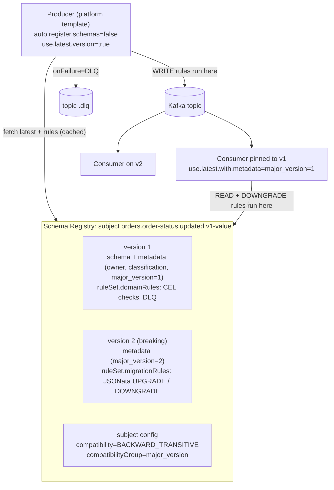
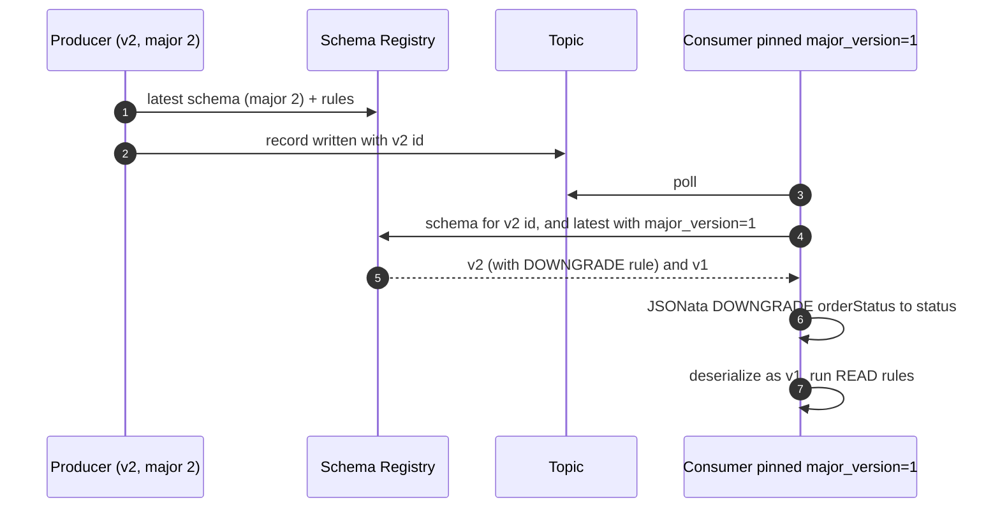

# What this part is for

- Explain a data contract as something the platform **enforces**, not a page of documentation.
- Know where each rule runs (client, not broker), what it costs, and where it does not run.
- Have a clean answer for breaking changes: compatibility groups + migration rules, or a `.v2` topic.

Docs: https://docs.confluent.io/platform/current/schema-registry/fundamentals/data-contracts.html
(CC version: https://docs.confluent.io/cloud/current/sr/fundamentals/data-contracts.html). **[V]** = check.

---

# 1. What a data contract is in Schema Registry

A registered schema version can carry four things:

| Part | Holds | Example |
|---|---|---|
| **Schema** | structure (Avro / Protobuf / JSON Schema) | `OrderStatusUpdated` record |
| **Metadata** | `properties` (key/value), `tags` (by field path), `sensitive` (property names to encrypt) | `owner=orders-team`, `classification=internal`, `major_version=1` |
| **Tags** | inline in the schema (`"confluent:tags": ["PII"]`) or in metadata | `customerName` tagged `PII` |
| **Rule set** | `domainRules` (WRITE/READ) and `migrationRules` (UPGRADE/DOWNGRADE) | CEL check on order ID; JSONata rename |

Requirements: CP **7.4+** with **Confluent Enterprise** and
`resource.extension.class=io.confluent.kafka.schemaregistry.rulehandler.RuleSetResourceExtension`
on the registry; in Confluent Cloud the **Stream Governance Advanced** package (Essentials: "Data
rules: No"). Java clients need `io.confluent:kafka-schema-rules` (CEL, CEL_FIELD, JSONata
executors) next to the serializer, both ≥ 7.4.



# 2. Rules

| Field | Values | Note |
|---|---|---|
| `name`, `doc` | free text | name also selects a specific executor config |
| `kind` | `CONDITION` (true/false) or `TRANSFORM` (changes data) | |
| `type` | `CEL`, `CEL_FIELD`, `JSONATA`, `ENCRYPT` (CSFLE, module 04), custom | executor chosen by type |
| `mode` | domain: `WRITE`, `READ`, `WRITEREAD`; migration: `UPGRADE`, `DOWNGRADE`, `UPDOWN` | |
| `tags` | e.g. `["PII"]` | rule applies to fields with these tags |
| `params` | key/value | e.g. `dlq.topic` |
| `expr` | rule body | CEL or JSONata |
| `onSuccess` / `onFailure` | `NONE`, `ERROR` (default on failure), `DLQ`, custom; two values for two-way modes (`NONE,ERROR`) | |
| `disabled` | bool | |

**Rules run in the client** — the serializer (WRITE) and deserializer (READ, migrations). The
broker never runs them. Consequences:

- A producer that does not use the Confluent serializer, or uses an old one, skips them. That is why
  broker-side ID validation (module 08 notes §3) and a platform producer template are needed.
- **Not executed** in Kafka Connect on Confluent Cloud, Flink SQL, or ksqlDB (CP or CC). Control
  Center does not show metadata/rules.
- Only the **root** schema's rule set runs, not the rule sets of referenced schemas — except
  **inline rules** (CP 8.4), which run also inside referenced schemas, on serialization only, when
  the client sets `validation.rules.execution=BEFORE_DOMAIN_RULES|AFTER_DOMAIN_RULES`.
- After registering a rule set, producers should run with `auto.register.schemas=false` and
  `use.latest.version=true` (cache refresh with `latest.cache.ttl.sec`).

## 2.1 CEL — data quality (`CONDITION`)

The expression gets the whole record as `message`.

```json
{
  "ruleSet": {
    "domainRules": [
      {
        "name": "orderIdFormat",
        "kind": "CONDITION",
        "type": "CEL",
        "mode": "WRITE",
        "expr": "message.orderId.matches('^SO-[0-9]{7}$')",
        "params": { "dlq.topic": "orders.order-status.updated.v1.dlq" },
        "onFailure": "DLQ"
      },
      {
        "name": "statusKnown",
        "kind": "CONDITION",
        "type": "CEL",
        "mode": "WRITE",
        "expr": "message.status in ['CREATED','CONFIRMED','DELAYED','LOCATION_CHANGE','READY','DISPATCHED','CANCELLED','UNKNOWN']",
        "onFailure": "ERROR"
      }
    ]
  }
}
```

Built-in helpers include `isEmail()`, `isHostname()`, `isIpv4()`, … and (newer) decimal,
timestamp and variant functions. "Timestamp not in the future" needs the current time: the docs
show `now` for **inline rules** (Protovalidate naming, CP 8.4); a ruleSet CEL rule only has
`message`. [V]

## 2.2 CEL_FIELD — field transforms (`TRANSFORM`)

Expression form: `<guard> ; <transform>`. Variables: `value`, `name`, `fullName`, `typeName`
(`STRING`, `INT`, …), `tags`, `message`. Primitive types only. Typical: masking by tag.

```json
{ "name": "maskPII", "kind": "TRANSFORM", "type": "CEL_FIELD", "mode": "WRITE",
  "tags": ["PII"], "expr": "typeName == 'STRING' ; 'XXXXX'" }
```

## 2.3 DLQ action

`onFailure: "DLQ"` + `params.dlq.topic`. The serializer writes the failing record to that topic
instead of throwing. To capture the **key** too, wrap the key serializer:
`key.serializer=io.confluent.kafka.serializers.WrapperKeySerializer` +
`wrapped.key.serializer=<real key serializer>` (the value serializer otherwise never sees the key).
The DLQ write uses the client's own Kafka connection settings. [V — check which properties the
action reads in your client] Keep the DLQ topic **without** broker-side validation, give it an
owner and an alert on volume.

## 2.4 Global rules and metadata

The registry config (global `/config` or per subject `/config/{subject}`) can hold
`defaultMetadata`, `overrideMetadata`, `defaultRuleSet`, `overrideRuleSet`. Merge order at
registration: default → what the schema brings → override. Uses for a platform team:

- `overrideRuleSet` with a `CEL_FIELD` or `ENCRYPT` rule on tag `PII` → **every** new schema gets it,
  whatever the producer team sends.
- `overrideMetadata` `{"major_version": "2"}` while a major version is current.

# 3. Breaking changes: compatibility groups + migration rules

Normal evolution is controlled by the subject's compatibility level:

| Level | Allowed change (roughly) | Upgrade order |
|---|---|---|
| `BACKWARD` (**Schema Registry default**) | delete fields, add optional fields; new schema reads data of the *previous* version | consumers first |
| `BACKWARD_TRANSITIVE` | same, against **all** earlier versions | consumers first |
| `FORWARD` / `_TRANSITIVE` | add fields, delete optional fields; old schema reads new data | producers first |
| `FULL` / `_TRANSITIVE` | both | any order |
| `NONE` | anything | coordinate by hand |
| `LOGICAL` (CP 8.4) | checks how Flink/Iceberg map the schema to SQL; conflicts with FORWARD* | [V] |

For a **breaking** change you have two options:

1. **New topic** (`….v2`), parallel run, consumers move, old topic retired on an announced date.
   Simple to reason about; offset correlation between topics is the hard part.
2. **Same topic, new major version**:
   - subject config: `compatibilityGroup = "major_version"` → compatibility is checked only
     among schemas with the same `major_version` metadata value;
   - v2 carries `metadata.properties.major_version = "2"` and **migration rules** (`JSONATA`,
     `UPGRADE` for new readers of old data, `DOWNGRADE` for old readers of new data);
   - consumers pin a major version: `use.latest.with.metadata=major_version=1`;
   - a consumer two majors away runs the migrations transitively (1→2→3).

```json
{
  "metadata": { "properties": { "major_version": "2" } },
  "ruleSet": {
    "migrationRules": [
      { "name": "statusToOrderStatus", "kind": "TRANSFORM", "type": "JSONATA", "mode": "UPGRADE",
        "expr": "$merge([$sift($, function($v, $k) {$k != 'status'}), {'orderStatus': $.'status'}])" },
      { "name": "orderStatusToStatus", "kind": "TRANSFORM", "type": "JSONATA", "mode": "DOWNGRADE",
        "expr": "$merge([$sift($, function($v, $k) {$k != 'orderStatus'}), {'status': $.'orderStatus'}])" }
    ]
  }
}
```



Cost of option 2: every consumer must run a recent Confluent deserializer with the rules
executor. Spark `from_avro` in Databricks or Tableflow do not run JSONata migrations. For a
consumer base of Databricks teams, option 1 (`.v2` topic) is usually the safer default; option 2
for app-to-app topics with Java/Go/Python clients. [V]

# 4. In practice — sensible defaults

| Topic | Default |
|---|---|
| Format | Avro; Protobuf allowed for service teams |
| Compatibility | `BACKWARD_TRANSITIVE` set explicitly on published subjects (not relying on the BACKWARD default) + CI lint "additive only" |
| Metadata | `owner`, `classification`, `major_version`, `sla` mandatory (`defaultMetadata` + CI check) |
| Rules | CEL checks for business keys (order ID, item tag, location ID) in the platform producer template; DLQ per data product |
| PII | tags + `ENCRYPT` (CSFLE, KEK in Azure Key Vault) via `overrideRuleSet` on tag `PII` |
| Breaking change | `.v2` topic for analytics consumers; compatibility groups + JSONata only for app-to-app topics |
| Where rules can't run (Flink SQL, CC Connect) | write the check in SQL / validate in a client app before republishing |

# 5. Check yourself

**1. Where do data-contract rules run?**
In the client serializer/deserializer, never on the broker. That is why a platform producer
template and broker-side ID validation are both needed: the template runs the rules, the broker
rejects clients that skip the serializer.

**2. Harder: "So a team using plain `StringSerializer` bypasses all of it?"**
They bypass the rules, yes — but if the topic has broker-side schema ID validation, their records
have no schema ID and the broker rejects the batch. So they cannot publish to a governed topic
without the serializer, and with the serializer the rules come with the latest schema.

**3. How do you handle a breaking change without a new topic?**
Compatibility group on `major_version`, v2 registered with `major_version=2` and JSONata
UPGRADE/DOWNGRADE rules, consumers pinned with `use.latest.with.metadata`. Each consumer sees its
own major version. It only works for consumers running the Confluent deserializer with the rule
executor — not for Spark `from_avro` or Tableflow.

**4. Harder: "Your order-ID rule rejects a record from the item-tracking system at 03:00. What happens to that item's event?"**
With `onFailure=DLQ` the producer does not fail; the record goes to the DLQ topic with its key
(wrapper key serializer) and the owning team is alerted. Business impact decides per rule:
ERROR for rules where a bad record must stop the producer, DLQ where flow matters more. DLQ
volume per data product is a platform metric.

**5. Can the platform force PII masking on schemas teams register themselves?**
Yes: `overrideRuleSet` in the registry config injects a rule (CEL_FIELD mask or ENCRYPT) for tag
`PII` into every new schema version. Producers cannot remove it, because override wins.

**6. What do rules cost in Confluent Cloud?**
They need Stream Governance Advanced on the environment (Essentials has no data rules); Advanced
starts at about $1/hour per environment plus schema counts above the included 20,000. [V]

# Sources

- CP data contracts: https://docs.confluent.io/platform/current/schema-registry/fundamentals/data-contracts.html
- CC data contracts: https://docs.confluent.io/cloud/current/sr/fundamentals/data-contracts.html
- Stream Governance packages: https://docs.confluent.io/cloud/current/stream-governance/packages.html
- CP 8.4 release notes (LOGICAL compatibility, inline rules, topic-subject associations): https://docs.confluent.io/platform/current/release-notes/index.html
- CEL spec: https://github.com/google/cel-spec · JSONata: https://jsonata.org
- Terraform `confluent_schema` (`ruleset`, `metadata`), `confluent_subject_config` (`compatibility_group`): https://registry.terraform.io/providers/confluentinc/confluent/2.94.0/docs
