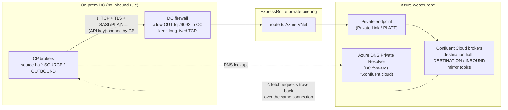
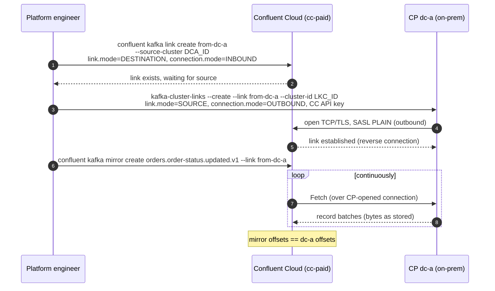
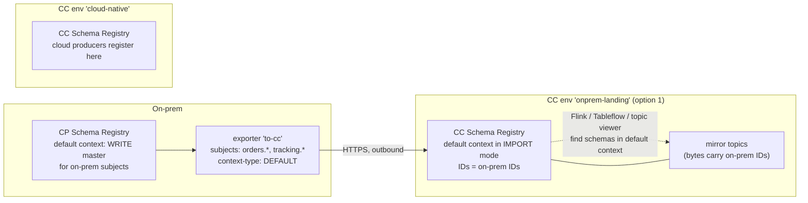
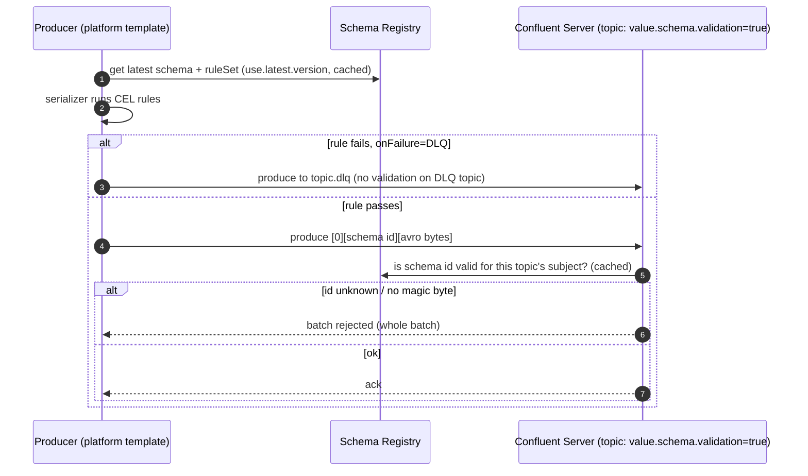

# What this module is for

- Explain, at packet level, how an on-prem Confluent Platform cluster feeds Confluent Cloud on Azure
  with **no inbound firewall rule**, and what can go wrong.
- Keep schema IDs valid across that boundary (**Schema Linking**, contexts) and know which cloud
  features break when schemas sit in a non-default context.
- Know what **broker-side schema ID validation** checks and what it does not, on CP and CC.
  The rule layer (CEL, JSONata, DLQ, compatibility groups) is in `notes-data-contracts.md`.

**[V]** = depends on version or region; check before you say it as fact.

---

# 1. Source-initiated Cluster Linking, CP → Confluent Cloud

Docs: https://docs.confluent.io/cloud/current/multi-cloud/cluster-linking/hybrid-cc.html ·
https://docs.confluent.io/cloud/current/multi-cloud/cluster-linking/private-networking.html

## 1.1 The two halves

A source-initiated link is **two link objects with the same name**, one on each cluster.

| | Destination half (Confluent Cloud) | Source half (CP, on-prem) |
|---|---|---|
| Mode | `link.mode=DESTINATION`, `connection.mode=INBOUND` | `link.mode=SOURCE`, `connection.mode=OUTBOUND` |
| Created with | `confluent kafka link create <name> --cluster <lkc> --source-cluster <CP cluster id> --config <file>` | `kafka-cluster-links --create --link <name> --config-file <file> --cluster-id <lkc>` |
| Holds | **all link configs**: offset sync, ACL sync, auto-create filters, prefix | only connection settings: CC bootstrap + CC API key (`SASL_SSL`/`PLAIN`), and `local.*` settings for how the link authenticates to its own CP cluster |
| Order | **first** | second |
| Mirror topics | created here (`confluent kafka mirror create`) | — |

Requirements: Confluent Server with an Enterprise licence on CP (not Apache Kafka, not Community,
not the "Customer-managed CP for Confluent Cloud" subscription), CP **7.1.0+** for a KRaft
destination (all of CC), IBP ≥ 3.0. On the CC side the link's service account needs only
**Cluster: Alter** on the destination cluster. On CP, from 7.8.9 / 7.9.8 / 8.0.6 / 8.1.4 / 8.2.2 /
8.3.0, the `ClusterLinkConnection` RBAC role covers the link principal. [V]

## 1.2 Which CC cluster can be the destination

| CC destination | CP → CC possible? | Network path from the DC |
|---|---|---|
| Basic, Standard | **No** (not destinations at all) | — |
| Dedicated, public endpoints | Yes, source-initiated | Internet, TLS on 9092 (the hybrid tutorial uses this) |
| Dedicated, private (Private Link / VNet peering) | Yes, source-initiated | DC must route to the private endpoint (ExpressRoute private peering into the VNet that holds the endpoint) |
| Enterprise (always private) | Yes, source-initiated | Same as above; PrivateLink Attachment on Azure, region subset [V] |
| Freight | AWS with private networking only [V] | — |

Note: the hybrid tutorial page still says "requires a Dedicated cluster"; the private-networking
page lists Enterprise too. Trust the networking page, test before you commit. [V]

## 1.3 What actually goes over the wire

1. Each CP broker opens TCP connections **out** to the CC brokers (TLS, SASL/PLAIN with a CC API
   key).
2. CC uses those connections **in reverse**: its mirror fetchers send fetch requests to the CP
   brokers over the connection CP opened. To the DC firewall this is one outbound session that stays
   up. The firewall must not cut long-lived idle TCP sessions.
3. Nothing in Azure ever needs a route to the DC. That is the whole point.

For a **laptop lab** the same mechanism works over home NAT to a public Dedicated cluster: the
Docker container dials out to `pkc-….westeurope.azure.confluent.cloud:9092`; CC could never dial
`dc-a:29092` (a private Docker hostname behind NAT). A destination-initiated link would fail here.

The reverse direction (CC → CP, e.g. for cloud-produced data or a cloud DR copy coming home) is
also DC-initiated: the CP cluster creates a normal *destination* link and pulls from CC.

## 1.4 Settings that matter for a read replica

| Setting (on CC destination half) | Recommended | Why |
|---|---|---|
| explicit `confluent kafka mirror create` per topic, or `auto.create.mirror.topics.filters` with `PREFIXED` on curated prefixes only | explicit, from a PR | The link copies **everything** in a topic, PII included. The allow-list is the control |
| `consumer.offset.sync.enable` | **off** | Cloud consumers are other groups; nothing to sync. Avoids overwriting offsets of cloud groups |
| `acl.sync.enable` | **off** | Cloud principals are different (CC service accounts / Entra ID) |
| `mirror.start.offset.spec` | `latest` or a timestamp for big topics | Avoids reading full retention from the DC on day 1 |
| `cluster.link.prefix` | none (or `onprem.` if names could clash with cloud-native topics) | A prefix blocks reverse commands; fine for a one-way read replica |
| CP side: quota on the link principal | yes | A catch-up cannot saturate mission-critical brokers |

## 1.5 Failure modes

| Symptom | Cause | Fix |
|---|---|---|
| Link created on CP but never "available" | CC half missing, wrong `--cluster-id`, or CP cannot reach CC (DNS, port 9092 blocked, proxy) | Create CC half first; test `openssl s_client -connect pkc-…:9092` from a broker |
| Works, then stops every few hours | Firewall idle timeout kills the long-lived TCP session | Raise idle timeout for this flow |
| Mirror `SOURCE_UNAVAILABLE` | Link auth expired (rotated CC API key, cert) | Rotate with overlap; alert on link auth failures |
| Mirror `FAILED` | Old v0/v1 message format in the source topic | Rewrite/upgrade the topic |
| Cloud consumers fail to deserialize | Schema IDs from the on-prem registry unknown in CC | Schema Linking (§2) **before** the first mirrored record |

---

# 2. Schema Linking and contexts

Docs: https://docs.confluent.io/platform/current/schema-registry/schema-linking-cp.html ·
https://docs.confluent.io/cloud/current/sr/schema-linking.html

## 2.1 Why it is needed

A record in Kafka holds only `magic byte 0 + 4-byte schema ID + payload`. The mirror copies these
bytes. ID 17 in the on-prem registry means nothing to the CC registry — or worse, means a
*different* schema. Schema Linking copies schemas **with their IDs** so the bytes still resolve.

## 2.2 Contexts

- A **context** is a separate namespace inside one registry: its own subjects **and its own ID
  space**. ID 17 in `.onprem` and ID 17 in the default context can be different schemas.
- Default context = `.`; named contexts start with a dot: `.onprem`, `.onprem.ops`.
- Qualified subject: `:.onprem:orders.order-status.updated.v1-value`. Unqualified = default.
- Clients pick a context with a **base path** in the URL: `https://<sr>/contexts/.onprem`
  (or a `context.name.strategy` class for per-topic choice). Lookups by ID can also pass
  `?subject=:.onprem:<subject>`.
- `:.__GLOBAL:` holds only config and mode, no schemas.

## 2.3 Exporters

An **exporter** runs in the *source* registry and pushes to a destination registry.

| Field | Values | Note |
|---|---|---|
| `subjects` | list, prefix `foo*`, `*` (default context, default), `:*:` (all contexts), `:.ctx:*` | |
| `context-type` | `AUTO` (default; `.lsrc-xxxxxx`), `CUSTOM` (+ `context-name`), `NONE` (keep source context), `DEFAULT` (into destination default context; CP 7.4.2+), `REPLACE` (REST only) | |
| `subject-format` | e.g. `dc_${subject}` | rename on the way |
| `config` | destination `schema.registry.url` (FQDN), basic auth, `proxy.host`/`proxy.port` | |

States: `STARTING` (exports existing schemas) → `RUNNING` (exports new ones, tracks offset) ⇄
`PAUSED`. To change subjects: pause → update → **reset** → resume (without reset, older schemas of
new subjects are skipped). Limits: 10 exporters per CP registry; CC 10 per environment on
Essentials, 100 on Advanced. Exporters keep running if their creator loses access — audit
`/exporters` calls. CP source needs `SchemaExporterResourceExtension`,
`SchemaExporterUpdateHandler` and the same `password.encoder.secret` everywhere.

The destination context (or subject) is put in **IMPORT** mode: only the exporter writes there.
For DR you run the reverse: primary READWRITE, secondary IMPORT, flip on failover.

## 2.4 The default-context catch (important for a CP → CC design)

| Consumer of the schema | Looks in |
|---|---|
| Your own clients | wherever the URL/base path points (`/contexts/.onprem`) |
| **CP** broker-side schema ID validation | **default context only** |
| **CC** broker-side validation (Dedicated) | `TopicNameStrategy`: all contexts; Record/TopicRecord strategies: default only; or `confluent.schema.validation.context.name` |
| CC ksqlDB, CC broker-side validation, CC topic viewer, for **mirror topics** | hybrid tutorial: put the schema in the **default context** of the CC registry |
| CC Flink, Tableflow | not documented for named contexts; assume default context until tested [V] |

So exporting on-prem schemas into `:.onprem:` keeps IDs safe but can make the topics invisible
to cloud-native tooling. Options:

1. **Separate CC environment as on-prem landing zone** (own registry), exporter with
   `context-type DEFAULT` (or `NONE`). Only the on-prem registry writes there (IMPORT mode), so no
   ID collision; cloud-native producers live in other environments. Cost: one more environment,
   cross-environment access for consumers.
2. Named context + clients with `/contexts/.onprem`, and accept that topic viewer / ksqlDB (and
   maybe Flink/Tableflow) need a re-serialized copy. Weaker for "tier-0 = Tableflow table".
3. Export into the default context of a shared environment: only if you can guarantee no ID
   overlap — you can't, so no.

---

# 3. Broker-side schema ID validation

Docs: https://docs.confluent.io/platform/current/schema-registry/schema-validation.html ·
https://docs.confluent.io/cloud/current/sr/broker-side-schema-validation.html

| | Confluent Platform | Confluent Cloud |
|---|---|---|
| Where | Confluent Server brokers, **Enterprise licence on the brokers** (the registry's licence is not enough; not available under the "Customer-managed CP for CC" licence) | **Dedicated clusters only** |
| Broker setting | `confluent.schema.registry.url=http://sr:8081` in `server.properties` | none; uses the environment's CC registry (self-managed SR not allowed) |
| Topic settings | `confluent.value.schema.validation=true`, `confluent.key.schema.validation=true` (independent, default false); `confluent.{key,value}.subject.name.strategy` | same + `confluent.schema.validation.context.name` (default `default`) |
| Default subject strategy | **`AssociatedNameStrategy`** (CP 8.4: explicit topic-subject association, falls back to TopicNameStrategy; cache `confluent.association.cache.ttl.sec=300`) [V] | `TopicNameStrategy` |
| Contexts | default context only | see §2.4 |
| Scope | one registry per cluster | one registry per environment; no cross-environment visibility |

**What it checks:** the record has the wire-format prefix and the schema ID exists and matches a
subject for that topic. **What it does not check:** the payload. "Schema Validation does not
perform data introspection." Garbage after a valid ID passes; a well-formed record that violates
business rules passes. Null values/keys and tombstones pass. One bad record rejects the **whole
batch** (the producer gets an error for all of it).

It is the cheap, server-side guard that makes "no schema, no publish" impossible to skip by a
client that forgot the serializer. Content quality is the serializer's rules (data contracts).

Mirror topics: validation is one of the topic configs that is **never synced**; mirror topics are
read-only anyway, so validation at the source covers what lands in the cloud.

---

# Changed vs. older docs and common claims (no course to compare)

| Claim you may hear | Current state (2026-11-07) | Source |
|---|---|---|
| "CP → CC needs CP 7.8+" | CP **7.1.0+** as source of a source-initiated link to CC. **7.8.x+** is the current CP page's requirement for a CP *destination*. Reverse/failback commands on hybrid links: CP 7.7+ | CC CL overview; CP CL overview; CP mirror topics |
| "Destination must be Dedicated" (hybrid tutorial) | Dedicated **or** privately networked Enterprise (Freight on AWS) | CC CL private networking |
| "Schema rules work on Essentials" | No: data rules need **Stream Governance Advanced** in CC; Enterprise + `RuleSetResourceExtension` on CP 7.4+ | SG packages; data contracts doc |
| "Broker validation on any CC cluster" | **Dedicated only** | CC broker-side validation |
| "Validation checks the data" | Only the schema ID. No introspection; tombstones pass; batch-level reject | same |
| Default subject strategy = TopicNameStrategy | On CP 8.4 brokers the default is **AssociatedNameStrategy** (explicit topic-subject associations, new in 8.4) falling back to TopicNameStrategy [V] | CP schema validation doc; CP 8.4 release notes |
| Schema Linking needs Advanced in CC | Essentials and Advanced both work (10 vs 100 exporters) | CC Schema Linking |
| Schema Linking needs full Enterprise on CP | From CP 8.1, exporters work with Enterprise, the Customer-managed CP for CC subscription, or when the destination is CC Schema Registry | CP Schema Linking doc |
| `context.type` / `subject-rename-format` | Flags are `--context-type`, `--context-name`, `--subject-format`; CFK uses `contextType`, `contextName`, `subjectRenameFormat`; REST uses `contextType`, `context` | CP Schema Linking; CFK |
| `confluent kafka link create --config-file` | CLI v4: `--config <file or k=v,…>`; `--source-cluster-id` → `--source-cluster` since v3 | CLI v4.82 reference |
| Data contracts: rules on referenced schemas | Only the root schema's ruleSet runs — except CP 8.4 **inline rules** (`validation.rules.execution`) which also run for referenced schemas, on serialization only | data contracts doc |
| New in CP 8.4 Schema Registry | Logical Types; `LOGICAL` compatibility (conflicts with FORWARD/FORWARD_TRANSITIVE); inline data-quality rules; explicit topic-subject associations | CP 8.4 release notes |

---

# In practice

Setting: mission-critical Confluent Platform on-prem in two data centres; cloud (Azure) data and
AI consumers read from Confluent Cloud and never touch the operational clusters.

**Design positions this module supports:**

- DC → Azure is **one** outbound flow per cluster: a source-initiated link over ExpressRoute
  private peering to a Private Link endpoint of an Enterprise or Dedicated cluster. No DC listener
  for Azure, no inbound rule, no per-broker NAT.
- The link carries only curated export topics, created from a reviewed PR (Terraform for the CC
  half + mirror topic; CFK `ClusterLink` CR in Git for the CP half, applied by ArgoCD).
- **One write master per subject.** On-prem producers register on-prem; an exporter pushes
  to CC. Recommend a dedicated **CC landing environment with DEFAULT context** so Tableflow,
  Flink, ksqlDB and the topic viewer see the schemas (§2.4). If the team insists on one environment,
  use a named context and template the `/contexts/.onprem` URL — and test Flink/Tableflow first.
- **Enforcement layers:** CI compatibility test → serializer rules (CEL, DLQ) in the platform
  producer template → broker-side ID validation on published on-prem topics (CP) → link filter
  → (CC Dedicated) validation on cloud-native published topics. Each layer catches what the one
  before cannot.
- Legacy producers (ESB/Camel routes, IoT bridges) that cannot run the Confluent serializer: raw internal
  topic → platform-owned validator → governed topic. The validator must be a **client application
  with Confluent serdes** (Kafka Streams / Java / Camel with the Confluent serializer) — data
  contract rules do **not** execute in CC-managed Connect, Flink SQL or ksqlDB. In Flink SQL you
  write the checks as SQL, not as contract rules.
- IoT and OpenShift: the CFK operator runs the CP half; the same link pattern is used by an IoT
  cluster (non-critical) or not at all (critical stays in the DC).

**Common claims in reference designs that this module corrects:**

1. "Published subjects: BACKWARD_TRANSITIVE (Kafka default…)": the **Schema Registry
   default is BACKWARD**, not BACKWARD_TRANSITIVE, and it is a Schema Registry setting, not Kafka.
   BACKWARD_TRANSITIVE is a good *choice*; say "we set it".
2. "Schema Linking into an IMPORT-mode context `:.onprem:`": correct as a mechanism, but
   CP broker validation supports only the default context, and CC ksqlDB / broker validation /
   topic viewer need mirror-topic schemas in the CC default context. Prefer a landing environment
   with `DEFAULT` context, or state the trade-off.
3. "A platform-owned Connect converter or Flink job validates": rules don't run in CC
   Connect, Flink SQL or ksqlDB. Use a client app with Confluent serdes, or SQL checks.
4. "Minimum CP version 7.1+ or 7.8+": 7.1.0+ for CP as source to CC; 7.8+ is for CP as a
   destination; 7.7+ for reverse commands.
5. Licence: also check *which* subscription — "Customer-managed CP for Confluent Cloud" does not
   include Confluent Server / Cluster Linking / broker validation.
6. "Timestamp not in the future" as a contract rule: a ruleSet CEL rule has only `message`; the `now`
   variable is documented for CP 8.4 **inline rules**. [V]

**Questions an architect asks the team that owns the platform:**

- Which CC cluster type is the link destination, and how does the DC reach its private endpoint?
- Which CP subscription is licensed — does it include Confluent Server and Cluster Linking?
- Which topics are on the link allow-list, and who approves a new entry?
- Which registry is the write master per subject, and which context do cloud consumers read?
- What is the firewall idle timeout for the outbound link flow?

---

# Check yourself

**1. Why does a source-initiated link need no inbound firewall rule?**
The CP brokers open the TCP/TLS sessions to Confluent Cloud. CC then sends its fetch requests back
over those sessions. The DC sees one long-lived outbound flow; nothing from Azure initiates a
connection into the DC.

**2. Where do you configure offset sync for a CP → CC link?**
On the **destination** half in Confluent Cloud — all link configs live there. The CP half only has
the connection: CC bootstrap, CC API key and `local.*` settings for authenticating to its own
cluster. For a read replica I leave offset and ACL sync off.

**3. Harder: "Can the destination be an Enterprise cluster with Private Link? Your laptop demo used public Dedicated."**
Yes, per the private-networking matrix: CP 7.1+ to a privately networked Enterprise or Dedicated
cluster, source-initiated, as long as the CP brokers can reach the private endpoint — so
ExpressRoute private peering and DNS forwarding to the Private Link zone. The demo used public
Dedicated only because a laptop cannot reach a private endpoint. Enterprise is always private.

**4. Why Schema Linking, if the mirror copies the bytes anyway?**
Because the bytes contain only a schema ID from the on-prem registry. Without the same ID in the
cloud registry, cloud consumers fail or decode with the wrong schema. Schema Linking copies the
schemas with their IDs, in IMPORT mode, so only the exporter writes there.

**5. Harder: "You export into context `.onprem`. A data engineer opens the topic in the Cloud Console and sees gibberish; Flink can't read it. Why?"**
Several CC features look up mirror-topic schemas only in the default context (documented for
ksqlDB, broker validation and the topic viewer). Fix: a separate landing environment whose registry
receives the on-prem schemas into its default context, with the on-prem registry as the only
writer. Or keep the context and give consumers the `/contexts/.onprem` URL — but then tooling breaks.

**6. What does broker-side schema validation actually check?**
That the record carries a schema ID that exists in the registry for that topic's subject. It
does not parse the payload, it lets null values and tombstones through, and one bad record rejects
the whole batch. It is a "no schema, no publish" guard, not data quality.

**7. Harder: "Can you turn on broker-side validation in Confluent Cloud for the data teams' topics?"**
Only on Dedicated clusters, with the environment's CC registry. On Basic, Standard or Enterprise
the settings are not exposed. On-prem it needs Confluent Server with the Enterprise licence on the
brokers. For mirror topics it doesn't matter — they are read-only and validated at the source.

**8. What happens to the link if someone rotates the CC API key?**
The CP half authenticates with that key; the mirror goes `SOURCE_UNAVAILABLE`/link errors until
the source-half config is updated (`kafka-configs --alter --cluster-link …`). Rotate with overlap:
create new key, update the link, then delete the old key; alert on link auth failures.

**9. Can on-prem and cloud both register the same subject?**
Not in the same context: the exporter puts the destination in IMPORT mode, so cloud writes are
refused. That enforces "one write master per subject" technically, not just by policy.

**10. How would you build this declaratively on OpenShift?**
CFK `ClusterLink` CR with `sourceInitiatedLink.linkMode: Source` on the CP side and a
`SchemaExporter` CR, in Git, applied by ArgoCD. The CC half, mirror topics and topic configs in
Terraform (`confluent_cluster_link` with `DESTINATION`/`INBOUND`, `confluent_kafka_mirror_topic`).
Both reviewed in one PR per data product.

---

# Sources

- Hybrid CP ↔ CC tutorial: https://docs.confluent.io/cloud/current/multi-cloud/cluster-linking/hybrid-cc.html
- CC Cluster Linking overview (types, versions, RBAC role): https://docs.confluent.io/cloud/current/multi-cloud/cluster-linking/index.html
- CC Cluster Linking private networking matrix: https://docs.confluent.io/cloud/current/multi-cloud/cluster-linking/private-networking.html
- CC mirror topics (config sync, never-synced configs): https://docs.confluent.io/cloud/current/multi-cloud/cluster-linking/mirror-topics-cc.html
- CP Cluster Linking configs: https://docs.confluent.io/platform/current/multi-dc-deployments/cluster-linking/configs.html
- CP Schema Linking + contexts: https://docs.confluent.io/platform/current/schema-registry/schema-linking-cp.html
- CC Schema Linking: https://docs.confluent.io/cloud/current/sr/schema-linking.html
- CP broker-side schema ID validation: https://docs.confluent.io/platform/current/schema-registry/schema-validation.html
- CC broker-side schema ID validation: https://docs.confluent.io/cloud/current/sr/broker-side-schema-validation.html
- Stream Governance packages: https://docs.confluent.io/cloud/current/stream-governance/packages.html
- CP licences (subscription contents, SR commercial features): https://docs.confluent.io/platform/current/installation/license.html
- CP 8.4 release notes: https://docs.confluent.io/platform/current/release-notes/index.html
- CFK Cluster Linking: https://docs.confluent.io/operator/current/co-link-clusters.html · CFK Schema Linking: https://docs.confluent.io/operator/current/co-link-schemas.html
- Terraform `confluent_cluster_link`, `confluent_kafka_mirror_topic`, `confluent_schema_exporter`: https://registry.terraform.io/providers/confluentinc/confluent/2.94.0/docs
